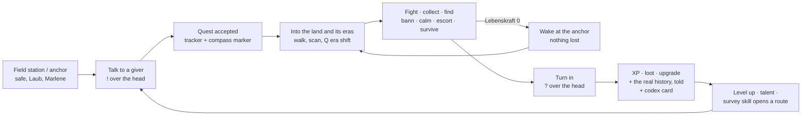

# Karlsberg Quest — Action-RPG rework (living design spec)

> Version 1.0 · 2026-11-15 · Owner: schloss-karlsberg maintainers · Decision: PRD **D-008** (supersedes D-003 "no combat"
> and the "no XP" rule of PRD §6.1). Contracts: `src/systems/contracts.ts`, `src/rpg/types.ts`.
> This file is the source of truth for the rework; change it when you change the design.

**The owner's request (2026-11-15, verbatim):** "it should not that much 'quiz' things and no 'word
quizzes' or games in this. more like people give you a 'quest' and you need to go and collect some
things or 'kill' some things - like in wow or witcher. improve that - it should be a fun, action learn
role play game."

**In one sentence:** Karlsberg Quest becomes a dark first-person **action RPG** on the real LiDAR
terrain of the Karlsberg: ghosts of the court give you **quests**, you go into the land and its eras to
**fight spectral things, collect, find and escort**, and when you come back they **tell you the real,
sourced history** — which lands in your codex. Nobody ever asks you to fill in a blank.

Contents: [1 Pillars](#1-pillars) · [2 Core loop](#2-core-loop) · [3 Controls](#3-controls) ·
[4 Combat](#4-combat) · [5 Enemies](#5-enemies) · [6 Progression](#6-progression) ·
[7 Loot and collections](#7-loot-items-collections) · [8 Quests, journal, history](#8-quests-journal-and-how-history-is-taught) ·
[9 Technical contract](#9-technical-contract) · [10 HUD layout](#10-hud-layout) ·
[11 Quest catalogue](#11-quest-catalogue) · [12 Removed / kept](#12-removed-and-kept) ·
[13 Tracks](#13-tracks-file-ownership-and-merge-order) · [14 Risks](#14-risks-and-open-questions)

---

## 1. Pillars

1. **The land remembers** (kept). The real 1 m LiDAR terrain is the world; every era is the same place
   seen again. Quests send you across it: the Ehrenhof, the Karlslust, the Apfelallee, the Baumagazin.
2. **People ask, you act.** Every task comes from a person (a ghost, Laub in the compass, Marlene on the
   radio) with a reason. Objectives are verbs you *do*: bann, fight, collect, reach, listen, calm,
   escort, survive. No quizzes, no word games, no blank-filling, no multiple choice.
3. **Fights are short, readable and juicy.** Telegraphed attacks, a dodge with i-frames, the lantern's
   Bannlicht, hit-stop and knockback, spectral enemies that come apart in mist, sparks, ash and rising
   grit. Never blood, never gore, never a real person.
4. **History is the reward, not the test.** At turn-in the giver tells you what really happened, with
   sources; the codex card unlocks with its confidence label. Learning happens by playing, listening
   and reading.
5. **Grim truth, labelled fiction** (kept). Real cruelty, debt and destruction told plainly; the
   supernatural (and every enemy) is invented and says so.
6. **Dark world, warm hub** (kept). The field station, Laub's dry voice, Marlene's coffee.

Tone rules (PRD §4.4) still apply in full; combat adds three:
- **No real person is ever an enemy.** Historical people (the duke, Mannlich, Pfeiffer, Landremont …)
  and real victims (the 1785 fireworks dead, unpaid workers, villagers) are never targets, never
  enemies, never "killed". The looters of 1793 are not enemies: the *Raffschatten* are greed given a
  shape, and Laub says so.
- **The animals of the menagerie are calmed or caught, never hurt.** Attacks pass through them.
- **Memorial places are no battlefields.** No spawns, no attacks, no fanfare at the Rondell (1785) or
  in the Festsaal (W5); `memorial:set` areas switch combat off.

## 2. Core loop



A chapter is a **main chain** of 4–6 quests (the story beats, the set pieces, the wow moments) and
**2–4 side quests** that open while the chapter runs. A session: 20–40 min; a quest: 5–15 min.
Being undone costs nothing but the walk back (no lost progress, no lost items, enemies of an
unfinished group regain their strength).

## 3. Controls

| Verb | Desktop (default, remappable) | Notes |
| --- | --- | --- |
| Move / run / crouch / lie flat | WASD, Shift, C, X | Running costs **Atem** only while in combat |
| Look | Mouse; keyboard `,` `.` Bild↑ Bild↓ | |
| **Camera** | **Mouse wheel** zooms (1.8–8 m, kept in the save); **F5** switches over-the-shoulder ↔ first person (also in Einstellungen → Steuerung) | Third person is the default; the spirit view is always first person |
| **Ziel erfassen** (lock-on) | **Tab** or **middle mouse**: lock the best enemy in view, press again for the next, hold off / walk away (30 m) to release | Without a lock, swings snap to the nearest enemy within 7.5 m and ±70° (third person) |
| **Hieb** (light attack, 3-hit combo) | **LMB** or **K** | Shares LMB with the measuring tape: while measuring (R), LMB measures |
| **Wuchthieb** (heavy, charged) | **hold LMB / K** ≥ 0.45 s, release | Breaks armour, staggers; slows you while charging |
| **Ausweichen** (dodge roll, i-frames) | **Space** (+ direction) | Space still stands you up from crouch / prone and climbs while flying |
| **Bannlicht** (lantern flare) | **RMB** or **G** | Cone; stuns spectral enemies, makes Irrlichter hittable, scatters the pack |
| **Schnellgegenstand** (quick-use) | **H** | Kräuterbalsam by default; choose the item in the Ausrüstung tab |
| **Fähigkeiten** (abilities, §4.2): Ausfall · Erdstoß · Wirbel | **T** · **Z** (Y on a US layout) · **U** | Unlocked at levels 2 · 4 · 6; one row of free keys; a HUD slot each with a cooldown ring |
| Talk / examine / pick up / listen (hold) | **E** | Accept / turn in quests in the conversation |
| **Journal** (quests, codex, collections, gear, talents) | **J**; **I** opens Ausrüstung | Replaces the Chronik board (Tab moved to the lock-on, camera track 2026-11-19) |
| Lantern | L | |
| Era shift | Q (at an anchor), hold Q to return | Kept |
| Scan 0–3, maps M, measure R, Röntgenblick V, plans B, spirit view F | as before | Survey skills, now quest rewards |

Accessibility (ARCHITECTURE §5 contract, extended): `settings.reducedMotion` → no camera shake, no
roll camera tilt, shorter hit-stop; `settings.reducedFlash` → no full-screen flashes from combat at
all, hit flashes are local and ≤ 25 %; telegraphs always use **shape + motion + sound + caption**, never
colour alone; `settings.soundIndicators` shows screen-edge arrows for off-screen attackers; gentle mode
(below) makes fights forgiving; every combat key is remappable; keyboard-only play works (K, G, H, T / Z / U).

## 4. Combat

Over the shoulder by default (camera track, 2026-11-19), first person as an option
(Einstellungen → Steuerung, F5). The player is a modern surveyor (§4.7) holding the **Messstab**
(the surveyor's iron-shod ranging pole, right hand, upgraded through the campaign) with the
**lantern** on the belt; in first person both are the view model as before.

### 4.0 Camera and targeting (camera track, `src/player/camera.ts`, `src/systems/combat/targeting.ts`)

- **Spring arm:** pivot at the head, 0.62 m right shoulder offset, distance = wheel zoom (default
  3.6 m). It never sits inside a wall, a palace collider, a tree trunk (`forest.trunksNear`), under
  the terrain or above a room's ceiling (`world.ceilingAt`): it snaps in at once and eases back out.
- **Fights:** aggro enemies within 16 m are written to `cameraHints.fight`; the arm pulls back and
  lifts until they fit in the frame (a boss adds its radius). **Conversations:** the talking NPC's
  head (within 8 m) is `cameraHints.focus`; the view eases into an over-the-shoulder two-shot.
- **Lock-on:** Tab / middle mouse picks by distance + angle off the view (aggro and bosses first),
  a second press cycles, it breaks at 30 m or on death; the view is kept within ±26° of the target.
  A ground ring (`combat-target-ring`) marks the locked or soft target; swings, the heavy and
  abilities turn to it. Off-screen aggro enemies get chevrons on an ellipse around the character
  (`.kqc-around`, pulsing on a wind-up; none during staged beats).

### 4.1 Player resources

| Resource | Base | Per level | Regenerates |
| --- | --- | --- | --- |
| **Lebenskraft** (HP) | 100 | +12 | Out of combat after 6 s: 4 / s; fully at the field station and at anchors |
| **Atem** (stamina) | 100 | +3 | 25 / s after 0.8 s without spending |
| **Bannlicht charges** | 2 | talents | 1 per 11 s (`bannRecharge`; 8 s until the combat variety pass) |

Atem costs: Hieb 10 · Wuchthieb 25 · Ausweichen 20 · running 8 / s (only while `combat:state
{inCombat:true}`). At 0 Atem you cannot dodge or run (`player.canSprint = false`) until it is back to 25. A **perfect
dodge** gives 12 Atem back (combat variety pass: dodging a pack's rhythm well pays for itself).
Abilities cost Atem too: Ausfall 15 · Erdstoß 25 · Wirbel 28.

### 4.2 Moves

- **Hieb**: 3-hit combo (0.38 s each), 70° arc, 2.6 m reach, soft aim assist towards the nearest enemy
  within 25° (gentle mode: 40°). Third hit ×1.4 damage and a knockback push.
- **Wuchthieb**: hold 0.45–1.0 s (move speed ×0.5, `player.moveScale`), release: ×2.2 damage (talents
  more), breaks frontal armour (Steinfresser, Strohmann's bundles), big stagger. The Steinbrecher's
  front stays hard even to a Wuchthieb (×0.35): its joints are at the sides and the back.
- **Cleave** (2026-11-16, playtest): a swing hits the nearest enemy in its arc fully and the next
  ones at 50 %, at most 2 (Hieb) / 3 (Wuchthieb) / 4 (Laubs Lot sweep) targets (`CLEAVE`, rules.ts).
- **Bosses** never skip a phase: one hit stops just under the next phase line, and a boss rising into
  its next phase (`roar`) cannot be hurt.
- **Ausweichen**: 0.35 s roll of ~4.5 m in the move direction (backwards without one) via
  `player.impulse()`; i-frames 0.08–0.33 s. A dodge in the last 0.15 s before a hit is a **perfect
  dodge** (slow-mo 0.25 s unless reduced motion; talent "Konterschritt": next hit ×2).
- **Bannlicht**: the lantern flares (lights it if it was dark — the pack will see you): a 60° / 9 m cone.
  Spectral enemies in it are **gebannt** (stunned, `bannStun` s), Irrlichter fall and become hittable,
  Mahnbriefe drop to the ground, boss weak points open (Schuldbuch's seal). **A tool, not a nuke**
  (combat variety pass, `BANN` in rules.ts): the flare itself does no damage; the first blow on a
  gebannt enemy deals ×1.3 and wakes it (an Irrlicht stays down for its stun); flared again within 8 s
  it is held half as long; a charge takes 11 s. It also **tears veils** (Nebelweberin), **breaks a
  Rufer's call**, and is **thrown back by an uncracked Scherbling** in the cone (1.5 s dazzle — no
  aim assist, no flare — and 6 damage).
- **Abilities** (combat variety pass, `SKILLS` in rules.ts; T / Z / U; a HUD slot each in the vitals
  dock with glyph, key and a conic cooldown ring that fills; gentle mode cooldowns ×0.8; while one
  runs you cannot swing, roll or flare):
  - **Ausfall** (level 2, 7 s, 15 Atem): a 0.3 s lunge of ~6.5 m (aim assist 35°, it carries you
    past the target): ×1.7 to everything in the line, staggers the first; invulnerable while lunging.
    For reaching a Rufer or a Nebelweberin and getting round a Foliant's board.
  - **Erdstoß** (level 4, 11 s, 25 Atem): the staff driven into the ground after 0.42 s: a 4.6 m shock
    ring, ×1.5 with falloff, staggers and knocks back, **breaks every guard and armour** it reaches;
    invulnerable around the impact. Two rings, dust, ember cracks, a deep boom.
  - **Wirbel** (level 6, 13 s, 28 Atem): three hits all round (3.3 m, ×0.85 each) over 0.95 s while you
    keep moving at 75 %; bolts within 2.6 m glance off (`deflect`). It emits
  `combat:bann`: the **hunt** scatters pack hounds in the cone for 4 s (they cannot be damaged — "Die
  Meute schlägt man nicht. Man entkommt ihr."), the **menagerie** jaguar retreats.
- **Schnellgegenstand** (H): drink / use in 0.6 s (can be interrupted by a hit).

### 4.7 The player character (`src/player/avatar.ts`)

A rigged CC0 Quaternius human (`public/assets/models/camera/surveyor.glb`) recoloured as a modern
surveyor: olive field jacket with a hi-vis orange vest panel, dark work trousers, boots, an orange
backpack; the brass lantern hangs on the left hip and is the hunt lantern's light origin; the
Messstab rides across the back and comes to hand in a fight. Upper and lower body blend apart:
idle / walk / run / sprint by real ground speed (strafe and back-pedal while locked on), the combo
as forehand – backhand – wide slash and the heavy from a full wind-up, scrubbed to the combat
timing; dodge roll, hit, death, interact and wave as full-body or upper-body actions; crouch and
prone lean the body. The body turns smoothly toward travel (or the target in a fight). Low tier
loads the same model (0.6 MB). `kq.avatar.state()` / `setMode()` for tests.

### 4.3 Feel ("juice")

| Effect | Light hit | Heavy hit / kill | Player hit | Reduced motion / flash |
| --- | --- | --- | --- | --- |
| Hit-stop (local: enemies + weapon freeze) | 60 ms | 110 ms | 80 ms | halved |
| Camera shake | 0.03 | 0.12 | 0.15 | off |
| Knockback (enemy) | 0.4 m | 2–3 m | player pushed 1.2 m | kept (no camera tilt) |
| Particles | mist puffs / sparks / grit by family | the dissolve (§5.3) | screen-edge frost vignette | fewer, no white flash |
| Sound (Web Audio, procedural) | dull wooden thock + family layer | crack + whoosh + dissolve | breath + heartbeat at < 30 % | — |
| Screen | — | — | vignette pulse | no full-screen flash |

Fun pass (2026-11-16): enemies **flinch** away from each staff hit (big bodies barely move), elites
stagger only on a Wuchthieb, every kill **pops** (a quick swell, a ring and a family-coloured spray)
before the dissolve; armour **clanks**. Below 25 % an elite **reels** (white double ring, a white
beating heart, „Gnadenstoß“ on its bar): one Wuchthieb then ends it — the **Gnadenstoß** (long hit-stop,
0.4 s slow motion, crack + bell; no slow motion with reduced motion).

Hit-stop never uses the global pause stack (`ctx.pause`): combat freezes its own simulation and
viewmodel for the duration. Optional floating damage numbers (handwritten, small): setting
"Schadenszahlen" (combat adds the row under "Spiel", default on).

### 4.4 Enemy telegraphs and AI

Every attack has a wind-up ≥ 0.5 s (`EnemyAttackDef.telegraph`, `TELEGRAPH_MIN`, unit-tested; 0.4 s until the balance round of 2026-11-20, docs/BALANCE.md) shown by **pose + glow +
sound + caption**; area attacks also draw a ground ring (decal) that fills up. States: idle / patrol →
notice (a short call, `enemy:aggro`) → approach → wind-up → strike → recover (the opening) → … →
**gebannt** (stunned) → undone. At most **two enemies attack at once** (token system); the others circle.
Groups leash to their spawn (`leash`, default 40 m) and reset when the player leaves. Gentle mode:
telegraphs ×1.4, one attacker at a time, enemy HP ×0.75.

**Pack tactics (fun pass, `sim.ts`):**
- **Surround**: aggro'd non-boss enemies spread around the player by angular repulsion (`assignSlots`);
  flankers (Streuner, Raffschatten, Grusling) and elites lean to the player's back. Waiting enemies
  circle on their slot ring instead of queuing in front.
- **Rhythm**: besides the two tokens, a blow may only *land* ≥ 0.85 s after the previous one
  (1.3 s gentle) and wind-ups start ≥ 0.45–0.75 s apart, so a pack's blows come one after another and
  each can be read and dodged (unit-tested: no two blows within 0.5 s).
- **Retreat and return**: hit-and-run kinds (Streuner, Mahnbrief, Raffschatten, Nebelling) back off for
  0.55–0.95 s after ~60 % of their strikes and come back from a shifted angle.
- **Alert**: one member noticing you wakes the whole pack and its escort; the elite calls („Der
  Leithund führt sie an!“).
- **Kiting**: the Nebelweber and Irrlichter keep their distance; the Nebelweber slips ~8.5 m away when
  you close to 4 m (once every 6–8 s).
- **Raffschatten** run once per life, for at most 1.4 s, then turn and fight.
- **Bosses** keep a stand-off matched to their size and are untouchable during their reveal (§5.2).

### 4.5 Being undone, waking up

Lebenskraft 0 → `player:died` → `player:caught {by:'combat'}` → the story's curtain ("Der Nebel hat
dich niedergeworfen.") → wake at the beat's `wake` place / the chapter checkpoint (as for the pack).
**Nothing is lost**: quest progress, items, XP stay; the unfinished group regains its strength.
Bosses restart their phase 1; a boss fight resumes at its arena when you walk back in (the story beat
did not move on).

### 4.6 Where fighting happens — and where not

- Combat is on in every era, but **enemies only exist where content spawns them** (quest objectives,
  story `enemy` actions, ambient groups declared by chapters). The present (today) is calm by default.
- **Safe zones** (no spawns, attacks do nothing, enemies leash out): the field station (r 40 m),
  memorials (`memorial:set`), conversations, NPC talk radius (6 m), and `flags['combat.disabled']`
  (story sets it, e.g. the finale W8 and the endings).
- **The hunt (die Meute) stays a threat, not a fight**: stealth, chases, par force, the drive and the
  finale keep their rules. The Bannlicht scatters hounds for a breather; that's all. The fightable
  hounds are the **Streuner** (strays).
- **Fire and Steinfraß** (fx) stay timers; combat adds enemies inside them (Glutlinge, Steinfresser).
- **The finale W8 is deliberately not a fight**: you lie down and light the lantern. The Messstab
  stays lowered ("Du hebst den Stab nicht."). The one battle you win by not fighting.

## 5. Enemies

All invented, all spectral, all with German names. Data: `src/rpg/enemies.ts` (ids are a contract).

### 5.1 Roster

| Id | Name | Era(s) | Role | Weakness / counter | Undone as |
| --- | --- | --- | --- | --- | --- |
| `nebelling` | Nebelling | today (tutorial), 1789, 1793-02, 1796 | slow trash, lunges | anything; teaches attack + dodge | mist |
| `irrlicht` | Irrlicht | today dusk, 1789 night, 1793-02 | floats, blinks, cold spark bolts | **immune until Bannlicht**, then falls | sparks |
| `streuner` | Streuner (stray hound of the pack) | 1789 night, 1793-02, 1793-07, 1796 | fast, flanks, pounces (crouch-growl-eye-flare) | dodge the pounce, hit the recovery; Bannlicht staggers | lies down, eyes go out, smoke |
| `mahnbrief` | Mahnbrief (unpaid decree) | 1789, 1793-02 | swarms, paper-cut swoops | Bannlicht drops them | paper → grey flakes |
| `raffschatten` | Raffschatten (greed shade) | 1793-07 | carries a sack, flees, fights when cornered | corner it; drops what it grabbed | ash |
| `glutling` | Glutling | 1793-07 (burning rooms, Ehrenhof) | leaps, swells, bursts | kill before it swells / dodge the burst | sparks |
| `grusling` | Grusling | 1796 | crumb swarm from robbed-out trenches | sweep (Wuchthieb, Laubs Lot) | grit rising upward |
| `steinfresser` | Steinfresser | 1796 | slow, frontal armour, ground slam | Wuchthieb breaks the crust; hit the back | grit rising upward (W7) |
| `nebelweber` | Nebelweber (fun pass) | 1789, 1793-02, 1793-07, 1796 (escort only) | **caster**: keeps 8–16 m away, spins a slow *Frostkugel* that lands where you stood (landing ring) and quick *Eisnadeln*; slips away when you close in; lays a **Schleier** on up to 3 of its pack within 10 m (9 s, blows ×0.25; pip tag „Schleier“) | run it down between casts, dodge sideways off the ring; the **Bannlicht tears the veil** | mist |
| `foliant` | Foliant (combat variety pass) | 1789, 1793-02 (escort) | **front blocker**: carries its board before it — a light blow from the front bounces off (6 Atem, „Deckung“ tag), it turns slowly; *Zuklappen* and a short *Rammen* lunge | a **Wuchthieb** or the **Erdstoß** breaks the guard (5 s, ×1.25, staggers); **from the side or back** ×1.15; hit it while it swings (the board is open) | paper |
| `scherbling` | Scherbling (combat variety pass) | 1793-07, 1796 (escort) | **mirror**: hovering shards, a splinter fan and a splinter ring; **throws the Bannlicht back** (dazzle + 6) while uncracked, blows on it ×0.6 („Spiegel“) | a Wuchthieb or the Erdstoß **cracks** it (then ×1.3 and the flare works); never flare with it in the cone | sparks |
| `rufer` | Rufer (combat variety pass) | 1793-02, 1796 (escort) | **summoner**: keeps 6–12 m off and **calls** one of the small fry out of the fog on the far side (1.5 s wind-up, every 8 s, at most 2 about; called ones give no XP) | **prioritise**: any blow or the Bannlicht during the call breaks it; the Ausfall reaches it | smoke |

### 5.2 Bosses (one per chapter, the finale excepted)

| Chapter | Boss | Arena | Phases | Mechanic | Ends with |
| --- | --- | --- | --- | --- | --- |
| 1 | **Das Schuldbuch** (`schuldbuch`) — a ledger as big as a door with the ducal seal for a heart | Bauplatz at the gallery's east end, 1789 dusk (1276/−1228) | 3 | page-slam rings, summons Mahnbriefe, seal bolts; the **Bannlicht breaks the seal open** (4 s window) | pages scatter in the wind; Matthes' Lohnzettel drops |
| 2 | **Der Pikeur** (`pikeur`) — the faceless rider | the Karlsbergweiher dam, 1793-02 night (819/−875), end of the par force | 3 | charges along the dam (horse rears + horn = telegraph), whip, calls Streuner; he **cannot cross running water**: lure his charge onto the overflow and he balks (stagger) | he is **not defeated**: he blows "verloren" and rides into the fog (he returns in Ch. 4 as Jost) |
| 3 | **Der Strohmann** (`strohmann`) — the straw of the hundred wagons, risen with arms | Ehrenhof straw carts, 1793-07 dusk (1210/−1114), before the torch | 3 | flail sweeps, spark rain (glowing ground rings), Glutlinge; soft at the back where the bundles are tied | collapses into ash and smoke — the fire still comes (history doesn't change) |
| 4 | **Der Steinbrecher** (`steinbrecher`) — a giant of robbed-out blocks | Ehrenhof as stone yard, 1796 (1216/−1114) | 3 | block throws, quake rings, Gruslinge; hits on the joints knock blocks loose that **fly west towards Homburg** | falls apart into the empty court → the Steinfraß (W7) takes over |
| Finale | — (W8: lie down, light the lantern) | Zwinger, today night | — | no fight; combat is disabled | the hounds lie down |

**Reveal (fun pass):** the first time a boss notices you in a session it **reveals itself** for 2.6 s
(`BOSS_INTRO`, state `intro`): it rises, throws up its arms and flares; the view turns to it and pulls
back a little (eased in and out; off with reduced motion); a title card in the lower third —
„DER PIKEUR — Herr der Meute“, „DAS SCHULDBUCH — Was niemand bezahlt hat“, „DER STROHMANN — Das
Feuer, das noch kommt“, „DER STEINBRECHER — Was von den Mauern blieb“ — and a music sting (two drum
blows under a low minor brass chord, a root per boss). Nobody can hurt anybody during the reveal.
A reset boss (after a catch) comes straight at you.

**Death:** 1.4 s at 0.3× speed (not with reduced motion), a ring running 14 m over the ground, a storm
of its own matter, a column of pale light and a **loot fountain** of golden glints; a long falling
chord. The caption „… – bezwungen.“ (not for the Pikeur, who leaves).

**Models (procedural, `bodies.ts`):** the Pikeur rides a black ghost horse with a trotting gait, pale
ghost-fire mane and tail, a tricorn rider with ember eyes, a brass horn loop and the whip, two hounds
trotting at heel; the Schuldbuch is a floating ledger with brass-cornered covers, pages that turn,
ribbons, an octagonal glowing seal and orbiting scraps; the Strohmann is a striding giant of bound
sheaves (≈ 5.7 m) with a crown of straw, **real flame particles** licking from head, shoulders and
flails, and a soft glowing back; the Steinbrecher strides on separate legs with knees, a chest plate,
elbows and fists, hot joints only at back and sides. Slabs near the lens dither away (the camera is
never inside a boss).

### 5.3 Rules for enemies

- **Dissolve, never die**: `DissolveStyle` mist / sparks / smoke / ash / paper / grit-rising / fade.
  Kill feedback is the dissolve + sound + XP number, never a body, never blood, never a scream of pain.
- **No humans**: shades and figures are faceless; no enemy wears a uniform of a real army, no
  national symbols; no enemy has the shape of a victim.
- **Readable at 30–60 m in fog** (like the pack): silhouettes + ember eyes / glow cores pierce fog.
- **Notes are labelled fiction** (`note_de` ends with "(Fiktion)", unit-tested); the journal's bestiary
  page shows them.

### 5.4 Difficulty tiers

`tier` 1–4 = chapter 1–4; a quest spawn without its own `tier` takes its chapter's (`CHAPTER_TIER`,
quests/logic.ts: prolog 1, k1 1, k2 2, k3 3, k4 4; bosses keep tier 1, their HP is tuned per boss;
`tier: 0` = 60 %, the prologue's first Nebelling). Enemy HP × (1 + 0.45 (tier − 1)), damage ×
(1 + 0.15 (tier − 1)) (2026-11-16: until then every quest spawn ran at tier 1 and the playtests found
regular fights trivial; `tests/combat-balance.test.ts` keeps a non-dodging bot honest). The player's
level curve (§6) keeps pace; side quests are optional XP.

### 5.5 Packs, elites, escorts (fun pass, `src/systems/combat/packs.ts`)

A group of **three or more** in the past (not today, not a boss) is a pack:
- its last member is the **elite** (`ELITES` in `src/rpg/enemies.ts`): a name over its bar, an ember
  halo on the ground, three circling motes, tinted eyes, ×1.9–2.4 HP, ×1.2–1.3 damage, ×3 XP, bigger,
  and one **extra move** — Nebelmutter (Frosthauch ring), Sumpflicht (spark fan), **Leithund**
  (*Hetzjagd* charge), Pfändungsbefehl (seal throw), Goldraffer (gold whirl ring), Glutkern (spark
  spit), Grusvater (grit blast ring), Mauerbrecher (thrown block with landing ring), Nebelspinnerin
  (frost ring). An elite turns **rasend** at 50 % (cooldowns ×0.7) and **reels** at 25 % (Gnadenstoß,
  §4.3). Once undone it stays undone (`EnemyGroupState.eliteDown`, saved).
- it brings an **escort** of other kinds (mixed groups; combat variety pass in bold): Nebelinge + a
  Nebelweber (**+ a Foliant** in 1789 / 1793-02), Irrlichter + 2–3 Nebelinge, Streuner by era (1789 3
  Mahnbriefe **+ a Foliant**; 1793-02 a Nebelling, a Mahnbrief **+ a Rufer**; 1793-07 a Raffschatten **+
  a Scherbling**; 1796 2 Gruslinge **+ a Rufer**), Mahnbriefe **+ a Foliant** (+ a Nebelweber from four),
  Raffschatten + 2 Glutlinge **+ a Scherbling** (+ a Nebelweber from four), Glutlinge + a Raffschatten
  **+ a Scherbling**, Gruslinge + a Nebelweber **+ a Rufer**, Steinfresser + 3–4 Gruslinge **+ a Rufer**. Escorts live in the group
  `<group>+escort`, never count for the group or a kill objective (they give XP), and drift off into
  the fog 1.1 s after their pack is gone. `kq.combat.kill(group)` takes the escort too.

- **Second wave** (combat variety pass, `waveOf` / `WAVE`): a pack fight gets reinforcements once —
  12 s in or at its first kill, announced 1.8 s ahead at a point 10.5 m from you on the side away
  from the pack (a fog column, a low call, the caption „Da kommen mehr – von hinten!“ and an edge
  arrow), then they rise out of the ground. 1789 Streuner: a hound + 2 Mahnbriefe; 1793-02: 2
  Nebelinge + a Mahnbrief; later Streuner: a hound + 2 Nebelinge; Nebelinge / Irrlichter: 2 Nebelinge;
  Mahnbriefe 3; Raffschatten: one + 2 Glutlinge; Glutlinge 3; Gruslinge 4; Steinfresser: one + 2
  Gruslinge. Wave members are escorts (no objective credit, XP yes).
- **Per-fight overrides** (playtest round 5): a quest or story spawn may set `escorts` and `wave`
  (`[{kind, n}]`, `[]` = none), `aggro` (the group comes at you at once — an ambush) and `veiled`
  (a ward only the Bannlicht lifts); a story spawn may set `near` (spawn that many metres from you,
  towards x / z). Prologue groups (`q.p.*`) get no default escort or wave: the tutorial fights are
  one kind each (the Eiskeller: 4 Nebelinge, then 2 more from behind; the hohlweg Streuner is the
  veiled one that teaches the flare). Hounds fight with hounds; the K3 basket thieves are
  Raffschatten only. A boss that reached phase 2 or 3 resumes there after a death
  (`EnemyGroupState.bossPhase`), and big bosses (radius ≥ 2.5) keep you 1.4 m off their body.
- **Era hazards** (`hazardOf` / `HAZARD`): in a pack fight, every 6.5 s: **1793-07 Glut** — two 2.3 m
  rings fill for 1.4 s with embers falling into them, then burn (10 to you, 30 % of their HP to
  enemies, elites half); **1796 Steinschlag** — one 2.1 m ring for 1.5 s, a dressed block falls onto
  it (14, 45 %). Rings land near you and near the pack; enemies are fair game (lure them in).

**Balance (`tests/combat-balance.test.ts`, bots in `tests/combat-bots.ts`):** per chapter, at the
intended build (§6), a standard encounter (prologue 4 Nebelinge today; K1 3 Streuner 1789; K2 4
Streuner 1793-02 tier 2; K3 4 Raffschatten tier 3; K4 3 Steinfresser tier 4 — each with its elite,
escort, second wave and the era's hazards from K1 on):
- the **tank** (stands, swings, never dodges) loses ≥ 40 % Lebenskraft (≥ 20 % in the prologue) or is
  undone;
- the **masher** (runs at the nearest, hammers the attack, flares whenever it can, never dodges, no
  abilities) takes **≥ 15 s** (≥ 12 s in the prologue) and loses **≥ 40 %** or is undone — from K2 on
  it usually goes down;
- the **skilled** bot (rolls out of telegraphs and hazard rings, backs off when winded, Rufer and
  Nebelweberin first, Wuchthieb on guards, mirrors and armour, flares only for veils, Irrlichter or
  three in the cone and never into an uncracked mirror, Ausfall / Erdstoß / Wirbel when they pay) wins
  every one with **more than a third** of its Lebenskraft in **18–75 s** (measured 2026-11-17:
  prologue 45 s, K1 66 s, K2 29 s, K3 37 s, K4 27 s; it loses 8–52 %).
- Gentle mode: the masher clears K2 and the tank survives it.
- **Per content encounter** (round 5, `tests/combat-encounters.ts` reads every quest and story
  spawn): in each chapter's first fight the masher lives with ≥ 10 % and the skilled bot wins in
  ≤ 50 s; in every regular fight the skilled bot wins with a third of its Lebenskraft in ≤ 75 s;
  Irrlicht pairs last ≥ 12 s. Measured: the masher keeps 52 % (K1 Registratur), 60 % (K2 Spur),
  77 % (K3 Nachmittag), 67 % (K4 Karren); the prologue's first fight is meant to be lost by a
  masher; the Enge 36–40 %; Irrlicht pairs about 18 s.

## 6. Progression

### 6.1 XP and levels (1–12)

Total XP to reach level n (`LEVEL_XP` in `src/rpg/stats.ts`): 0 · 150 · 400 · 750 · 1200 · 1800 · 2600 ·
3600 · 4800 · 6200 · 7800 · 9600. Targets: end of prologue L3, Ch. 1 L5–6, Ch. 2 L7–8, Ch. 3 L9–10,
Ch. 4 L11–12 with side quests (main only ≈ L10–11).

| Source | XP |
| --- | --- |
| Main quest | 150–800 (Ch. 4 finale 800) |
| Side quest | 100–300 |
| Bonus objective | 20–60 |
| Enemy | 4–30; boss 200–400 |
| New codex card (from echoes, examined documents, quests) | 10 |
| Collection complete | 100–200 |

Level up: +12 Lebenskraft, +3 Atem, +4 % damage, **1 talent point**, a stamp card ("Stufe 4") with a
chime (no flash). From level 6: a second charm slot. Mirrored as `flags['rpg.level']`.

### 6.2 Talents (`TALENTS` in `src/rpg/stats.ts`)

Three short branches, 11 points over the campaign, respec free at the field station:

| Stab (staff) | Laterne (lantern) | Feldbuch (field book) |
| --- | --- | --- |
| Wucht (3): heavy ×+0.25 | Weites Licht (2): +2 m, +10° | Spürsinn (2): collectibles on the compass within 40/80 m |
| Der dritte Hieb (1): combo finisher staggers | Lange Glut (2): recharge ×0.85 | Kräuterkunde (2): healing ×1.2, +5 % loot |
| Standfest (2): +15 HP | Lichtkreis (1): +1 charge, stun ×1.3 | Langer Atem (2): stamina costs ×0.88, +10 Atem |
| Konterschritt (1): perfect dodge → next hit ×2 | Laternenwärme (1): heal on banishing | Gedächtnis (1): XP ×1.1 |

### 6.3 The Messstab and charms

One weapon, five stages, all **quest rewards** (no crafting, no shop):

| Stage | Item | From | Damage |
| --- | --- | --- | --- |
| I | Messstab (Eschenstab) `item.stab.esche` | Prologue, the field station | 12 |
| II | mit Eisenbeschlag `item.stab.eisen` | Ch. 1 "Matthes' Lohn" (Hanne) | 16 |
| III | mit Silberdraht `item.stab.silber` | Ch. 2 "Die Parforcejagd" | 19 ×1.15 |
| IV | mit Bannkerben `item.stab.bann` | Ch. 3 "Die Hunde los" (Jost) | 23 ×1.2 |
| V | mit Laubs Lot `item.stab.lot` (heavy = sweep) | Ch. 4 "Der Steinplatz" | 26 ×1.25 |

**Charms** (1 slot, 2 from L6): Solls Rechenpfennig (+loot), Josts Hundemarke (−8 % damage taken),
Kasuarfeder (cheaper dodge), Matthes' Zeichen (cheaper Atem), and **the object you saved from the
Festsaal**: Türgriff (stagger), Dukat (XP), Uhr (Bannlicht recharge) — or nothing, by choice.

### 6.4 Survey skills become quest rewards that open routes

The skills system stays as is (`skill:grant`, unlock cards, Laub's remarks); only *who* grants changes
(quest rewards instead of Chronik confirmations):

| Skill | Granted by (quest) | Opens |
| --- | --- | --- |
| Relief 1–3 | Prologue "Was der Wald verbirgt" (steps) | wall lines, Hohlweg, pits; hidden side-quest spots |
| Kartograf 1 | Prologue "Die Feldstation" | map 1840 (M) |
| Kartograf 2 | Ch. 1 "Die Karlslust bei Nacht" | map 1935; the Torhaus anchor → Ch. 2 |
| Kartograf 3 (Messen R) | Ch. 2 "Die Parforcejagd" | measuring; bonus objective in the gallery (Ch. 3) |
| Spurenleser 1–2 | Ch. 1 "Tausend Hunde" (Jost), Ch. 2 "Die Spur im Raureif" | horn meanings; pack routes (stealth stretches) |
| Baumeister 1–2 | Ch. 3 "Das graue Buch" | room names, confidence view |
| Röntgenblick | Ch. 3 "Die Hunde los" | point cloud: Grusling burrows and hidden stones in Ch. 4 |

## 7. Loot, items, collections

- **No currency** (PRD: no shop, no grind). Loot is consumables, lore and quest items.
- **Consumables** (`src/rpg/items.ts`): Kräuterbalsam (heal 45), Riechsalz (Atem), Lampenöl (Bannlicht
  charges + oil), Kalkstaub (thrown: stuns spectral enemies in 6 m — "Das sind Kalköfen"). Stack 5–9.
- **Loot numbers (progression track, 2026-11-16)**: tables retuned so a small enemy drops about every
  third kill (`loot.klein` balsam 22 % / oil 10 % / salts 6 %, `loot.licht`, `loot.raff`, `loot.stein`
  raised, `loot.boss` adds a Kalkstaub); every empty roll in a row adds +6 % to the next (at most
  +30 %), so a dry streak never lasts. Rolls are seeded (enemy id + drop counter): a reload does not
  re-roll. `tests/rpg-contracts.test.ts` needed no change (level curve, talents and `deriveStats`
  untouched).
- **Additive type changes (progression track)**: `ProgressionSlice` gained the optional `codexXp`
  (facts that already paid +10 XP), `placed` (world pickups by id, persisted), `drops` (loot seed
  counter) and `dry` (empty rolls in a row); new `PlacedPickup` (the `loot:place` payload + `drop`).
  `src/rpg/items.ts` adds `lootTable()` / `collectionDef()`, `src/rpg/stats.ts` adds `talentDef()`,
  `talentBlock()`, `spentPoints()`, `weaponPower()`. No contract event changed.
- **Drops**: enemy `loot` tables roll on `enemy:killed`; drops appear as **glowing pickups** (warm
  core + slow bob + motes, era-tinted, visible through fog to 40 m; E or walking over picks up).
  `loot:drop` → `loot:place` → `item:pickup`.
- **Quest items**: placed by `collect` objectives (`place`) or dropped (`drop`), declared in the
  chapter's quest file (`items`, ids `item.<chapter>.<name>`).
- **Collections** (journal tab "Sammlungen", sets in `COLLECTIONS`, members declared by quest files
  with `set`): **Seiten der Chronik** (one page per chapter — the narrative spine, now literal
  pickups), **Die Namen der Hunde** (five collars: Diane, Sultan, Fanfare, Rauhreif, Bijou), **Matthes'
  Zeichen** (four marked stones across eras), **Planblätter**, **Mannlichs Festpläne**. A complete set
  gives XP and a line from its owner. Relief patterns (rm.01–08) stay codex cards.
- **Inventory**: journal tab "Ausrüstung": weapon, charm slots, consumables (set the quick-use item),
  quest items, lore (read the text).

## 8. Quests, journal and how history is taught

### 8.1 Lifecycle

`hidden → offered → active → ready → done` (or `failed`). Mirrored as `flags['quest.<id>']`;
objective counts as `flags['quest.<id>.<objective>']`.

- **Main quests** are offered by the story (`{"do":"quest","op":"offer"|"start"}` in a beat), so the
  chapter's beats stay the backbone (era shifts, set pieces, endings). A beat waits for
  `{"quest":{"id":…}}` (done) or an objective.
- **Side quests** offer themselves while their chapter runs and `available` holds (after quests, a
  flag, an era, a level). A side quest can be declined and taken up later.
- **Givers**: placed ghosts (`giver {npc}`: Hanne, Soll, Jost, Peter, the gardener, the servant …) or
  voices (`giver {voice: laub | marlene}`: spoken, accepted at once). Historical people are never
  givers (their words must be sourced; a request would be invented).
- **Turn-in**: at the giver (default), someone else (`{npc}`), or `auto` (voices, set pieces).

### 8.2 Conversation flow (npc system)

E near a giver opens the field-book conversation. Quest topics come first, marked:
**!** (offer; main quests: ! in a brass ring), **?** (ready to turn in), grey **?** (active),
**§** ("Erzähl mehr", after a turn-in).

1. *Offer*: the giver speaks `offer` lines → the **quest card** (an RPG offer card in the
   conversation: kicker "Neue Aufgabe" / "Nebenaufgabe", title, "von <giver>", the pitch
   (`summary_de`), the goals (bonus ones marked, counts ×n), the reward preview: EP, items,
   skills, "n Codex-Karte(n)") → buttons **Annehmen: „<accept_de>“** / **Später.** (side quests).
   Voice givers (Laub, Marlene) accept at once: the banner shows title, first goal and EP.
2. *While active*: `progress` lines (a hint in the giver's voice — never a riddle).
3. *Turn-in*: `turnin_lines` → the **turn-in card** (every goal ticked, the reward) → **Übergeben**
   → the reward card (XP stamp, items, "Neu im Codex: …" with the confidence badge) → ONE history
   line as the moment of it (`HISTORY_AT_TURNIN` in `src/systems/quests/logic.ts`; its source and
   codex card under the line) → `next` quest offered. The other history lines wait for the
   **„Erzähl mehr: <title>“** topic at the same giver (same chapter; `quest:told` when heard) and are
   always in the journal. Voice / auto turn-ins say one thanks line and one history line (held
   while a fight is on) and the reward card says "Mehr dazu im Feldbuch (J)".

No stance cards, no answer grids: see §8.6.

### 8.3 Markers

| Where | What | Shape (colour-blind safe) |
| --- | --- | --- |
| Over a giver's head | offer / main offer / ready / active | `!` · `!` in a ring · `?` · grey `?` |
| Compass (Bussole strip) | tracked objective; givers with offers within 150 m; turn-ins | diamond · `!` · `?` |
| World | objective zones within 200 m | a faint era-tinted light column that fades when you are inside |
| World | the tracked objective ("lead") within 420 m | a tall gold volumetric beam + pulsing ground ring |
| Screen | the lead | waymark: diamond + distance, label when looked at; clamps to the edge with an arrow off screen |
| World | pickups | warm glow + motes |

**Always know what to do (2026-11-19, `src/systems/quests/wayfinding.ts`, `src/ui/waymark.ts`):**

- **The lead** is the first tracked quest (main first) with a place: `objectiveTarget()` resolves
  every type (escort → `to`, collect → the nearest pickup left, talk → the npc, examine / echo →
  `where` or the clue's own place from the content pack, else `where` / `place`). A ready quest
  leads to its turn-in npc. When the main quest has no place, the story's objective leads, never
  a side quest. One lead drives the compass diamond (`kqq:obj`, with distance), the waymark and
  the gold beacon, and the tracker shows its distance.
- **Objective text** says what and where ("Am Damm: Taste 2 (Lokales Relief) drücken, dann zur
  Markierung gehen"); objectives may carry `hint_de`.
- **Stall hint:** no progress for `STALL_SECONDS` (60 s; then every 90 s) → a "Tipp" under the
  tracker and a toast (`quest:hint`). Progress is an objective count change or walking 12 m closer;
  the clock stops during fights, modals and an open dialogue. `hintFor()` builds the text from the
  type, the scan key, Bannlicht for `needsBann` enemies, a time jump when the target is in another
  era, and the compass direction. Hooks `kq.quests.lead()`, `hint()`, `stall(seconds)`.
- **Prompts name the action** ("E – Messstab nehmen"); the Feldstation hub prompt is low priority
  and E opens the hub only when its prompt is the one shown.

### 8.4 Journal (J) and tracker

- **Tracker** (HUD top-left column, `hud.stack(el, 35)`): up to three tracked quests (main first),
  title + active objectives with counters ("Irrlichter bannen 2/5"), ticks when done, a soft pulse
  on progress (no flash).
- **Journal** (one modal, field-book look, tabs from `src/ui/journal.ts`):
  10 **Aufgaben** (active / done; summaries; the history told at turn-in can be re-read) ·
  20 **Codex** (cards with source, confidence D/I/N/U, label FAKT / STRITTIG / LEGENDE / FIKTION, "neu") ·
  30 **Sammlungen** (collections, bestiary page) · 40 **Ausrüstung** · 50 **Talente** (progression).
  The station's Pinnwand (hub item `chronik`) opens the journal (`chronik:open` → journal).

### 8.5 How history is taught — without quizzes

1. **Told at turn-in**: 1–4 sourced lines in the giver's voice (Hanne tells what a journeyman earned;
   Soll the debts; Jost the kennel). Each `fact` unlocks its codex card on the spot.
2. **Codex cards** with source, confidence label and FAKT / STRITTIG / LEGENDE / FIKTION, readable any
   time in the journal. Contested facts stay contested (flight date, place of death, bear boxes).
3. **Echoes** (hold E, kept): voices of what happened here, labelled "Erinnerung (Fiktion)", quotes
   marked.
4. **Examined documents and objects** (E, kept): the Rechenbrett, the Kaufbrief, the Wachbuch …
5. **Lore collectibles** with short texts (collars, pages, stones, plan sheets).
6. **Laub's remarks and Marlene's radio** (kept): the dry footnote, the present-day context.
7. **Optional "Erzähl mehr" topic** at a giver after turn-in: deeper sourced lines, no XP needed.
8. **Bestiary notes** say plainly which parts are fiction.

Never: fill-in-the-blank, word or noun selection, multiple choice with a right answer, "confirm three",
hint ladders for puzzles, losing knowledge when caught.

### 8.6 Deeds, not stances (playtest round 3)

The stance cards (two or three replies at a turn-in) still read like a quiz and are **gone** (the
quest validator rejects `stance`). What the epilogue tells now comes from what the player **did**:

| Deed | How it is recorded | Epilogue slot |
| --- | --- | --- |
| side quests done (all 16) | the quest state mirror `quest.<id>` = `done` | one per chapter: `vermessung` (prolog), `hof` (K1), `flucht-tat` (K2), `brand` (K3), `steine` (K4); `meute-namen` (K1 Hundenamen) |
| the lantern at the gate (K2) | `flag.k2_tor` = `leuchten` · `dunkel` (story `choice` with lantern conditions) | `flucht` |
| what is carried out of the Festsaal (K3) | `flag.k3_objekt` = `tuergriff` · `dukat` · `uhr` · `nichts` | `objekt` (per ending) |
| lying down at the Zwinger (K4) | `quest.q.k4.stellen` = `done` | `meute` |

**Flag contract for physical choices** (`DEED_ITEMS` in `src/systems/quests/index.ts`, event
`quest:deed {flag, value, item}`): picking up (`item:pickup`) `item.charm.tuergriff` / `.dukat` /
`.uhr` sets `flag.k3_objekt` = `tuergriff` / `dukat` / `uhr`; the first one taken wins (a set flag
stays, `nichts` may be overwritten). Leaving the Festsaal with nothing is the story's `nichts`.
Quest-file items declare more with `deed: {flag, value}` (`ItemDef.deed`, schema). The set-pieces
track makes the three objects physical and only has to place the pickups; the epilogue needs no
change.

Each slot is ONE sentence in priority order (the first deed that holds), else its `offen` sentence
(empty for add-on slots: nothing is said), written as a first-person story ("Im Sommer 1789 bekam
Hanne den Lohnzettel ihres Mannes zurück, … Den entlaufenen Kasuar ließ ich laufen, bis er müde
war …"). One source for the words: `scripts/content-build/epilogue-deeds.mjs` (the endings pack
via `enden.mjs`; the story fallback in `05-enden.story.json` via `node
scripts/content-build/enden.mjs --story`). The old stance flags (`flag.p_spuren`, `flag.k1_lohn`,
…) are no longer written or read; `k4_15` keeps the `readings` action for old saves only.

The two story choices stay story choices, and both are physical: the gate (`k2.tor`, lantern up or
down) and the Festsaal object (`k3.objekt`, which also becomes a charm).

## 9. Technical contract

### 9.1 Systems (registered in `src/systems/index.ts`, after `scenery`)

| System | Folder | Owns | State slice |
| --- | --- | --- | --- |
| `progression` | `src/systems/progression/` | XP, levels, talents, inventory, equipment, consumables, loot rolls, world pickups, collections, level-up card, XP bar, journal tabs Ausrüstung / Talente | `ProgressionSlice` |
| `combat` | `src/systems/combat/` | Lebenskraft / Atem / Bannlicht, the viewmodel (staff + lantern), attacks, dodge, enemies (AI, visuals, audio), groups and spawns, bosses, hit-stop / shake / particles, death → caught, vitals + boss bar | `CombatSlice` |
| `quests` | `src/systems/quests/` | quest state machine, offers / turn-ins, objective tracking, spawns + pickups for objectives, rewards, codex unlocks, journal modal (Aufgaben / Codex / Sammlungen), tracker, giver markers, beacons, compass markers | `QuestSlice` |

Pure shared modules (no three.js, no DOM): `src/rpg/types.ts` (all shapes), `src/rpg/enemies.ts`
(roster), `src/rpg/items.ts` (items, loot, collections), `src/rpg/stats.ts` (level curve, talents,
`deriveStats`). Systems may import these; they never import each other.

### 9.2 Events (`src/systems/contracts.ts`)

Requests are imperative, facts past tense. Payloads are plain JSON.

| Event | Emitted by | Listened by | Payload |
| --- | --- | --- | --- |
| `quest:command` | story (`quest` action) | quests | `{op, id, objective?, n?}` |
| `quest:offered` / `accepted` / `progress` / `objective` / `ready` / `completed` / `failed` | quests | story (conditions via flags), progression, HUD, barks | see contracts |
| `npc:topics` | quests | npc | `{npc, topics: QuestTopic[]}` |
| `npc:marker` | quests | npc | `{npc, mark}` |
| `npc:follow` | quests (escort objectives) | npc (the ghost walks after the player) | `{npc, follow}` |
| `quest:accept` / `decline` / `turnin` / `told` | npc | quests | `{id, npc}` |
| `quest:deed` | quests (a thing taken: §8.6) | anyone | `{flag, value, item}` |
| `enemy:spawn` / `enemy:despawn` | quests, story | combat | group spec / `{group}` |
| `enemy:spawned` / `killed` / `cleared` / `aggro`, `boss:phase` | combat | quests, progression, story, barks | see contracts |
| `combat:hit` / `combat:state` / `combat:bann` | combat | fx, audio, barks, hunt, menagerie | |
| `player:damaged` / `healed` / `died` | combat | HUD, barks | |
| `player:caught {by:'combat'}` | combat | story (curtain + wake), npc | |
| `menagerie:calmed` | combat (menagerie behaviour) | quests | `{id, animal}` |
| `xp:grant`, `item:grant`, `loot:place`, `loot:clear` | quests, story, combat | progression | |
| `xp:gain`, `level:up`, `item:pickup`, `item:use`, `loot:drop`, `equip:change`, `talent:learned`, `stats:changed` | progression | quests (collect / use), combat (stats), HUD | |
| `codex:unlocked` | quests (turn-in), chronik (clues) | journal, progression (+10 XP) | `{factId}` |
| `skill:grant` | quests (rewards), story | skills | unchanged |

Existing events the RPG systems use: `npc:talk`, `room:enter`, `clue:found`, `clue:grant`,
`echo:end`, `story:chapter`, `story:beat`, `era:change`, `memorial:set`, `hub:enter`,
`chronik:open`, `game:start`, `save:loaded`, `settings:change`.

### 9.3 Story schema additions (`src/systems/story/types.ts`, validated)

Actions (`quest`, `xp`, `item` are one-shots on resume; `enemy`, `loot` are idempotent by id):

```jsonc
{ "do": "quest", "op": "offer", "id": "q.k1.lohn" }               // offer | start | progress | complete | fail | reset
{ "do": "quest", "op": "progress", "id": "q.k1.karlslust", "objective": "rondell", "n": 1 }
{ "do": "enemy", "op": "spawn", "group": "k1.weiher", "kind": "irrlicht",
  "x": 1854, "z": 214, "era": "1789", "count": 5, "radius": 18, "time": "night", "respawn": 0 }
{ "do": "enemy", "op": "despawn", "group": "k1.weiher" }          // "*" = all
{ "do": "loot", "id": "k1.seite", "item": "item.k1.seite", "x": 1811, "z": 363, "era": "1789" }
{ "do": "xp", "amount": 50, "reason": "first-shift" }
{ "do": "item", "item": "item.stab.esche" }
```

Conditions:

```jsonc
{ "quest": { "id": "q.k1.lohn" } }                                 // done (default)
{ "quest": { "id": "q.k1.lohn", "state": "active" } }              // offered | active (also ready) | ready | done | failed
{ "quest": { "id": "q.k1.lohn", "objective": "zettel", "gte": 1 } }
{ "level": 4 }
{ "event": "enemy:killed", "match": { "group": "k1.weiher" }, "times": 5 }
{ "event": "enemy:cleared", "match": { "group": "k3.strohmann" } }
```

Flags: `quest.<id>` (state), `quest.<id>.<objective>` (count) — quests; `rpg.level` — progression;
`combat.disabled` — story (finale, endings); `tools.measuring` — tools (LMB belongs to the tape).

### 9.4 Quest files (`content/quests/<nn>-<chapter>.quests.json`)

One per chapter (`00-prolog`, `01-kapitel-1` … `04-kapitel-4`; `99-test` is the worked example, loaded
only with `?storytest`). Schema `content/schema/quests.schema.json`; authority
`src/systems/quests/validate.ts` (run by `pnpm validate` and `tests/rpg-contracts.test.ts`): ids
`q.<chapter>.<name>` (prolog → `p`, enden → `end`), known speakers (historical speakers need
sources), codex facts, clues, enemy kinds, items, places inside the playable area, no `stance`
(§8.6), collect objectives have enough places, … The story validator rejects unknown quest ids and
items. Abridged example (full: `content/quests/99-test.quests.json`):

```jsonc
{
  "chapter": "k1",
  "items": [{ "id": "item.k1.lohnzettel", "kind": "quest", "name_de": "Matthes’ Lohnzettel", "text_de": "…" }],
  "quests": [{
    "id": "q.k1.lohn", "kind": "main", "era": "1789",
    "title_de": "Matthes’ Lohn", "summary_de": "Hanne wartet seit einer Woche auf den Lohn ihres Mannes …",
    "giver": { "npc": "hanne" }, "turnin": "giver",
    "offer": [{ "speaker": "hanne", "text": "…" }],
    "progress": [{ "speaker": "hanne", "text": "…" }],
    "turnin_lines": [{ "speaker": "hanne", "text": "…" }],
    "history": [{ "speaker": "hanne", "text": "Zwei Tage arbeitet ein Geselle für einen Gulden …", "fact": "cx.08" }],
    "objectives": [
      { "id": "soll", "type": "talk", "text_de": "Den Kanzlisten nach Matthes fragen", "npc": "soll", "topic": "matthes" },
      { "id": "buch", "type": "kill", "text_de": "Das Schuldbuch bezwingen", "enemy": "schuldbuch", "after": ["soll"],
        "where": { "x": 1276, "z": -1228, "r": 25, "era": "1789" },
        "spawn": [{ "kind": "schuldbuch", "x": 1276, "z": -1228, "era": "1789", "boss": true, "time": "dusk" }] },
      { "id": "zettel", "type": "collect", "text_de": "Den Lohnzettel aufheben", "item": "item.k1.lohnzettel", "after": ["buch"],
        "drop": { "enemy": "schuldbuch", "chance": 1 } }
    ],
    "rewards": { "xp": 400, "items": [{ "item": "item.stab.eisen" }], "codex": ["cx.10"] },
    "next": "q.k1.traenen"
  }]
}
```

Objective types: `kill` (enemy / group / spawn) · `collect` (item; `place` pickups or `drop`) · `reach`
(where) · `talk` (npc, topic) · `room` (palace room) · `examine` (clue found) · `echo` (echo ended) ·
`calm` (menagerie animal) · `escort` (npc to a place) · `survive` (seconds with spawns) · `use`
(item) · `event` (any event + match — escape hatch, e.g. `hunt:goal {mode:'parforce'}`) · `manual`
(story `quest progress`). `after` orders objectives; otherwise they run in parallel. `optional` +
`bonus_xp` for bonus objectives.

### 9.5 Other hooks added for the tracks

- **Input** (`src/player/input.ts`): actions `attack` (LMB, K), `bannlicht` (RMB, G), `dodge` (Space),
  `quickUse` (H), `inventory` (I); shared pairs C crouch/down, LMB interact/attack, Space up/dodge;
  the canvas suppresses the context menu.
- **Player** (`src/player/player.ts`, additive): `moveScale`, `canSprint`, `impulse(vx, vz, s)`,
  `pushed`.
- **HUD** (`src/ui/hud.ts`): `hud.dock('vitals' | 'boss' | 'feed', el, order)` (§10) next to
  `hud.stack(el, order)`.
- **Journal tabs** (`src/ui/journal.ts`): `addJournalTab({id, label, order, render, badge?, hide?})`.
- **Debug** (`window.kq`): `kq.quests`, `kq.combat`, `kq.progression` (each track extends its own:
  e.g. `kq.quests.accept/complete/progress/turnin`, `kq.combat.spawn/hit/kill/god/state`,
  `kq.progression.grant/xp/level/equip/use/state`).
- **Combat track additions** (no change to `contracts.ts`): event `combat:swing {x, z, yaw, reach}`
  (declared in `src/systems/combat/index.ts`), setting `Settings.damageNumbers` („Schadenszahlen“,
  game section, default on), `lanternPose {side, lift}` exported by `src/systems/hunt/lantern.ts`,
  `PackSim.scatter()` in the hunt, `MenagerieSlice.calmed: string[]`.
- **Combat variety additions** (additive): `EnemyDef.guard?: 'front'` (a frontal guard: the Foliant)
  and `EnemyDef.reflectsBann?: boolean` (the Scherbling) in `src/rpg/types.ts`; enemy ids `foliant`,
  `scherbling`, `rufer` and the Nebelweber's `schleier` attack in `src/rpg/enemies.ts`;
  `BASE_STATS.bannRecharge` 11; input actions `skill1` / `skill2` / `skill3` (T / Y / U, rebindable,
  labels `action.skill1–3`); `kq.combat.skill(id)`. `enemy:killed.by` keeps its union: an ability
  kill or a hazard kill reports `'heavy'`.
- **Test chapter**: `?storytest`, `kq.story.goto('test', 'q1')` — Hanne offers `q.test.lohnzettel`
  (kill 3 Mahnbriefe → collect the Zettel → turn in: the turn-in card, one history line, „Erzähl mehr“) and then the side quest
  `q.test.irrlichter` (Laub, two Irrlichter). Every track's e2e can start there.

### 9.6 Additions by the quests track (additive only)

- `src/rpg/types.ts`: `QuestTopic.history?: QuestHistoryLine[]`, `QuestTopic.card?: QuestCard` (the
  offer / turn-in card the quests system builds and the npc system draws), topic kind `more`
  ("Erzähl mehr"), `QuestProgress.told`, `ItemDef.deed` (§8.6);
  `QuestSlice.bestiary?: Record<string, number>` (kills per enemy kind for the journal's bestiary).
- `src/systems/contracts.ts`: `npc:follow {npc, follow}` (escort objectives; npc moves the ghost).
- Transient flag `npc.near` (npc): set while a ghost is within talk radius, so the Chronik leaves E
  and its prompt to the conversation.

## 10. HUD layout

| Area | What | Owner |
| --- | --- | --- |
| Top-left column (`hud.stack`) | era 0, status 10, room 20, story objective 30, **quest tracker 35**, story gauges 40 | core / tools / story / **quests** |
| Top centre | compass strip (markers), threat eye, **boss bar** (`dock('boss')`) | core / **combat** |
| Bottom-left (`dock('vitals')`, above the oil gauge) | **Lebenskraft + Atem** 10, **Bannlicht charges** 20, **abilities** (glyph, key, cooldown ring) 25, **level + XP bar** 30, **quick-use slot** 40 | **combat** / **progression** |
| Right edge (`dock('feed')`, under the toasts) | pickup feed ("+ Kräuterbalsam"), objective ticks | **progression** / **quests** |
| Bottom centre | prompt, subtitles, dialogue card (kept) | story / npc |
| Bottom-right | Bussole (kept), fx gauges | story / fx |
| Over the world | giver glyphs (npc), beacons (quests), pickups (progression), enemy health pips + gebannt ring + trait tags „Deckung“ / „Schleier“ / „Spiegel“ / „Rufer“ (combat), **target ring** under the locked enemy and **chevrons around the character** for off-screen attackers (combat, third person) | |

Field-book look (ink, paper, brass), high-contrast rules for every new piece (solid backing,
≥ 4.5 : 1), no meaning by red vs green alone (HP red-orange + a notch pattern, Atem pale blue,
XP brass). `e2e/pol-flow.spec.ts` overlap checks extend to the new boxes.

**Zones** (round 6, `src/ui/hud.ts`): the areas above are zones that never share pixels. The
top-left column ends 18 px above the bottom-left zone (vitals dock, or the oil gauge); in a fight
(`data-kq-mode="combat"`, while `hud.acting('combat')`) the tracker shows only the tracked quest's
title and its next goal; a column still too tall folds the other quests to their titles
(`.kq-tl-tight`) before its bottom is cut with a fade. During a boss reveal or a staged climax
(`hud.staged`, `data-kq-mode="staged"`) the column's lines and the feed step back and **no edge
markers** are drawn (combat's attacker / wave arrows, the hunt's sound arrows). Damage numbers are
capped (`clamp(16px, 3.2vh, 25px)`, heavy ≤ 29 px) and sit beside the target's projected body,
never on it. `e2e/readability.spec.ts` checks 1280×720, 1366×768 and 1920×1080 in a fight with a
boss bar.

**One centre card at a time** (playtest round 4, `src/ui/cards.ts`, docs/ARCHITECTURE.md §5):
clue page, reward, level and skill cards share one slot with a queue; nothing comes up during a
fight (+3 s), a chase, a boss reveal or an NPC conversation; skill unlocks ride on the level card
(and on each other); the reward card goes by itself after 5 s or when you walk away; the tracker
folds done goals away; at most two toasts at a time.

## 11. Quest catalogue

Coordinates are local metres (x east, z south) from the existing story / bible / packs; **(prüfen)**
marks new spots the content tracks must check on the terrain (`scripts/content-build/probe.mjs`,
`terrain.mjs`). Codex ids from `content/packs/codex.pack.json`. XP values are starting points.
Main quests are offered by the chapter's beats; their order is the chapter's beat order.

### 11.0 Prolog "Vermessung" (today → first shift 1789) — tier 1, levels 1–3

As built (`content/quests/00-prolog.quests.json`, generated by `scripts/content-build/prolog.mjs`).
XP is tuned so the prologue (quests + kills + codex entries) ends just past level 3. The station's
Pinnwand / Regal / Schublade (E at the door) are optional: the hub grants their clue pages in any
prologue beat (no quest, no gate); the p10 objective suggests them in the evening.

| Id | Kind | Giver → turn-in | Objectives (place) | Enemies | Rewards | History taught |
| --- | --- | --- | --- | --- | --- | --- |
| `q.p.feldstation` "Der Messstab" | main | Marlene (radio, while you walk) → auto | pick up the **Messstab** (763/−900, 3 m from the door; the Bussole hangs on it); **3 Nebelinge** rise on the way down to the dam (803/−889, just outside the station's safe ring) — the first fight, ~10–20 s after "Neues Spiel" (`e2e/pacing.spec.ts` asserts ≤ 45 s of play) | nebelling ×3 (tier 0) | 20 XP, `item.stab.esche`, Kartograf 1 | cx.34 Laserscan 2025, cx.35 Schauen, nicht graben |
| `q.p.relief` "Was der Wald verbirgt" | main | Marlene → auto | the dam (819/−875) with Relief; the wall remnant (813/−903); the Orangerie step (1237/−966) | — | 80 XP, Kräuterbalsam ×2 | rm.07 Fundament, rm.08 Weiher und Damm |
| `q.p.quelle` "Wasser, das sich erinnert" | main | Laub (beat p3q, right after he wakes at the Orangerie wall) → auto | down the slope to the **Karlsbergquelle** (1059.3/−833.1, r 7; motes down the brook and a light column guide); at the log trough **E „Wasser berühren“** (≈ 2.7 s scene on game time: dip, ripple, freeze, the brook runs back → `quelle:touch`) → the **first shift, to 1789**: the Brunnenstube, Laub's rule (p3r); hold Q home | — | 30 XP | cx.41 Die Karlsbergquelle (FAKT), cx.42 Das Wasser erinnert sich (FIKTION) |
| `q.p.bussole` "Die Bussole spricht" | main | Laub (beat p4, back in today after the spring) → auto | Ehrenhof (1216/−1114); map compare (M); Hohlweg (1172/−1238); the **Eiskeller** pit (1508/−1296), then **4 Nebelinge** rise (combat tutorial) | nebelling ×4 | 95 XP, Kräuterbalsam ×2 | cx.01 Ehrenhof, rm.01, cx.33 Karte 1836–41, rm.04 Hohlweg, rm.02 Eiskeller |
| `q.p.punktwolke` "Spuren in der Punktwolke" | main | Marlene (tablet) → auto (home) | examine the point cloud (station); **Q → 1789** at the Ehrenhof (1789, r30; the second, self-made shift, p9 „Der eigene Wechsel“; the first was the spring's); the servant's echo (`echo.p.diener`); **one Streuner** (1185/−1112, Bannlicht tutorial); hold Q home | streuner ×1 | 105 XP, Lampenöl; stance `flag.p_spuren` (hunde / wild / messfehler / offen) | cx.03 Karl II. August, cx.36 Die Wilde Jagd (LEGENDE), cx.38 Fiktionsliste |
| `q.p.meiler` "Kohlplatten" | side | Marlene (after `q.p.relief`) | find 3 charcoal-kiln platforms with Relief (reach; no pickup) | — | 50 XP, Lampenöl | rm.03 Meilerplatz |
| `q.p.trichter` "Nicht anfassen" | side | Marlene (after `q.p.bussole`) | find the bomb crater, **do not touch**, report it on the radio (story reaction `trichter-melden`) | — | 40 XP | rm.06 Bombentrichter, cx.35 |
| `q.p.irrlichter` "Lichter am Weiher" | side | Laub (after `q.p.punktwolke`) | bann **3 Irrlichter** over the Karlsbergweiher (820/−869) | irrlicht ×3 | 50 XP, Lampenöl ×2 | rm.08 |

### 11.1 Kapitel 1 "Der Hof" (1789, day → dusk → night) — tier 1, levels 3–6

As built (`content/quests/01-kapitel-1.quests.json`, `scripts/content-build/kapitel1.mjs`); ends at level 6.

| Id | Kind | Giver → turn-in | Objectives (place) | Enemies | Rewards | History taught |
| --- | --- | --- | --- | --- | --- | --- |
| `q.k1.ankunft` "Zu Fuß, außer einem" | main | Laub → auto | Q at the Ehrenhof (1222/−1119); the guard's echo (`clue.k1.wache`); the wings (`clue.k1.fluegel`) | — | 60 XP | cx.11 Zu Fuß, außer einem |
| `q.k1.registratur` "Der Kanzlist zählt" | main | Soll (Registratur, 1198.8/−1152.6) → Soll | Rechenbrett, Kaufbrief, Schlözer-Heft (room); **6 Mahnbriefe** flutter into the Küchenhof (1212/−1180) | mahnbrief ×6 | 130 XP, Solls Rechenpfennig | cx.07, cx.05, cx.02 (STRITTIG) |
| `q.k1.lohn` "Matthes' Lohn" | main | Hanne (Bauplatz, 1287/−1228) → Hanne | ask Soll about Matthes (`matthes`); Matthes' mark (`clue.k1.zeichen`, item `item.k1.zeichen`); at dusk **Das Schuldbuch** rises at 1294/−1234; pick up the **Lohnzettel** it drops | **schuldbuch** (boss) | 260 XP, **Messstab II**; stance `flag.k1_lohn` | cx.08, cx.10, cx.09 (LEGENDE) |
| `q.k1.zwinger` "Tausend Hunde" | main | Jost (Zwinger, 1174.6/−1571) → Jost | Jost's hiding lesson (`verstecken`); 5 pieces of meat (Jägerhaus yard ~1210/−1625); bring them to the kennel; **3 Streuner** (1169/−1636) | streuner ×3 | 160 XP, Josts Hundemarke, Spurenleser 1 | cx.06, cx.37 |
| `q.k1.karlslust` "Die Karlslust bei Nacht" | main | Laub → auto (`quiet` turn-in) | Q at the Tschifflik terrace (1822/70); count the Rund; bear boxes; **5 Irrlichter** over the Schwanenweiher (1852/248, the pack waits until they are out); the **Rondell** (memorial: quiet, no spawns) — `clue.k1.feuerwerk`; the **Chronikseite**; run to the Tosbecken (1812/203); home | irrlicht ×5; the pack (threat) | 240 XP, Kartograf 2 | cx.12, cx.13 (STRITTIG), cx.14 (quiet), cx.15 |
| `q.k1.kasuar` "Der Kasuar ist los" | side | the gardener (`gaertner`, 1903/87) → gardener (after `q.k1.lohn`) | **calm the cassowary** (menagerie: never an enemy) | — | 90 XP, Kasuarfeder | cx.12 |
| `q.k1.festplaene` "Mannlichs Festpläne" | side | the servant (`diener`, Pfeilersaal) → servant (after `q.k1.registratur`) | **4 Mahnbriefe** in the Orangerie garden (1274/−986); collect 3 Festplan sheets (collection `festplaene`); Mannlich's echoes (`clue.k1.mannlich`, `clue.k1.mannlich_lohn`) | mahnbrief ×4 | 100 XP | cx.04, cx.40, cx.15 |
| `q.k1.hundenamen` "Die Namen der Hunde" | side | Jost (after `q.k1.zwinger`) → Jost | five collars (collection `hundemarken`), each guarded by one Streuner | streuner ×5 | 130 XP | hound names (FIKTION), cx.06 |

### 11.2 Kapitel 2 "Die Flucht" (9/10 Feb 1793, night, frost) — tier 2, levels 6–8

As built (`content/quests/02-kapitel-2.quests.json`, `scripts/content-build/kapitel2.mjs`); ends at level 8.

| Id | Kind | Giver → turn-in | Objectives (place) | Enemies | Rewards | History taught |
| --- | --- | --- | --- | --- | --- | --- |
| `q.k2.spur` "Die Spur im Raureif" | main | Laub → auto | Q at the Parkzaun (1680/−400); the wool scrap (`clue.k2.zaun`); up the Apfelallee — eyes in the fog: **sneak** (the pack); the Orangerie; its echo (`clue.k2.orangerie`); bonus: **3 Streuner** on the trail (+40 XP) | streuner ×3 (optional); the pack (threat) | 200 XP, Spurenleser 2 | cx.16 |
| `q.k2.wachbuch` "Das Wachbuch" | main | Laub → auto | the Wachhaus (1171/−1123): **4 Irrlichter** round the fire pan (the memory waits until they are out); the echo (`clue.k2.wache`); the Wachbuch | irrlicht ×4 | 170 XP | cx.17 (STRITTIG) |
| `q.k2.warnung` "Hinter der Tür" | main | Laub → auto | through the south wing to the Kabinett door: `clue.k2.warnung`, `clue.k2.abschied` (no combat in the palace) | — | 200 XP; stance `flag.k2_pfeiffer` (treu / dorf / lohn / angst / offen) | cx.16, cx.18 |
| `q.k2.parforce` "Die Parforcejagd" | main | Jost (Ehrenhof) → auto (home) | the departure + gate choice (`flag.k2_tor`, kept); the hunt is **run**, never fought — W4 "Das sind Kalköfen" (`clue.k2.landremont`); at the dam (826/−868) **Der Pikeur** stands: strike him back until he rides off (he never dies); home | **pikeur** (boss); the pack (threat) | 420 XP, **Messstab III**, Kartograf 3; stance `flag.k2_stelle` (gewarnt / geschwiegen / gefuehrt / offen) | cx.19 |
| `q.k2.bodenbrett` "Das Bodenbrett" | side | Laub (after `q.k2.wachbuch`) → auto | **2 Irrlichter** in the gallery (1205/−1205); watch Soll's candle (`clue.k2.soll`) | irrlicht ×2 | 80 XP | cx.25, cx.26 |
| `q.k2.lichter` "Lichter im Wald" | side | Laub (after `q.k2.wachbuch`) → Laub | three lights on the slope, each two Irrlichter; the kiln (`clue.k2.koehler`) | irrlicht ×6 | 120 XP, Kalkstaub ×3; stance `flag.k2_lichter` (kalkoefen / fackeln / wachfeuer / laternen / offen) | cx.19, rm.03 |
| `q.k2.kisten` "Bepackte Wagen" | side | the servant (`diener`, 1268/−950) → servant (after `q.k2.spur`) | 4 crates for Mannheim in the snow; **4 Streuner** sniff at them | streuner ×4 | 110 XP, Riechsalz ×2 | cx.20 |

### 11.3 Kapitel 3 "Die Nacht" (28 Jul 1793, afternoon → fire) — tier 3, levels 8–10

| Id | Kind | Giver → turn-in | Objectives (place) | Enemies | Rewards | History taught |
| --- | --- | --- | --- | --- | --- | --- |
| `q.k3.nachmittag` "Der Nachmittag" | main | Laub → Hanne | Q at the Ehrenhof (1210/−1114); the straw echo (`clue.k3.stroh`); the man with the gilded armchair (`clue.k3.lehnstuhl`); Küchenhof (1212/−1180): **5 Raffschatten** snatch Hanne's basket — drive them off, bring the basket back | raffschatten ×5 | 350 XP; stance `flag.k3_pluenderer` | cx.23 Die Plünderung, cx.22 (straw from Metz) |
| `q.k3.buch` "Das graue Buch" | main | Soll (empty Registratur, 1202.2/−1150.5) → auto | Waffensammlung (B04.1.eg-waffensammlung, empty); Naturalienkabinett crates (B04.2.og-naturalienkabinett, `clue.k3.kisten`, bonus `clue.k3.koenig`); the gallery (W6, `clue.k3.galerie`); bonus: **measure the gallery** (R, `clue.k3.messen`), the Tempelzimmer (`clue.k3.papier`); the loose board (`clue.k3.falltuer`) → the grey book (`clue.k3.chronik`) → pick up **the one page** (`item.k3.seite`, Chronikseiten) | raffschatten ×3 at the Durchfahrt (1201/−1163: the gallery floor is above the terrain, no fights up there) | 400 XP, Baumeister 1 + 2 | cx.20 Rettung der Sammlungen, cx.21 Das abbestellte Naturalienkabinett, cx.24 Bibliothek (STRITTIG), cx.25, cx.26 |
| `q.k3.strohmann` "Der Strohmann" | main | Laub → auto | dusk: the straw carts in the Ehrenhof (1214/−1110) rise as **Der Strohmann** — defeat it; then the commissioner's torch (`clue.k3.fackel`, 1225/−1118): the fire starts | **strohmann** (boss; its own Glutlinge) | 350 XP | cx.22 Der Brand |
| `q.k3.festsaal` "Der Festsaal" | main | Laub (voice, at the torch) → Hanne (at the Gärtnerei gate 1270/−1293) | up the Prunktreppe under the smoke meter, bonus: **Glutlinge** on the stairs (1258/−1138; not in the Festsaal: memorial); W5 — **choose the object** (`k3.objekt`: Türgriff / Dukat / Uhr / nichts → charm, given by the choice); out by (a) / (b) / (c) (the Tempelzimmer passage); sneak through the garden (the pack by ear) to the gate | glutling ×4 (bonus) | 500 XP, the chosen charm | cx.27 Ein Türgriff, ein Dukat, eine Uhr; cx.28 Was schnell gebaut wurde (paper marble) |
| `q.k3.hunde` "Die Hunde los" | main | Laub (voice, at the gate) → Jost (Zwinger, 1250/−1568) | north past Marstall and Remisen (the pack by ear), **3 Streuner** on the road (1263/−1520), the Zwinger (1258/−1566); Jost and the cages (`clue.k3.jost`) | streuner ×3, the pack (threat) | 300 XP, **Messstab IV (Bannkerben)**, Röntgenblick | cx.06 (the kennel, its end) |
| `q.k3.jaguar` "Der Jaguar" | side | Hanne (at the gate, after `q.k3.festsaal`; the gardener has no roster figure yet) → auto (Laub) | the jaguar (1276/−1418) circles outside your light: keep the lantern lit, **three Bannlicht flares** drive it home — never hurt it | — (menagerie) | 200 XP | cx.12 (the menagerie's end) |
| `q.k3.kabinett` "Abbestellt" | side | Soll (after `q.k3.buch`) → Soll (Registratur, later at the gate) | 4 Raffschatten in the Küchenhof (1222/−1172) drop the 4 specimen labels (`item.k3.etikett`) | raffschatten ×4 | 200 XP | cx.21 (the cabinet sold to Holland, then cancelled — `clue.k3.holandre`) |
| `q.k3.lehnstuhl` "Der vergoldete Lehnstuhl" | side | Peter, Hanne's boy, with one of the chairs (Ehrenhof 1202/−1104; `mann` has no roster figure yet) → Peter | three Raffschatten (1195/−1097) want the chair: drive them off, then **escort** Peter to the court gate (1192/−1113) | raffschatten ×3 | 150 XP | cx.23 (what the villages took — and why), comic-dark |

### 11.4 Kapitel 4 "Der Steinbruch" (1796 → 1840 echo → today) — tier 4, levels 10–12

| Id | Kind | Giver → turn-in | Objectives (place) | Enemies | Rewards | History taught |
| --- | --- | --- | --- | --- | --- | --- |
| `q.k4.zettel` "Ein Zettel auf der Stufe" | main | Marlene (note) → auto | read Marlene's note (`clue.k4.marlene`); Laub's confession (1); Q at the Taleingang (497/−900) | — | 100 XP | — |
| `q.k4.karren` "Die Karren nach Westen" | main | Laub → auto | the carts echo (`clue.k4.karren`); **3 Steinfresser** gnaw the valley guard houses (KB-B63/64, 508/−900) — stop them; the west viewpoint (200/−905): the Hohenburg (`clue.k4.hohenburg`), the carts run backwards (`echo.k4.rueckwaerts`) | steinfresser ×3 | 250 XP | cx.31 Steine auf Wanderschaft |
| `q.k4.baumagazin` "Das letzte Haus" | main | Soll (Baumagazin, 496/−842) → Soll | the lease letter (`clue.k4.pacht`); Peter's cart: Matthes' mark (`clue.k4.stein_karren`, stone 2/4); **5 Steinfresser** gnaw at the stockpile in the yard (478/−852) — defend it; bonus: 6 Gruslinge | steinfresser ×5, grusling ×6 | 300 XP | cx.32 Das Baumagazin, cx.30 |
| `q.k4.steinplatz` "Der Steinplatz" | main | Laub → auto | Ehrenhof 1796 (1216/−1114): the notice on the pillar (`clue.k4.anschlag`, 1195/−1112); **Der Steinbrecher** (1224/−1116) — defeat it (W7 follows: the Steinfraß); the robbed-out trench (`clue.k4.graben`, 1240/−1193) and its page (`item.k4.seite`) | **steinbrecher** (boss) | 450 XP, **Messstab V (Laubs Lot)** | cx.29 Tod und Schulden (STRITTIG), rm.05 Ausbruchgraben |
| `q.k4.standpunkt` "Standpunkt siebzehn" | main | Laub → auto | the Forsthausbrunnen (1386/−1477): Laub's echo of 1840 (`clue.k4.laub_1840`); Laub's confession (2); the pack **drives** you (lossless) to the Zwinger (today, 1216/−1571) | the pack (drive, threat) | 350 XP; stances `flag.k4_zerstoerer` | cx.33 (the 1840 survey Laub belonged to) |
| `q.k4.stellen` "Sich stellen" | main | Laub (voice) → Jost (the Pikeur, Zwinger today) | **W8: lie down (X) and light the lantern (L)** — combat disabled; Jost takes off his hat; the horn | — (no fight) | 800 XP, **Das Horn**; stance `flag.k4_meute` | cx.39 Der Karlsberg heute |
| `q.k4.zeichen` "Matthes' Zeichen" | side | Peter (Baumagazin, 494/−826) → auto (Laub) | the four marked stones: 1 (bonus: `clue.k1.zeichen`, counts if seen), 2 (Peter's cart, `clue.k4.stein_karren`), 3 in the Ehrenhof rubble 1796 (1240/−1105, guarded by Gruslinge), 4 today — seen from the road at the Karlsberger Hof (483/−839, private ground: look, never enter) | grusling ×8 | 300 XP, Matthes' Zeichen (charm); stance `flag.k4_steine` | cx.31 (Karlsberg stones in Homburg houses) |
| `q.k4.graeben` "Gruslinge im Graben" | side | Laub (after `q.k4.steinplatz`) → auto | clear 3 robbed-out trenches of Grusling swarms (1232/−1188, 1236/−1180, 1226/−1194), compare with Relief 3 today (`clue.k4.graben_heute`) | grusling ×15 | 250 XP | rm.05 Ausbruchgraben (the "walls" of the prologue are trenches) |
| `q.k4.pacht` "Die Pächter" | side | Soll (after `q.k4.baumagazin`) → Soll | recover 3 lease and demolition notices from Steinfresser lairs on the slope (650/−930, 800/−960, 1000/−1000; they drop them) | steinfresser ×3 | 250 XP | cx.30 Pacht und Abriss (1796) |

### 11.5 Endings

Unchanged (bible 06-enden): the choice at the table (museum / burn / keep), the epilogue assembled from
the player's deeds (§8.6: side quests done, the lantern at the gate, `flag.k3_objekt`), told as a
first-person story, credits, "Ende noch einmal wählen" (title and, after the credits, the pause
menu). The last K4 beat (`k4_15` "Das Feldbuch") has Laub say that what you did and what you left
both count. After the credits the HUD line says what is left to do (free roam, Feldbuch, the choice
again); the ending's own lines are told on the ending card only (`story:ending` lines are not
spoken by the trigger runner), and the presenter is cleared at the credits.
`flags['combat.disabled']` is set from the finale on (`k4_11` … `e2`; cleared after the credits).
The fallback epilogue keys accept the pack's value spellings (`herzog_selbst` ≡ `herzog` …).

## 12. Removed and kept

**Removed (from the player's path):**
- The **Chronik board**: case pages with blanks, noun selection, "Prüfen", **batches of three**,
  confirmed / unconfirmed entries (`chronik:fill`, `chronik:batch`, `chronik:case-complete` are no
  longer emitted in play).
- **Noun / word quizzes** of every kind; nouns as an inventory the player sees.
- **Laub's hint ladder for cases** (4 / 8 / 12 min) and "Laub fragen".
- **Losing unconfirmed finds when caught** (nothing is ever lost now).
- **Case completion as chapter gates** (`confirmed`, `caseComplete`, `reading` conditions stay in the
  engine for old saves and tests, but the campaign no longer uses them; turn-ins gate instead).
- The old skill grants on "satz-N" (Chronik confirmations) — they move to quest rewards.
- The PRD's "no combat" (D-003) and "no XP / no levels / no loot" (§6.1) rules.

**Kept:** the real terrain and every era; Q era shifts and anchors; interiors and the burning palace;
the fire and the Steinfraß; the hunt (patrol, par force, drive, finale, snow tracks) as threat; the
menagerie (now calmed in side quests); ghosts / NPC figures and conversations; echoes (hold E) and
examined clues; the codex (40 cards + 8 relief patterns) with sources and confidence; survey skills
and tools (scan, maps, measure, X-ray, plans, pack routes); Laub's dry voice and Marlene; the field
station; story beats, checkpoints and wake places; memorials; endings and epilogue; every wow moment
W1–W8; gentle mode and Rauhnacht; accessibility; performance budget; procedural art and audio
(D-007); save format (new slices only, `STATE_VERSION` unchanged).

The Chronik **content** in the packs (cases, nouns, hints) stays in the files for now (validated,
unused); a later cleanup may drop it.

## 13. Tracks, file ownership and merge order

Five parallel tracks. One owner per file; shared files are edited only by their owner. The
architect's contract files are frozen except for additive, documented changes.

| Track | Owns (writes) | Uses (read-only) | Must not touch |
| --- | --- | --- | --- |
| **quests** | `src/systems/quests/**`, `src/systems/npc/**`, `src/systems/chronik/**`, `content/quests/99-test.quests.json`, `content/quests/README.md`, `content/schema/quests.schema.json`, `tests/quests*.test.ts`, `tests/chronik.test.ts`, `e2e/quests.spec.ts`, `e2e/chronik.spec.ts`, `e2e/npc.spec.ts` | contracts, `src/rpg/*`, story actions / conditions, `src/ui/journal.ts`, `hud.stack/dock` | combat / progression folders, `src/ui/hud.ts`, chapter story / quest files, packs |
| **combat** | `src/systems/combat/**`, `src/rpg/enemies.ts` (numbers, new ids), `src/player/player.ts` (additive), `src/systems/hunt/**` (Bannlicht scatter), `src/systems/menagerie/**` (calm / catch), `tests/combat*.test.ts`, `e2e/combat.spec.ts` | contracts, `src/rpg/types.ts`, `src/rpg/stats.ts` (`deriveStats`) | quests / progression / npc / chronik / story folders, `src/ui/hud.ts`, content |
| **progression** | `src/systems/progression/**`, `src/rpg/items.ts`, `src/rpg/stats.ts`, `src/ui/hud.ts` (only if a dock is missing; prefer docks), `tests/progression*.test.ts`, `e2e/progression.spec.ts` | contracts, `src/rpg/types.ts`, `src/ui/journal.ts` | combat / quests / npc / story folders, content |
| **contentA** | `content/story/00-prolog`, `01-kapitel-1`, `02-kapitel-2`.story.json; `content/quests/00-prolog`, `01-kapitel-1`, `02-kapitel-2`.quests.json; `scripts/content-build/{prolog,kapitel1,kapitel2}.mjs` (+ their generated packs); `content/bible/01–03` (rework notes); `e2e/helpers/{prolog,k1,k2}.ts`, `e2e/chapter-{prolog,k1,k2}.spec.ts`; their `it` blocks in `tests/story*.test.ts`; `tests/quests-content-a.test.ts` | everything else | system code, other chapters, `codex.mjs` / `speakers.mjs` (ask the architect) |
| **world** (round 2) | `src/world/**` (`route.ts`, era looks), `src/systems/scenery/**`, `src/systems/travel/**` (survey points, map UI, route POIs, Wegweiser), `tests/travel.test.ts`, `e2e/world.spec.ts`, `e2e/scenery.spec.ts` | contracts, combat / story / quests hooks and events, `src/ui/journal.ts` (`addJournalTab`) | combat / quests / story folders, content |
| **contentB** | `content/story/03-kapitel-3`, `04-kapitel-4`, `05-enden`.story.json; `content/quests/03-kapitel-3`, `04-kapitel-4`.quests.json; `scripts/content-build/{kapitel3,kapitel4,enden}.mjs` (+ packs); `content/bible/04–06`; `e2e/helpers/{k3,k4}.ts`, `e2e/chapter-{k3,k4}.spec.ts`, `e2e/campaign.spec.ts`; their `it` blocks; `tests/quests-content-b.test.ts` | everything else | system code, other chapters |

Architect-owned (frozen, additive changes only, announce in this file): `src/systems/contracts.ts`,
`src/rpg/types.ts`, `src/systems/story/{types,engine,validate,validate-cli}.ts` (RPG parts),
`src/player/input.ts`, `src/ui/journal.ts`, `src/systems/index.ts`, `docs/ACTION-RPG.md`,
`PRD.md`, `docs/ARCHITECTURE.md` (each track adds its own system section at the end of §12).

**Merge order:** progression → combat → quests → contentA → contentB (content last: it depends on
the systems only through the contract, so it can be written in parallel and merged last). After the
merge: full `pnpm e2e` once, then the campaign spec.

**Every track:** `pnpm typecheck`, `pnpm test`, `pnpm validate`, `pnpm build` green; e2e: smoke + its
own specs on its `KQ_E2E_PORT`, with screenshots `test-results/screens/<prefix>-*.png` that the
track looks at; ARCHITECTURE.md section for its system; commits end with the co-author line.

## 14. Risks and open questions

| Risk | Mitigation |
| --- | --- |
| First-person melee feels floaty | third person by default (camera track); viewmodel anticipation + follow-through, hit-stop, knockback, sound layers; soft lock and lock-on; tune in e2e screenshots and by hand |
| Combat breaks the dread | few enemies, placed by content; the hunt stays unfightable; memorials are quiet; nights stay dark |
| SwiftShader e2e too slow for fights | `?manual` + `kq.step`, debug hooks (`kq.combat.kill`, `god`), short arenas |
| Performance (many enemies + fog + forest) | instanced spectral bodies (like the pack), ≤ 12 active enemies, `PERF_BUDGET` bench scene "combat" |
| Story beats waiting on Chronik confirmations | content tracks replace every `confirmed` / `caseComplete` / `reading` gate with `quest` conditions (the validator can be tightened afterwards) |
| Old saves mid-chapter | old flags kept; quests start fresh per chapter (story re-offers the current beat's quest on resume with `onResume: true`) |
| "Looks like a 1990 game" (owner, real GPU, 2026-11-19) | D-009: stylized modern look, CC0 assets allowed; render baseline (soft sun shadows, AO, bloom, ACES, per-era grade, stylized sky) and the asset pipeline in place (docs/ART-DIRECTION.md); four art tracks (nature, architecture, characters, FX + UI) build on it |
| Nature track cost (ground splat, grass, props, planar water reflection) | all of it is medium / high only (low tier unchanged, nothing fetched); reflection only on high, half resolution, nearest body in view; grass / props in rings around the player with tile caches. Open: the open meadow view at high measured ≈ 25–35 fps on an Apple M5 Pro at 1440 × 900 (forest ≈ 35–65, lake ≈ 50–75) — below the 60 fps target; the grass ring or the meadow tree impostors are the next knobs |
| Architecture still reads as flat boxes | architecture track (2026-11-19): CC0 PBR surface layers on the palace, scenery, interiors and Bauwagen; CC0 prop models near the player on medium / high; low tier unchanged (docs/ART-DIRECTION.md §8.2) |
| Characters look like 1990 (procedural capsules) | characters track: rigged animated CC0 humans for NPC ghosts, CC0 wolf / horse rigs for hounds, Raffschatten and the Pikeur under spectral shaders, a better view-model hand; low tier keeps the procedural bodies; other enemy kinds and the hunt still procedural |
| Four art tracks + round 6 readability in one build (integration, 2026-11-20) | merged into `main`; one look per docs/ART-DIRECTION.md §12 (1789 sun / haze, greener meadows, clumped grass, cattails, rig dither). Real GPU (Apple M5 Pro, Metal, 1440 × 900, high, 20 s each): forest ≈ 76 fps (was ≈ 52 before the leaf-shader LOD), fight with 5 rigged enemies in the forest ≈ 71, 1789 meadow / palace / Festsaal / Feb-1793 lake at the 100 fps cap; ≤ 199 draw calls, ≤ 6.3 M triangles (the forest-floor props are ≈ 5.6 M of them: next knob). Assets 25 MB on disk (budget 150), first load ≈ 31 MB incl. terrain / palace data (budget 40). Open: distant impostors still flat cards, 1796 palace ruin a box from afar, Festsaal paintings / mirrors unplaced, mist / paper / straw / stone enemies and three bosses still procedural |
| Art assets: licence or payload creep | CC0 only from the listed sites, every file in `public/assets/LICENSES.json`, `tests/assets.test.ts` checks records, sizes and budgets (150 MB total, 40 MB first load); lazy per area / era |
| Players stuck at the lake (owner, 2026-11-19) | the Mauerrest step had no marker and said "press E"; now every examine step points at its clue, the text names key 2 and "no E needed", the stall hint repeats it; the Feldstation prompt no longer hijacks E at the start (§8.3) |
| Real-GPU playtest round 7 (2026-11-19, two testers): stuck at the wagon, at the lake, at doors; ugly / slow | **Wagon:** the Messstab leans by the wagon door (762.2 / −912.3) in its beam, its E wins over the hub's. **Lake:** the player wades in up to 0.8 m from the shore line, deeper water holds like a wall (toast „Zu tief zum Waten“); every enemy is eased back to within 1.2 m of the shore (`SHORE_REACH_M`), so the Irrlichter are always reachable; every tracked quest keeps a compass mark. **Relief-Blick** switches back to the normal view 4 s after a find and the status line says how to leave it. **Doors:** a goal inside a building leads to the best outer door first (marker, beam, „Eingang: …“). **Spirit view** climbs over the canopy on its own. **Talking** eases the view onto the speaker. **Opening fights:** level 1–2 take 55 % / 75 % damage, one attacker at a time, bodies keep 1.45 m off the camera; the first Messstab comes with two Balsam; FOV 80. **1793-07** always burns (scenery fire). **Perf** (M5 Pro, Metal, 1440 × 900, high, vsync 60): station 45 → 60 fps, forest 47 → 60–66 fps (mid ring 130 m, floor props to 60–95 m); the forest's mid ring was the cost, not triangles. Open: CC0 tree / enemy models, the 1796 ruin kit, the 1789 Ehrenhof props, the Zwinger planks, the Hohenburg silhouette |
| Nature round 2 (2026-11-19): card trees, pale palisade, photo-scan rock blobs, brown haze, slow forest | 16 CC0 Quaternius tree models (common / pine / twisted / dead) with real leaf geometry, season colours, wind, lod0 → lod1 → baked impostors with dither cross-fades; stand proportions (crown kept, trunk stretched and slimmed, low limbs pruned); stylised ferns, bushes, flower clumps and boulders in clump-noise clusters; clearer day grade, stronger moon fill, no day-sky motes. Real GPU (M5 Pro, 1440 × 900, high, uncapped): densest forest 40 → ≈ 100 fps (p95 34 → 13 ms), title 47 → 85. Open: Festsaal fire ≈ 35 fps and palace ≈ 59 (fire / interior cost), sun-shadow receiving ≈ 7 ms |
| Creature & boss models (2026-11-19) | every procedural family a sculpted multi-part body with spectral / paper / flame / crystal / rock / straw surfaces, a see-through heart, outline, size variance and a per-family burning dissolve; Schuldbuch open ledger with page wings and seal eye, Strohmann burning sheaves, Steinbrecher carved blocks with ember seams, Pikeur's rider = CC0 human rig in the saddle (ART-DIRECTION §15). Gameplay numbers unchanged. Real GPU (M5 Pro, high): 92–100 fps in every showcase scene |
| Round 7 follow-up (2026-11-19): remaining stuck points, a lived-in 1789 Ehrenhof | **Doors:** markers lead door by door through a building's plan (`world.routeTo`: in by the right outer door, room to room, out by the door nearest an outside goal: Registratur → Küchenhof), labelled „Eingang: …“ / „Tür: …“. **Geisterblick:** one name for the flight everywhere; while flying the prompt lists the controls (W fliegt, wohin du schaust · Leertaste steigt · C sinkt · Umschalt schneller · F landet). **Zeitwechsel anchor:** the prologue's „Q drücken“ marker sits in the middle of the court (it flipped between two trigger rings). **Side goals:** a small second waymark for the nearest other tracked goal within 90 m (the Irrlichter at the lake while the lantern quest leads); in a fight the tracker keeps the quest whose zone you stand in. **After being caught** in K1 the beat's „Q am Ehrenhof“ is set again (repeatable reactions re-arm on a beat resume) and the tracker shows that step under the quest goal; the Mahnbriefe only fly out in 1789. **Ehrenhof 1789:** paving with a rosette at the anchor, lanterns, orange tubs, flags, coach, market, ghost guards / courtiers / servants / coach (docs/ART-DIRECTION.md §14) |

| Third-person camera + player character (camera track, 2026-11-19) | Over-the-shoulder spring arm with wall / trunk / terrain / ceiling collision, wheel zoom, fight pull-back, conversation two-shot; rigged CC0 surveyor (one 0.6 MB GLB, 16 clips); Tab / middle-mouse lock-on with ground ring, soft target, chevrons; journal on J only. Real GPU (M5 Pro, Metal, 1440 × 900, high): see docs/ART-DIRECTION.md §16. Open: no IK (feet slide a little on slopes, the left hand does not touch the staff), the roll / sprint are the stock clips, the first-person view model stays for the option |
| Round 8 integration (2026-11-19): nature 2 + creature models + lived-in Ehrenhof + third-person camera on `main` | merged with `--no-ff` (LICENSES union: 29 tree / floor models + the surveyor); docs renumbered (ART-DIRECTION §14 Ehrenhof, §15 creatures, §16 camera, §17 integration). Real GPU uncapped: forest 160–210 fps, palace / Ehrenhof 1789 ≈ 100, fire night ≈ 90, boss fights in third person 260–290, forest pack ≈ 175; Festsaal fire bench avg 15 ms, p95 20 ms. Fixed: a stale boss title card that stayed when two reveals followed closely. Gates: typecheck, unit, validate, build, full low-tier e2e. Open: Festsaal fire worst frames, avatar can hide a close enemy dead ahead, no IK |
| Round 9 real-GPU playtest (2026-11-20, new player + tour): stuck moments and blockers | Irrlichter: the lock and the swing prefer a hittable target (a gebannt light within +1.2 m reach), a wider Bann cone, a burst cap (non-boss damage ≤ 30 % max HP per 1.2 s); a Pikeur KO drops its telegraph rings; after a boss title the first way in is captioned. Prolog: the bed beat also completes after 150 s, the objective names the door; the Bussole quest waits for Laub's introduction; the starter Balsam is saved at once. The quest mark sits in the doorway (`routeTo` → `mark`), keeps out of the tracker / vitals, and a goal behind goes to the side edge. Lantern oil does not burn in conversations and burns half indoors. Camera pitch clamped −55°…+35° with auto-level; the Bauwagen is solid. KO curtain keeps „Niedergeworfen“ on the way up. Palace drawn in 48 m cells. Gates: typecheck, unit 530, validate, build, area e2e + smoke, campaign (low). Open: 1793-07 flames / smoke, 1796 ruins, card queue during combat, pointer-lock retry, Messstab in hand |
| Playtest tooling (2026-11-20, NEXT-SESSION §3.3 / §3.4): the player's own feedback and keyboard-only play | **F8** opens „Notiz an die Entwickler“ (modal: pauses, frees the mouse; Enter saves, Esc cancels): the note, a 480 px JPEG of the view (rendered again and read back, no `preserveDrawingBuffer`), position / yaw / heading, era, story chapter / beat, the quest the HUD leads to and its objective, HP / level, quality tier / fps and the last 30 s of game events go into IndexedDB (`kq-notes`). Passive, local telemetry: time per quest (accept → turn-in, active play), deaths / KOs with place and killer, stuck episodes (≥ 3 min of active play with an objective and no progress). Pause menu: „Notizen exportieren (n)“ (one JSON) and „Notizen löschen“. Hooks `kq.notes.*`, `kq.telemetry.state()`. **← / →** now turn the view (eased to 120°/s, fixed step; Komma / Punkt still work), ↑ / ↓ still walk, Bild↑ / Bild↓ tilt, A / D strafe; while locked on, the lock's keep-in-view still wins (same as the mouse). No network calls. Gates: typecheck, unit 541, validate, build, `e2e/notes.spec.ts` |
| Balance by feel, not numbers (2026-11-20, NEXT-SESSION §3.2) | **Fight metrics** `src/systems/combat/fightlog.ts` → `kq.combat.report()` / `reset()` (per fight: time to kill, damage / hits taken, hits with no on-screen telegraph, wind-ups vs 0.25 s reaction, dodge success, feedback per hit; real camera frustum). **Human-like bot** `tests/combat-human.ts` (250 ms ± 60 ms reaction, 15 % misread, σ 12° aim, the real moveset, learns boss ways in only from captions) through the real `CombatSim`: `pnpm sim:combat` (every family + every boss × 50, ≈ 6 s) → docs/BALANCE.md. Findings: no wind-up < 0.25 s, ≈ 1 hit in 500 unfair on open ground; Steinbrecher 68 % win (0 % without its hint); Schuldbuch 6 % without any hint; the Pikeur has no armour — his "bounce" is the `immune` caption („erst das Bannlicht“) on blows into reveal / roar (≈ 6.5 per boss fight); the lake Irrlichter are easy on flat ground (reeds / camera are the suspect). **Balance round (lead decision, same day, BALANCE.md §5):**

1. Steinbrecher HP 1150 → 950.
2. Blows into a boss reveal or roar emit `bossGuard` with a per-boss „… – warte.“ caption, not the Bannlicht line.
3. A per-boss bounce caption after 2 bounces (the Schuldbuch's names the seal), and the closed seal throbs.
4. Telegraph floor 0.5 s: Biss 0.5, Kratzen 0.55.
5. Stampfen 15, Schlag 11.

Results: Steinbrecher win 68 → 88 %, Raffschatten pack HP left 39 → 46 %. The Steinfresser pack is unchanged at 86 % (still open). |
| Bullet-time play (2026-11-20, NEXT-SESSION §3.1): Claude should play and feel fights, not script them | `kq.pilot.act({hold, tap, mouse {dx, dy, turnDeg, left/right: click \| hold}, steps, frames, keep})` simulates ≈ 0.25 s in `?manual` (or `kq.pilot.bulletTime(true)`) and returns an observation: HP / Atem, position, facing, era, lock, enemies ≤ 40 m with bearing, HP, AI state and **wind-up time left**, on screen or not; objective + marker bearing; open dialogue with numbered options (`kq.pilot.choose(n)`); combat events since the last act (hits dealt / taken, dodges, KOs, bounces, telegraphs); a strip of small JPEG frames rendered during the act. Mouse look without pointer lock (`input.addLook` → `player.look()` per step). HUD chip „⏸ Bullet-Time“. See docs/ARCHITECTURE.md §11. Open: projectiles in flight and boss ground rings are not listed separately (their wind-up is), occlusion is not checked for `onScreen` |
| Karlsbergquelle (2026-11-20, NEXT-SESSION §3.6, `21dc108` + `b90a311`): the first time travel had no cause the player saw (a bare Q at the Ehrenhof) | The real spring (OSM node 368031320 → 1061/−834.5, facing 234°) as scenery set `src/systems/scenery/quelle.ts` in all five eras (today log trough, dry wall, pipe, sunk spring house, steps, info board; 1789 invented baroque Brunnenstube with stone basin and bronze spout; Feb 1793 icicles and ice; 1796 plundered) and system `src/systems/quelle/` (layout, water shaders, sound, index; registered after travel): flag `quelle.call` → E „Wasser berühren“ → ≈ 2.7 s scene on game time → `quelle:touch` → story shift to 1789. Story p3q / p3r between p3 and p4, p9 renamed „Der eigene Wechsel“; `q.p.quelle` (30 XP), `q.p.bussole` 95, `q.p.punktwolke` 105 (prologue still ends at level 3), P8 rule lines; cx.41 (FAKT), cx.42 (FIKTION), cx.38. Forest and nature-prop clearings (`NatureProps.addClearing`), `KEEP_CLEAR` for caches. Look pass: lighter hexes for untextured kit pieces (docs/ART-DIRECTION.md §19). Debug `kq.quelle.info / touch / hold`. Gates: unit tests updated. Open: e2e pacing / prolog helper / campaign and look polish (other sessions); the spring is no anchor or fast-travel point; no ice-crust touch in Feb 1793 |
| New render cost on weak GPUs / headless e2e | tiers: `low` has no shadows / AO / bloom; SwiftShader and `?q=low` start on `low`; auto-downgrade unchanged; the bench route still gates draw calls and triangles |
| Fan round (2026-11-20, owner: loud fans on a 120 Hz MacBook Pro; research `perf-mobile-research.md` wins 1–5) | **Render pacing** in `core/loop.ts`: settings „Bildrate“ 30 / 60 / unbegrenzt (default 60; `FramePacer` draws every 2nd frame at 120 Hz, the fixed 60 Hz updates follow the wall clock as before); `renderRate`: title ≤ 30 fps, still panels (pause menu, journal, map, cards, hub, confirms; `modals.open({backdrop: 'still'})`) hold their frame, live panels (dialogue, choices) 15 fps after a 1.5 s settle, bullet time only on request (`requestRender`: pilot, `kq.step`, `screenshotReady`, hooks, real input), hidden tab nothing + AudioContext suspended, the rAF loop parks when idle. Under WebDriver bullet time / still menus keep the old behaviour unless `?idle` (e2e unchanged). Pixel ratio Hoch 1.25, Mittel 1; shadow map re-used every 2nd frame while the focus moved < ¾ texel and the map is ≤ 25 ms old (never in fights or bullet time; no swimming, checked on the real GPU); „Energiesparen“ (30 fps, pixel ratio 1, no AO, no water reflection, one battery hint). Real GPU: forest Hoch 66 → 60 renders/s (≈ 69 % load, 87 fps uncapped), menus / journal / bullet time 65 → 0, title 53 → 30 (docs/PERFORMANCE.md §5.1). Gates: typecheck, unit, validate, build, e2e framerate + pilot + perf + smoke + art. Open: wins 6–8 (missed-frame auto-quality, Apple GPUs → Mittel on first run, dynamic resolution) |
| Playtest round 10, F-30 / F-33 / F-41 (2026-11-20): the main quest vanished from the tracker and the Feldbuch „Laufend“ list; NPCs talked with their back to the player | **Quests** (`logic.ts`): a running main quest is always tracked (`tracked()` heals a lost entry, `track(id, false)` ignores it, journal shows „Hauptaufgabe – wird immer verfolgt“); `mainOffer()`: with no main quest running, the main quest on offer (the story offered it, e.g. „Matthes’ Lohn“ after „Der Kanzlist zählt“) heads the tracker as „! … – Bei Hanne annehmen“ (`.kqq-offer`, not `.kqq-main`: the story’s line still leads); `journalRunning()` lists running quests plus main quests on offer under „Laufend“; with no main quest at all the journal shows the story’s line as „Hauptweg: …“ (F-30 after „Spuren in der Punktwolke“; the missing next main *quest* there is content). Quests also restore on a state `load` (before the story’s resume). **NPC** (`npc/logic.ts` `approachYaw` / `shortestArc` / `yawToward`): a conversation turns the person round in 0.4 s (`TALK_TURN_S`), back to its idle heading in 1.2 s afterwards; a story line it speaks (`dialogue:say`) faces a player within 10 m; reduced motion snaps. Tests `tests/quests-tracker.test.ts`, `tests/npc-turn.test.ts` |

- **contentB (Ch. 3–4) speaker / roster needs** (roster figures for `gaertner`, `diener` and `mann` added at integration, 2026-11-16; the jaguar and the chair quests could move back to their §11.3 givers in a later content pass): `gaertner` and `mann` are in the quests validator's
  roster but have no NPC figure in `src/systems/npc/roster.ts` (the story validator warns "generic
  ghost"). Ch. 3 therefore gives the jaguar to Hanne and the gilded chair to Peter (Hanne's boy). With
  a gardener / villager figure (architect) both can go back to their §11.3 givers.
- **contentB:** (resolved at integration: the quests system settles known clues after every accept / objective) examine / echo objectives only count clues found while the quest runs (`settleKnown`
  runs on restore); Ch. 3–4 bridge this with story "settle" reactions (`quest progress` when the clue
  is already in the inventory). A `settleKnown` on accept in the quests system would make them redundant.
- **Q-11** Ranged option (thrown Kalkstaub is the only one) — enough? Lean: yes for v1.
- **Q-12** Damage numbers default on? Lean: on, small, handwritten; one switch.
- **Q-13** Respec cost? Lean: free at the field station.
- ~~**Q-14**~~ (resolved at integration: roster + validator know `gaertner`, `diener`, `mann`) (contentA) The story validator's NPC set (`src/systems/story`) knows soll, hanne, jost, peter, matthes, pikeur but not the side-quest givers `gaertner` and `diener`: their spawns validate as "generic ghost" warnings (k1_0 ×2, k2_0 ×1), and `src/systems/npc/roster.ts` has no look for them yet. Needs: add both to the roster/validator set (src owner).
- ~~**Q-15**~~ (resolved at integration: settle on accept / objective) (contentA) QuestBook counts a clue only when its objective is open; clues found earlier settle only on restore. The prolog/k1/k2 stories work around it with `settle.<quest>.<obj>` reactions. Nicer: settle known clues on accept in QuestBook.
- ~~**Q-16**~~ (resolved: `k4_15` fills every open reading with „offen“ when any stance flag is missing, so an unset `flag.k2_lichter` is covered) (contentA) Kapitel 4 still reads `flag.k2_lichter` as before; it is now set by the stance of `q.k2.lichter` (a side quest), so it may be unset — K4 needs an `offen` fallback.
- **Playtest round 1 (2026-11-16), fixed:** kill objectives count only at their place and era; chapter
  tiers for quest spawns, steeper tier HP, cleave falloff, bosses never skip a phase, bodies push the
  player out; a first small fight at the dam in the prologue; the K2 lantern refills on each trip and
  burns only in the past (Laub warns at half / low), a caught player wakes at the anchor and is told
  to press Q; outside K2 the lantern is full on every trip into the past; K4 Steinfresser after the
  carts echo, the 1796 breach opened, Steinfraß explained, 330 s; one centre card at a time, the
  dialogue card a subtitle strip in fights; stances as two or three spoken replies; missed side quests
  say why; Sie/du and wording fixes; the Hanne greeting before "Angewiesen"; no staff before the
  Messstab.
- **Playtest round 1, left open (by design or for a later pass):** Mahnbrief waves (Streuner flank
  AI, HP bar depth and boss intros: done in the fun pass); fireworks echo timing; Westblick carts; title screen save
  summary; camera clipping into walls at tight corners; pickup pole and crate meshes; stacked sound
  indicators; a number on the Lampenöl gauge; Laub offering side quests by voice; the K2 route gap
  between the Wachhaus and the Orangerie; Festsaal fire decals; Matthes' counter; a quest offer card
  preview of rewards.
- **Playtest round 2 (2026-11-16), fixed:** Schuldbuch and Strohmann spawns clear of NPC safe zones
  (`NPC_SPAWN_CLEAR`, an error for bosses), an engaged fight ignores NPC bubbles; content warning
  rewritten for an action RPG (gentle mode says what it changes); dialogue lines carry `until`
  (dropped once their moment passed) and `priority: 'now'` (cuts in), queued lines speed up; the
  dodge tip fires only in reach; the lantern does not burn behind a modal; the Karlslust Rund
  (19 houses, the count lights the doors); fireworks echo turns the view, readable sparks, era label
  1785; HUD calm (`hud.busy`: cards and story toasts wait for the fight, merged hit and EP numbers,
  incoming damage beside the vitals, skill cards top centre, no x/6 toasts, voice quests never push
  NPC quests out of the tracker); bosses keep a size-matched stand-off, near puffs fade and slabs
  dither away from the lens, boss swings draw their reach; Steinbrecher dark with face, plate and
  back/side joints, bigger darker Gruslinge, varied Steinfresser, prompts hidden and LMB always swings
  in a fight, the lantern drops in fights; credits roll on under the cursor (wheel / arrows scrub),
  clean data credits, no repo paths in source notes (validator); six-second ending vignettes (fog
  lifts and hounds lie down / fire and eras / eyes in the dark); the combat curtain names the
  enemy family; an era change clears combat particles; Raffschatten flee only once.
- **Combat fun pass (2026-11-16), fixed:** smarter packs (surround with flankers at the back, a
  rhythm of blows, retreat-and-return, pack alert), Raffschatten run once and briefly, the Nebelweber
  caster, named elites with an extra move and a Gnadenstoß, mixed escorts, Nebelinge 30 HP, a balance
  bot per chapter (tank loses ≥ 40 %, dancer wins); boss reveals (camera, title card, sting) and
  deaths (slow motion, burst, loot fountain), new procedural boss models with gaits, turning pages and
  flames; rims that contrast with the era's fog, less fog on enemies, HP bars on the crown that shrink
  with distance (nearer on top) and show the elite's name, red/white telegraph rings with a dark
  under-edge (sand, snow, night), flinch, kill pop, armour clank.
- **Combat fun pass, left open:** the Pikeur's black horse still reads pale grey at 12 m+ in the
  snowy night (lighting, not the rim); the dodging bot needs ~95 s for K2 (cautious bot, not the
  fight); the Gnadenstoß has no dedicated camera move; the title card is DOM over the frame.
- **Playtest round 2, left open:** banned Irrlichter drifting,
  Eiskeller Nebelinge threat, Strohmann phase-2 punish window (AI tuning pass);
  world markers on the death screen; the story.back objective after the K4 catch; Hanne's „Worauf
  warten Sie?“, the duplicate Serenissimus joke, Regal leftovers and the Messstab „(E)“ text (content
  pass); the Talente tab key, codex badge spacing, clue card coordinate captions, the compass waypoint
  to Hanne; a Steinfraß catch wipe.
- **Playtest round 2, world track (2026-11-16), fixed:** Vermessungspunkte — 11 glowing tripods,
  walked up to they measure in with a beam burst; M / Journal "Karte" opens the 1836–41 map with
  "Hinreisen" (not in a fight, a chase, a locked phase or, in the past, an active threat); Laub
  points at a known point when the goal is far; sprint grows to ×1.45 out of a fight. Route POIs
  every ~120 m on 17 chapter routes: guarded caches (2–4 era enemies), 26 Fundstücke (cards, Journal
  "Funde", no quizzes), Wegsteine (heal + lantern). Wegweiser motes round buildings (A* on the
  collider) when the straight line is blocked or the player is lost; the park gate east of the
  Torhaus stands 6 m open (the sentry box moved out of the slot). Set dressing: the Apfelallee
  (summer fruit, snow, felled in 1796), menagerie cages / bear boxes / boards, the Festsaal choice
  objects (clock, ducat, the handle-less door) with stacked paintings and the fallen chandelier, the
  Zwinger today (bowls, straw), Peter's gilded Lehnstuhl beside him in July 1793, rolling ox carts in 1796, a warmer, contrastier 1796 look and the
  Westblick haze lifting for the Hohenburg.
- **Playtest round 2, world track, left open:** Peter's gilded armchair follows Peter beside him
  (read from `kq.npc.list()`, not carried in his hands); the Festsaal choice objects are placed but the story's
  choice still runs through the dialogue (no physical pick-up); ~~the Hohenburg stays small from the
  Westblick~~ (round 3: magnified there); ~~the east-wing corner on the way to Hanne is handled by
  the Wegweiser~~ (round 3: the route bug fixed, a finger post and lamps); POI guards do not
  respawn after a reload of a cleared cache only (by design).
- **World track, round 3 (2026-11-16), fixed:** the Wegweiser led *into* the east-wing corner — its
  A* stepped 2 m across the interiors' thin walls (and probed doors at the player's feet, so the
  real Durchfahrten read shut); every move's midpoint is now tested, near goals on a 1 m grid,
  each probe at the ground-floor height, so the route to Hanne runs through the north wing's
  Durchfahrt or the Corps de logis' vestibule. While the straight line to a goal is
  blocked the compass shows a chalk-blue "Weg" marker at the route's next bend, so no marker sends
  you through a building. A finger post "Zum Garten — durch die Durchfahrt" stands in that corner,
  lamps mark the Durchfahrt on both sides. From the Westblick the Hohenburg's castle hill is drawn
  ×1.8 wide, ×3 tall with less haze and lit stone (it was a smudge). The Festsaal is hung: two
  portraits and a pier glass over the clock, an askew painting by the door, pale patches where the
  stacked paintings hung, fauteuils and a canapé, the second chandelier still hanging with burning
  candles. The Zwinger today has readable kennel rows, enamel bowls, a board and lanterns. Closed
  caches carry a warm light column (seen from the previous POI) that flares and goes out when the
  lid springs.
- **World track, round 3, left open:** ~~the Festsaal choice is still made in the dialogue~~
  (integrated: the set-pieces pickups stand on the dressed console and ledge); a ghost-hound mount (not cheap enough); the 1796 look is unchanged since round 2.
- **Playtest round 3 (2026-11-16), fixed (quest UX, dialogue flow, no quiz):** stance cards removed
  (§8.6: the epilogue is told from deeds as a first-person story; the item deed contract for the
  Festsaal objects; no "Wird fortgesetzt" / "Fortgesetzt im November" placeholders); quest offer
  card (title, giver, pitch, goals, EP / items / skills / codex preview, Annehmen / Später) and
  turn-in card (Übergeben); one history line per turn-in, the rest on „Erzähl mehr“; the banner
  names the first goal and EP; tracker objectives wrap under their text and the Bussole follows the
  tracked main quest's goal (its turn-in npc once ready); dialogue: a queued line older than 3 s
  after its beat / place changed is dropped, normal lines expire after 20 s, lore after 50 s, lore
  and long lines wait while the player fights (`hud.acting('combat')`), barks stay ≤ 120 chars;
  the Serenissimus joke, Burger / Falltür, Soll's „Vierzehn Bürger“, Horstmann and the 1796 intro
  are said once; the ending's lines are not replayed after the credits (`story:ending` lines are
  assembled, the presenter is cleared); post-game the HUD line and the pause menu say what is left
  (free roam, Feldbuch, „Ende noch einmal wählen“); the Regal shows RPG stats (Stufe, Aufgaben,
  Geister, Codex, Sammlungen, Gegenstände); one codex legend (FAKT … FIKTION; D/I/N/U on hover);
  no coordinates in clue card captions; the Messstab objective without „(E)“; an echo shows its own
  date in the era label („Erinnerung · 1840“).
- **Playtest round 3, left open:** ~~the Festsaal objects as physical pickups~~ (integrated, see
  below); offer cards for voice givers (they still accept at once with a banner);
  „Erzähl mehr“ is offered only within the turn-in's chapter.
- **Set pieces pass (2026-11-16):** K1 finale as a real par force hunt — eight hounds (up to ten),
  the Pikeur a silhouette ≥ 38 m up the slope, two flankers that run wide and cut off the route,
  lunges (crouch, eye flare, growl, leap where you will be; dodge [Leertaste] → miss; a bite shoves
  and jolts, three bites — gentle five — and they have you), then the stand at the narrows (the arc
  behind, two across the way out, two waves of strays to fight, breaking out draws a lunge), then
  the dash to the water (k1_14 → k1_14b → k1_14c; `tests/hunt-k1.test.ts` plays it through with
  simulated runners). Fireworks echo: shells high over the Rondell (chrysanthemum with pistil,
  willow, palm, crossette, crackle with strobing glitter and late pops, salvos), trails, powder
  smoke lit by the next bursts, stronger light on snow and pavilions, sound arriving late, the view
  framed up to the bursts for 4.5 s. K3: the Festsaal choice as four things in the room (E; flag
  `festsaal.took`, the fuse: 40 s after the offer Hanne takes you by the arm → `nichts`); charred
  beams fall in rooms that catch fire near you; Glutling cores and every enemy's eyes drawn after
  the smoke; the Zwinger pack behind bars (`kennel`) bursts out of the gate past you when Jost is
  done. K4: the Steinfraß edge — the ground lifts off as grains in a band that moves in with the
  meter, an on-screen explanation with the goal the first time, an objective marker to the
  trenches; W8: as the last hound lies down the horn blows „Sammeln“, the night greys, dawn after.
  Endings staged in the engine before the card (museum / burn / keep; skippable, reduced motion =
  still shots). Screenshots `fun-setpieces-*` (`e2e/setpieces.spec.ts`).
- **Set pieces pass, left open:** smoke stratification inside rooms (one ceiling layer as before),
  no collider for fallen beams (deliberate), fireworks echo still at the 1789 Rondell set (no extra
  palace light rig), the K1 stand's strays are generic Streuner (no hound-shaped fighters).
- **Round 3 integration (2026-11-16):** the four tracks (combat, world, quests, set pieces) merged.
  Seams: the Festsaal pickups (`interiors/festsaal.ts`) take the world set's fixed spots for the
  clock (console under the pier glass) and the ducat (window ledge) — `festsaalSpots(…, anchors)`
  from `scenery/worldsets.ts` — and the world set no longer draws its own clock and coin, so the room
  holds one of each; E → `festsaal.took` → the story sets `flag.k3_objekt` + the charm item
  (`DEED_ITEMS` sees the flag already set) → the deed epilogue. A boss reveal marks
  `hud.busy('reveal')` for its 2.6 s (counted in game time by the combat update) and the story's
  presenter holds every line but `now` until it ends (title card and sting are not talked over). A pack's escort kill carries `escort: true`
  and never counts for a kill objective (XP only); route POI guards of the right kind, era and
  place do count. After a wake the travel track's hint names the nearest measured
  Vermessungspunkt when it is far nearer the goal than the wake spot. Found by the full e2e run
  and fixed: M stays the 1840 overlay key while the prologue asks for the map comparison (story
  flag `map.compare`; travel hands M to the survey with `survey:cycle-map`), otherwise M opens the
  travel map; the long-walk sprint boost is off while a pack is out (`hunt:start` … `hunt:end`) and
  inside palace rooms (it overshot the K2 walk into the Schlafzimmer and was never meant for the
  tuned chases); route cache guards do not rise while a pack is out and go back into the fog when
  one starts (a K1 cache by the Tempelplatz woke Mahnbriefe into the par force hunt); the stand
  lunges only at a player moving *out* of the ring (arriving from the cascade at its back edge, or
  being shoved by a stray's blow, drew a bite); when the stand breaks, hounds at the player's heels
  fall back with the ones in the way, and the dash's head start is 3 s (was 1.5; Laub's „Jetzt!“
  needs a moment to read); the Journal's Karte tab sits last (Aufgaben 1, Codex 2, Sammlungen 3
  keep their digits). The campaign run found one more: a quest turned in at a beat change (K4's „Die Karren nach
  Westen“ at the rückwärts echo) queued its turn-in line and its long history line, and the beat's
  own line („Da steht er …“) waited behind both past its moment; a beat's non-lore line is now
  queued ahead of lore that has not started. The campaign's check of Jost's farewell (`jost.k4.08`)
  raced the level card being clicked away (real-time animation, game time stepped meanwhile); the
  helper now asks `kq.story.shown()` (ids of every line shown this session) whether it was on screen.
- **Playtest round 4 (2026-11-17), fixed:** route caches arm only in their own chapter (lore and
  shrines from theirs on); POI guards stay down within 40 m of a survey point or a quest fight and
  for 3 s after arriving. Combat: three swings through an Irrlicht bring the Bannlicht hint and lend
  a charge; Mahnbrief and Nebelling re-form once (40 % HP, unless finished by a heavy blow); an elite
  shrugs off a Bannlicht in its first 3 s of aggro (`resist`); `BANN.damageMul` 1.3; Streuner
  escorts by era (1789 Mahnbriefe, 1793-02 Nebelling + Mahnbriefe, 1793-07 Raffschatten + Glutling,
  1796 Grusling); tougher K3 trash, bigger K1 packs, the Baumagazin in two waves (four Steinfresser);
  the boss bar goes with the boss; HP refilled on a shift to the past and on a wake; a boss's death
  throws you back. Running costs Atem at half rate while a pack chases you (`SimInput.hunted`), down
  to 30 (a dodge and a half; it never stops you running). The
  reveal camera frames the boss; bosses rebuilt (Schuldbuch oxblood ledger with gilt tooling, the
  Strohmann golden straw with stalks and fire, the Steinbrecher hunched dressed stone, the Pikeur's
  horse a black mass with ember eyes) with stone and straw surfaces in the solid shader (material
  id in the 4th emissive channel). Story: a non-boss fight's wake at the nearest surveyed point when
  it is 60 m nearer; era-bound lines (lantern, hunt, oil) expire on a shift, oil lines once the
  gauge moves; Q objectives cleared by the shift; k4_8 is its own checkpoint and stops Steinfraß;
  „Ende noch einmal wählen“ resumes the beat; side quests end two chapters on; the NPC panel resets
  its speaker. Hunts: K2 par force with lunges from a flanker, heel / burst / keep pace and six bites for its
  130 s route; a pack switching mode keeps the new heel / burst / keep-pace settings; while hunted,
  the run cost wins over a fight's (an Irrlicht by the K2 escape route used to run you dry);
  the K1 Pikeur (kept far) rides past within ~5 m once, early, horn at your ear. K4: the 1840 echo
  shows the eyes in the fog (`hunt:tableau eyes`). Balsam drops: K1 8 %, K3 10 %, K4 26 %.
- **Combat variety pass (2026-11-17):** regular fights were five seconds of clicking (the Bannlicht
  one-shot a group). Now: the **Foliant** (front guard, flank or Wuchthieb), the **Scherbling**
  (mirrors the Bannlicht until cracked), the **Rufer** (calls adds from the far side; interrupt it),
  the Nebelweberin's **Schleier** (Bannlicht tears it); a **second wave** from another side; era
  **hazards** (1793-07 embers, 1796 falling stones) that hurt enemies too; the Bannlicht as a tool
  (no damage, one ×1.3 blow, half stun when repeated within 8 s, 11 s recharge); a perfect dodge gives
  12 Atem back; the pack's blows come a little further apart (`ATTACK_GAP` 0.5 / land 1.0 s); three
  **abilities** (Ausfall L2, Erdstoß L4, Wirbel L6 on T / Z / U) with HUD cooldown rings; masher and
  skilled bots in the balance test (§5.5). **XP cap reviewed:** summing `content/quests` gives
  main-only ≈ 6360 quest XP by the end of K4 (L10) and ≈ 8790 with every side quest; bosses (~1250),
  codex and collections (~600) and enemies bring the full run to the 9600 cap (L12) in K4 — the
  §6.1 targets (K4 L11–12 with side quests, main only L10–11) hold, so `LEVEL_XP` stays. To keep it
  so, what a Rufer calls gives **no XP** (no farming a caller); wave members give normal XP.
- **Playtest round 4, K3 on stage (fixed):** the chapter's stage directions are events now, not
  captions (`fx/k3-*`, one `K3Stage` owned by the fx system, era 1793-07 only). The Ehrenhof lives
  in the afternoon: instanced ghost figures (sepia ink bodies, a pale rim, hatching; they thin out
  near the camera so the player walks and fights through them) carry bales from the carts to the
  doors, plunderers walk out through the gate with paintings, chairs and bundles, French soldiers
  stand guard, a straw cart rolls in, stops, is unloaded and rolls out (`k3-crowd.ts`, scenes
  `afternoon` / `dusk` / `fire` from the story's beat and the fire). At dusk the commissioner
  stands on his cart with the torch, a crowd in rings raises fists to the „Ça ira“; the Strohmann's
  cart bursts into flying straw when it rises (the caption is down to „[Stroh knistert]“). The
  torch (`clue.k3.fackel`): the echo is reordered so the commissioner shouts and the crowd sings
  first, then the torch flies in a real arc from his hand (sparks trail), strikes a ground-floor
  window of the Corps de logis with a flash (0.2 with `reducedFlash`) and the ground floor catches
  window by window (`k3-torch.ts`: the palace model's own glass via `extractOpenings`, emissive
  panes, three flame tongues per opening, smoke from the openings), the view turns to it (a cut in
  reduced motion), and only then Mannlich, cut to one line. From then on the fire is a macro layer
  seen from the park and the Zwinger (`k3-blaze.ts`: up to six smoke columns 150–220 m tall leaning
  with the wind and lit from below, roof glows, a dome glow, 900 embers in the sky). The Zwinger
  (`hunt/kennelGate.ts`, KennelMode): Gittertüren in the yard's east wall; „E – Riegel ziehen“ 3–7.5 m
  outside them (or Jost alone after 75 s); the leaves swing outward with an overshoot, the seven
  hounds — real dogs here, dense coats, no wisps, no ember eyes — are bunched at the bars and burst
  out, their way bent `KENNEL_PASS` = 4.5 m beside the player (`kennelRoute`; the e2e measures
  3–6 m), the view eases to the gate and thumps once as they go by (neither in reduced motion);
  `hunt:release` grants `clue.k3.jost` (Jost shouts them out), then Laub's „Echte Hunde …“ —
  after the release, not before. After the turn-in Jost says „Einer muss sie ja wieder heimholen“
  and runs off with a swinging lantern (`k3:jost-run`), the horn is heard far off; at the field
  station a thread of cold smoke rises from the Bussole (`k3:wisp`). Removed: the galerie's
  „[Die Bilder verblassen …]“ line, the Zwinger toast, every long bracketed caption in K3.
- **Playtest round 4, left open:** the K3 ghost crowd is figures, not people (no faces, no
  individual animation beyond walk, arm and load); the released hounds reuse the pack's particle
  bodies in coat colours, not a modelled dog; the galerie's paintings do not hang again during
  their echo; stage directions inside spoken lines („(Er schneidet mit dem Hirschfänger.)“ in
  Jost's turn-in) are still text; the
  trench route's 1.4 m step (A* step limit, north-wing breach); the blue slab and black discs (not
  reproduced). (Fixed elsewhere: the Rückwärts / Jost / burn-ending memories —
  K2 / K4 / endings staged, below; an early fight, cards held in combat and the tracker — onboarding
  & pacing, below; the XP cap — combat variety pass, above.)
- **Onboarding, pacing and card flow (2026-11-17), fixed:** *First minute* — "Neues Spiel" puts
  you outside the trailer with one goal: the Messstab three metres away (the Bussole hangs on it);
  Marlene's radio greeting and her offer play while you walk; three tier-0 Nebelinge rise on the
  slope down to the dam (803/−889, just outside the station's 40 m safe ring) and the first
  wind-up within reach teaches the dodge (combat's `tut.dodge`), the prompt teaches LMB; first
  fight ~6 s of play after control in the e2e walker (`e2e/pacing.spec.ts`: ≤ 45 s asserted).
  Pinnwand / Regal / Schublade are optional (chapter reactions, no quest). *No standing still* —
  `scripts/content-build/audit-waits.mjs` lists every action chain > 12 s of speech while no marked
  goal (objective with a target, or a started / offered quest) is up; the goal now comes first and
  the lines play while you walk in p1, p7 (back to the Ehrenhof), p11 (the bed), k1_0, k2_0, k3_0
  (the quest starts first) and k4_2 (the carts quest before Laub's line, the echo 3 s after it);
  what the audit still lists is intentional (arrivals in 1789 with an echo, chapter ends, the K4
  lie-down finale and the dawn ending). Echoes no longer hold you: walking away lets the figures
  fade but the voices go on as subtitles and the memory counts (toast instead of the card); E is
  held 0.9 s to start one. *Cards* — one centre card at a time with a queue (§10), held in fights
  and conversations, level + skill merged, reward cards auto-dismiss (5 s or walking away), the
  tracker folds done goals away, two toasts at most, the quest banner waits for the chapter card.
  *The Rund* (K1 k1_9) — no lap round 19 huts: walking up to the ring (46 m) lights the doors one
  after the other round the circuit (w → n → o → s, a chalk light running the ring) while Laub
  counts, then three Mahnbriefe tear out of the north doors (`k1.rund`). Screenshots
  `s5-pacing-*`.
- **Onboarding & pacing, left open:** the station hub is still a menu (no walk-in trailer); the
  remaining long chains of the audit (above); a real ghost hound running the Rund (the chalk light
  runs it instead); the first Nebelinge have no rising-from-the-ground animation of their own.
- **Playtest round 4, K2 / K4 / endings staged (2026-11-17):** "climaxes are told in captions, not
  shown" — every bracketed stage direction in K2, K4 and the endings is now something you see, with
  at most a short sound caption beside it (`src/systems/fx/stage/`, debug `kq.stage`). The echo
  director paces a staged memory through a registry (`chronik/staging.ts`: intro / outro, pace,
  minimum length, voice-only speakers, figures at the clue with marks — where each speaker stands,
  walks to, looks, sits) and announces each subtitle (`echo:line`), so the set piece times itself
  on the words. **K4:** the Rückwärts echo — a dressed-stone wall 15 m ahead unbuilds into the air
  and the stones fly back into it, three carts with their carters roll backwards uphill to the wall
  ends, dust converges, the view's grade shifts, the Bussole ticks backwards (13 s; reduced motion:
  no ripple; reduced flash: no glints). The 1840 echo — Laub at his theodolite with a lantern, a
  horn far off, twelve pairs of eyes opening one by one round you in the fog, Laub runs and fades,
  the eyes follow and go out, a cut to black. The Steinbrecher's stones shove into a heap (cue
  `k4-quader`). After W8 the pack stays down where it lay (`hunt:tableau rest`, `from: 'pack'`),
  Jost kneels by one hound (NPC `pose: 'kneel'`: legs folded in the figure shader, lowered by the
  knee) and scratches it when asked about the names; at dawn five prints lie in the hoarfrost round
  your spot (`end-prints`). **K2:** frost grows over the Bussole glass and the edges of the view at
  the start of the chapter (back on a load / jump: `story:beat`), and thaws with a thread of smoke at
  the end; a candle lights behind a gallery window (placed on the facade by a ray from your eye);
  the departure echo rolls three wagons with torchbearers north into the fog. **K2 pacing:** the
  308 m crouch-walk is now a ≤ 60 s sneak — three hounds patrol a 34 m area across the trail, each
  casting an amber sight cone on the frost (`flags['hunt.cones']`: as long as the range it would
  notice you at right now, as wide as its view; it deepens to red when it sees you), until the
  hedge 80 m on: "Sicher. Aufstehen." (toast + Laub), the pack leaves. The Kabinett door (68 s of
  listening) is two short looks through the crack (< 20 s together): E puts your eye to the gap
  between the dark door leaves (DOM frame over the world), behind it the candlelit room plays —
  the Duke at his desk, Schügens, the physician, Pfeffel bursting in; A / D moves your eye to the
  other crack; the second look is the farewell. The full quotes stay on the clue cards and in the
  codex. **Endings:** the burn ending shows its memories through the hole the flame eats into one
  page after another, played by the world (the world's era is lent, `World.setEra`, and given back):
  the Ehrenhof in 1789 light, fireworks over the palace, the pack in the frost fog of the Apfelallee
  (15.5 s; reduced motion: three still shots in 7 s); the museum ending's Bussole needle settles
  north in the corner of the picture; the keep ending leaves five prints in the hoarfrost before the
  step, leading in and not away. **Lectures:** a quest's `history_at_turnin` (default 1) — Laub's
  Positionsblätter line (`q.k4.standpunkt`) moved to the calm morning at the Feldstation (k4_14),
  the WaldPark / Hörpfad line (`q.k4.stellen`) to the codex (both facts still unlock).
- **Integration (2026-11-17):** Landremont's riders (K2 W4, `clue.k2.landremont`) are staged too
  (`fx/stage/k2-reiter.ts`): as the craftsman answers, three dark horses with blue-coated riders —
  the leader's sabre up — gallop past you 7 m to the side, up to the palace, and go small in the
  fog with their hoofbeats; the caption is down to „[Galopp]“. Staged climaxes (the stage pieces,
  the K3 torch, the Zwinger breakout) hold the card queue like a fight, without a linger (the
  memory's own page comes right after it); the Zwinger hold starts as the gates open, so Jost's
  clue page waits until the hounds are through (a page on screen also stops the pack); a new
  ability rides on the level card; K1's last beat frosts the compass glass instead of a caption.
  Stone fall (1796 hazard) also strikes Gruslinge down: a trench can be half cleared before you
  arrive, and it counts.
- **Integration, last captions (2026-11-18):** the remaining long captions in the prologue, K1 and
  K4 happen on screen now. The HUD Bussole takes story cues (`bussole:jolt`: the needle is flung
  round, the case jumps and glows, and with x / z or a bearing it settles there — the Ehrenhof in
  p6, south-east at K1's end; `bussole:tick`: the needle ticks backwards in K4; `bussole:open`: the
  lid springs open and a page rises out, p7); it shows for the cue even before the story turned it
  on. K1's Registratur: the reminders whirl up off the desk and stream out towards the Küchenhof
  (`k1-papers`, caption „[Ein Fenster schlägt auf]“). The prologue's last night: a passing frost on
  the compass and the view's edges (`frost-breath`, „[Reif knistert]“). Sounds the player is not
  meant to see (barking behind the wall, a growl, a hiss from the pit where the Nebelinge then
  rise, paper rustling behind the Rund's doors) keep a short SFX caption (≤ 30 characters). The two
  stage directions inside spoken lines (Jost's „(Er schneidet mit dem Hirschfänger.)“, Soll's „(Er
  sieht auf seine eigenen Hände.)“) are gone from the text. e2e: `stage-k2k4.spec.ts` „Bussole
  cues … papers … passing frost“ (`s5-k2k4stage-bussole-deckel`, `-reif`, `-k1-papiere`). From the
  screenshots: the pack's own sound captions („[Hecheln, nah]“, „[Pfoten im Gras]“ …) keep quiet for
  12 s after the Zwinger breakout (they stood over the running hounds); the K4 rewind ticks the HUD
  Bussole back; the first survey point's map tip rides on its banner (a toast sat under it).
- **K2 / K4 staging, left open:** the
  sight cones read pale on bright frost from far away; Jost turns to face you when you come within
  8 m (the kneel reads best from the side); the burn memories' hounds open their eyes on the hunt's
  own clock (on a slow renderer only two or three pairs open in the 3 s shot).
- **Playtest round 5 (2026-11-18), fixed:** *Shown, not told:* every line is checked by
  `stageDirection` (no caption-only lines, captions ≤ 30 characters, no „(Pause.)“ in speech — a
  mid-line „…“ makes the subtitle breathe); the K4 Kommissär's „[Geräusch]“ line is a crowbar sound
  at the spot; the 1840 echo has bigger eyes over dark bodies, a cold night grade and denser fog
  at a slower pace; the burn memory's seven hounds stand 6 m off and open their eyes within 2 s
  (`hunt:tableau` `stagger`); the burn ending's card no longer retells the scene. *Slow start:*
  Marlene speaks before the first quest card; „Drück mal die Eins“ comes 3.5 s after the Damm
  card, and the second Relief key only after the first was used. *Fights:* per-fight escorts /
  waves / ambush / veil from content (§5.5); one kind per prologue fight, no Irrlichter on
  prologue routes, 2 Balsam from the Relief quest; a prologue death wakes at the nearest landmark
  ≥ 22 m off with its own line (Laub's horn advice only after a pack); the K1 Rund ambush comes at
  you from 9 m; K4 Karren tier 3, Baumagazin 3 Steinfresser; boss phase resumes after a death and
  big bosses keep a stand-off; armoured boss hits show „Abgeprallt“, after four in 12 s the hint
  where to hit; captions never stack the same line twice, at most two; no floating damage left
  after a death. *Cards:* soft holds (ARCHITECTURE: slide-in cards wait out a spoken line, an
  active pack, the Festsaal, a playing echo; 1.2 s linger); the level card shows the level reached;
  a lore line a fight interrupts plays again after it. *K2 sneak:* three hounds walk sentry beats
  across the way (`threat` `beats`), the hedge is 47 m on instead of 80 m, the cones are a darker
  amber with a marching rim. *Small:* stage pieces (the K1 papers, riders, wagons, stones) go on a
  death; the echo prompt no longer shows E twice; the K3 tracker no longer spoils the torch; the
  post-game objective names „Ende noch einmal wählen“ only when that save exists.
- **Playtest round 5, from the e2e run:** the K3 afternoon wanted 5 kills of the 4 Raffschatten it
  now spawns (a softlock): the quest validator rejects a kill objective its spawns cannot meet;
  Marlene's greeting is the first line of the Feldstation offer (a story `say` delays the actions
  after it by its speaking time, which held the quest back 13 s); the Damm rule does not wait for
  Relief 1 (Marlene's "Eins" line drops at the Damm instead); soft holds cap at 8 s. Gates:
  typecheck, 462 unit tests, validate, build; e2e smoke, combat, fun-combat, combat-variety,
  pacing, chapter prologue / K1–K4, stage-k2k4, story, chronik, integration, k3-stage; the full
  campaign (1.2 h) and the three endings.
- **Playtest round 5, left open:** the sight cones are still pale under the frost fog's grade from
  more than ~25 m; a dark rim on enemies and dithering bodies near the camera; damage-number
  clamping; the Steinfresser against sand; the quest tracker runs under the vitals panel in a busy
fight (seen in the K1 Rund shot); the carts echo does not yet turn your view to the
  carts; the gallery echo is still two quotes; HUD overlaps at small widths; edge markers during a
  boss reveal. (Round 6, below: all of these fixed but the gallery echo.)
- **Round 6, readability & HUD layout (2026-11-18), fixed** (most of round 5's "left open"):
  *Enemies* — every solid piece has an inverted-hull **ink outline** a fixed ~1.7 px wide (dark on
  pale fog, sand, snow and day; fog-lit at night; none on chips and thin seams), smoke bodies a
  firmer dark rim on bright backdrops, eyes larger at range (min 5.5 px), drawn after the ambient
  mist and less fogged. The **Steinfresser** is sooty grey rock with hotter seams (it was sandstone
  on sand). A body the camera is wedged into, or one between the boss-reveal camera and the boss,
  is screen-door dithered to ~30 % (`occlusionVis`, elliptical hull per body). **Camera
  clearance**: inside a big body's hull the view eases back out (≤ 3 m for a boss, to 1.3 × its
  hull), the player and the fight untouched. **Damage numbers** are capped (≤ 25 px, heavy ≤ 29 px,
  `vh`-scaled) and sit beside the target's projected body on alternating sides — above its crown
  when it fills the view, never on the boss bar. *K2 cones* — rendered after the ground mist and
  snow, with a per-pixel ink border and a marching amber line, plus a low glowing **fence** along
  the fan's outline that stands up off the frost: the fan reads at 25 and 40 m. *HUD* — zones
  (§10): a compact tracker in fights, a folded one when the column runs short, an 18 px gap above
  the bottom-left zone; during a boss reveal or a staged climax the tracker and feed step back and
  **no edge arrows** (combat attacker / wave, hunt sound arrows) are drawn; the boss title card
  sits higher (71 %) so the dialogue strip does not cover its epithet. *Carts echo* — the convoy
  is brought up the road beside the memory and the view eases to the nearest cart (a cut with
  reduced motion). e2e `readability.spec.ts` (screenshots `r6-read-*`: eras near / far, the
  Steinfresser on sand, a number beside its target, the Steinbrecher wedge, HUD at 1280×720,
  1366×768, 1920×1080 in a fight with a boss bar, the clean reveal, K2 cones at 25 / 40 m, the
  carts), unit `tests/readability.test.ts`.
- **Round 6, readability, left open:** the gallery echo is still two quotes (content); a boss
  that fills the view at melee is readable but still large (the stand-off, not the camera, keeps
  you off it); the outline is per box (a piece's inner edges are inked too, which reads as
  carved stone and paper, intentionally); HUD numbers / vitals do not scale up at 1920×1080;
  the dialogue strip can still start while a boss title card is up when a story line is
  `now`-priority.
