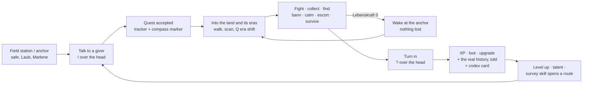

# Karlsberg Quest — Action-RPG rework (living design spec)

> Version 1.0 · 2026-11-15 · Owner: schloss-karlsberg maintainers · Decision: PRD **D-008** (supersedes D-003 "no combat"
> and the "no XP" rule of PRD §6.1). Contracts: `src/systems/contracts.ts`, `src/rpg/types.ts`.
> This file is the source of truth for the rework; change it when you change the design.

**The owner's request (2026-11-15, verbatim):** "it should not that much 'quiz' things and no 'word
quizzes' or games in this. more like people give you a 'quest' and you need to go and collect some
things or 'kill' some things - like in wow or witcher. improve that - it should be a fun, action learn
role play game."

**In one sentence:** Karlsberg Quest becomes a dark first-person **action RPG** on the real LiDAR
terrain of the Karlsberg: ghosts of the court give you **quests**, you go into the land and its eras to
**fight spectral things, collect, find and escort**, and when you come back they **tell you the real,
sourced history** — which lands in your codex. Nobody ever asks you to fill in a blank.

Contents: [1 Pillars](#1-pillars) · [2 Core loop](#2-core-loop) · [3 Controls](#3-controls) ·
[4 Combat](#4-combat) · [5 Enemies](#5-enemies) · [6 Progression](#6-progression) ·
[7 Loot and collections](#7-loot-items-collections) · [8 Quests, journal, history](#8-quests-journal-and-how-history-is-taught) ·
[9 Technical contract](#9-technical-contract) · [10 HUD layout](#10-hud-layout) ·
[11 Quest catalogue](#11-quest-catalogue) · [12 Removed / kept](#12-removed-and-kept) ·
[13 Tracks](#13-tracks-file-ownership-and-merge-order) · [14 Risks](#14-risks-and-open-questions)

---

## 1. Pillars

1. **The land remembers** (kept). The real 1 m LiDAR terrain is the world; every era is the same place
   seen again. Quests send you across it: the Ehrenhof, the Karlslust, the Apfelallee, the Baumagazin.
2. **People ask, you act.** Every task comes from a person (a ghost, Laub in the compass, Marlene on the
   radio) with a reason. Objectives are verbs you *do*: bann, fight, collect, reach, listen, calm,
   escort, survive. No quizzes, no word games, no blank-filling, no multiple choice.
3. **Fights are short, readable and juicy.** Telegraphed attacks, a dodge with i-frames, the lantern's
   Bannlicht, hit-stop and knockback, spectral enemies that come apart in mist, sparks, ash and rising
   grit. Never blood, never gore, never a real person.
4. **History is the reward, not the test.** At turn-in the giver tells you what really happened, with
   sources; the codex card unlocks with its confidence label. Learning happens by playing, listening
   and reading.
5. **Grim truth, labelled fiction** (kept). Real cruelty, debt and destruction told plainly; the
   supernatural (and every enemy) is invented and says so.
6. **Dark world, warm hub** (kept). The field station, Laub's dry voice, Marlene's coffee.

Tone rules (PRD §4.4) still apply in full; combat adds three:
- **No real person is ever an enemy.** Historical people (the duke, Mannlich, Pfeiffer, Landremont …)
  and real victims (the 1785 fireworks dead, unpaid workers, villagers) are never targets, never
  enemies, never "killed". The looters of 1793 are not enemies: the *Raffschatten* are greed given a
  shape, and Laub says so.
- **The animals of the menagerie are calmed or caught, never hurt.** Attacks pass through them.
- **Memorial places are no battlefields.** No spawns, no attacks, no fanfare at the Rondell (1785) or
  in the Festsaal (W5); `memorial:set` areas switch combat off.

## 2. Core loop



A chapter is a **main chain** of 4–6 quests (the story beats, the set pieces, the wow moments) and
**2–4 side quests** that open while the chapter runs. A session: 20–40 min; a quest: 5–15 min.
Being undone costs nothing but the walk back (no lost progress, no lost items, enemies of an
unfinished group regain their strength).

## 3. Controls

| Verb | Desktop (default, remappable) | Notes |
| --- | --- | --- |
| Move / run / crouch / lie flat | WASD, Shift, C, X | Running costs **Atem** only while in combat |
| Look | Mouse; keyboard `,` `.` Bild↑ Bild↓ | |
| **Hieb** (light attack, 3-hit combo) | **LMB** or **K** | Shares LMB with the measuring tape: while measuring (R), LMB measures |
| **Wuchthieb** (heavy, charged) | **hold LMB / K** ≥ 0.45 s, release | Breaks armour, staggers; slows you while charging |
| **Ausweichen** (dodge roll, i-frames) | **Space** (+ direction) | Space still stands you up from crouch / prone and climbs while flying |
| **Bannlicht** (lantern flare) | **RMB** or **G** | Cone; stuns spectral enemies, makes Irrlichter hittable, scatters the pack |
| **Schnellgegenstand** (quick-use) | **H** | Kräuterbalsam by default; choose the item in the Ausrüstung tab |
| Talk / examine / pick up / listen (hold) | **E** | Accept / turn in quests in the conversation |
| **Journal** (quests, codex, collections, gear, talents) | **J** / Tab; **I** opens Ausrüstung | Replaces the Chronik board |
| Lantern | L | |
| Era shift | Q (at an anchor), hold Q to return | Kept |
| Scan 0–3, maps M, measure R, Röntgenblick V, plans B, spirit view F | as before | Survey skills, now quest rewards |

Accessibility (ARCHITECTURE §5 contract, extended): `settings.reducedMotion` → no camera shake, no
roll camera tilt, shorter hit-stop; `settings.reducedFlash` → no full-screen flashes from combat at
all, hit flashes are local and ≤ 25 %; telegraphs always use **shape + motion + sound + caption**, never
colour alone; `settings.soundIndicators` shows screen-edge arrows for off-screen attackers; gentle mode
(below) makes fights forgiving; every combat key is remappable; keyboard-only play works (K, G, H).

## 4. Combat

First person, close and readable. The player holds the **Messstab** (the surveyor's iron-shod
ranging pole, right hand, upgraded through the campaign) and the **lantern** (left hand).

### 4.1 Player resources

| Resource | Base | Per level | Regenerates |
| --- | --- | --- | --- |
| **Lebenskraft** (HP) | 100 | +12 | Out of combat after 6 s: 4 / s; fully at the field station and at anchors |
| **Atem** (stamina) | 100 | +3 | 25 / s after 0.8 s without spending |
| **Bannlicht charges** | 2 | talents | 1 per 8 s (`bannRecharge`) |

Atem costs: Hieb 10 · Wuchthieb 25 · Ausweichen 20 · running 8 / s (only while `combat:state
{inCombat:true}`). At 0 Atem you cannot dodge or run (`player.canSprint = false`) until it is back to 25.

### 4.2 Moves

- **Hieb**: 3-hit combo (0.38 s each), 70° arc, 2.6 m reach, soft aim assist towards the nearest enemy
  within 25° (gentle mode: 40°). Third hit ×1.4 damage and a knockback push.
- **Wuchthieb**: hold 0.45–1.0 s (move speed ×0.5, `player.moveScale`), release: ×2.2 damage (talents
  more), breaks frontal armour (Steinfresser, Steinbrecher, Strohmann's bundles), big stagger.
- **Ausweichen**: 0.35 s roll of ~4.5 m in the move direction (backwards without one) via
  `player.impulse()`; i-frames 0.08–0.33 s. A dodge in the last 0.15 s before a hit is a **perfect
  dodge** (slow-mo 0.25 s unless reduced motion; talent "Konterschritt": next hit ×2).
- **Bannlicht**: the lantern flares (lights it if it was dark — the pack will see you): a 60° / 9 m cone.
  Spectral enemies in it are **gebannt** (stunned, `bannStun` s, take ×1.5 damage), Irrlichter fall and
  become hittable, Mahnbriefe drop to the ground, boss weak points open (Schuldbuch's seal). It emits
  `combat:bann`: the **hunt** scatters pack hounds in the cone for 4 s (they cannot be damaged — "Die
  Meute schlägt man nicht. Man entkommt ihr."), the **menagerie** jaguar retreats.
- **Schnellgegenstand** (H): drink / use in 0.6 s (can be interrupted by a hit).

### 4.3 Feel ("juice")

| Effect | Light hit | Heavy hit / kill | Player hit | Reduced motion / flash |
| --- | --- | --- | --- | --- |
| Hit-stop (local: enemies + weapon freeze) | 60 ms | 110 ms | 80 ms | halved |
| Camera shake | 0.03 | 0.12 | 0.15 | off |
| Knockback (enemy) | 0.4 m | 2–3 m | player pushed 1.2 m | kept (no camera tilt) |
| Particles | mist puffs / sparks / grit by family | the dissolve (§5.3) | screen-edge frost vignette | fewer, no white flash |
| Sound (Web Audio, procedural) | dull wooden thock + family layer | crack + whoosh + dissolve | breath + heartbeat at < 30 % | — |
| Screen | — | — | vignette pulse | no full-screen flash |

Hit-stop never uses the global pause stack (`ctx.pause`): combat freezes its own simulation and
viewmodel for the duration. Optional floating damage numbers (handwritten, small): setting
"Schadenszahlen" (combat adds the row under "Spiel", default on).

### 4.4 Enemy telegraphs and AI

Every attack has a wind-up ≥ 0.4 s (`EnemyAttackDef.telegraph`, unit-tested) shown by **pose + glow +
sound + caption**; area attacks also draw a ground ring (decal) that fills up. States: idle / patrol →
notice (a short call, `enemy:aggro`) → approach → wind-up → strike → recover (the opening) → … →
**gebannt** (stunned) → undone. At most **two enemies attack at once** (token system); the others circle.
Groups leash to their spawn (`leash`, default 40 m) and reset when the player leaves. Gentle mode:
telegraphs ×1.4, one attacker at a time, enemy HP ×0.75.

### 4.5 Being undone, waking up

Lebenskraft 0 → `player:died` → `player:caught {by:'combat'}` → the story's curtain ("Der Nebel hat
dich niedergeworfen.") → wake at the beat's `wake` place / the chapter checkpoint (as for the pack).
**Nothing is lost**: quest progress, items, XP stay; the unfinished group regains its strength.
Bosses restart their phase 1; a boss fight resumes at its arena when you walk back in (the story beat
did not move on).

### 4.6 Where fighting happens — and where not

- Combat is on in every era, but **enemies only exist where content spawns them** (quest objectives,
  story `enemy` actions, ambient groups declared by chapters). The present (today) is calm by default.
- **Safe zones** (no spawns, attacks do nothing, enemies leash out): the field station (r 40 m),
  memorials (`memorial:set`), conversations, NPC talk radius (6 m), and `flags['combat.disabled']`
  (story sets it, e.g. the finale W8 and the endings).
- **The hunt (die Meute) stays a threat, not a fight**: stealth, chases, par force, the drive and the
  finale keep their rules. The Bannlicht scatters hounds for a breather; that's all. The fightable
  hounds are the **Streuner** (strays).
- **Fire and Steinfraß** (fx) stay timers; combat adds enemies inside them (Glutlinge, Steinfresser).
- **The finale W8 is deliberately not a fight**: you lie down and light the lantern. The Messstab
  stays lowered ("Du hebst den Stab nicht."). The one battle you win by not fighting.

## 5. Enemies

All invented, all spectral, all with German names. Data: `src/rpg/enemies.ts` (ids are a contract).

### 5.1 Roster

| Id | Name | Era(s) | Role | Weakness / counter | Undone as |
| --- | --- | --- | --- | --- | --- |
| `nebelling` | Nebelling | today (tutorial), 1789, 1793-02, 1796 | slow trash, lunges | anything; teaches attack + dodge | mist |
| `irrlicht` | Irrlicht | today dusk, 1789 night, 1793-02 | floats, blinks, cold spark bolts | **immune until Bannlicht**, then falls | sparks |
| `streuner` | Streuner (stray hound of the pack) | 1789 night, 1793-02, 1793-07, 1796 | fast, flanks, pounces (crouch-growl-eye-flare) | dodge the pounce, hit the recovery; Bannlicht staggers | lies down, eyes go out, smoke |
| `mahnbrief` | Mahnbrief (unpaid decree) | 1789, 1793-02 | swarms, paper-cut swoops | Bannlicht drops them | paper → grey flakes |
| `raffschatten` | Raffschatten (greed shade) | 1793-07 | carries a sack, flees, fights when cornered | corner it; drops what it grabbed | ash |
| `glutling` | Glutling | 1793-07 (burning rooms, Ehrenhof) | leaps, swells, bursts | kill before it swells / dodge the burst | sparks |
| `grusling` | Grusling | 1796 | crumb swarm from robbed-out trenches | sweep (Wuchthieb, Laubs Lot) | grit rising upward |
| `steinfresser` | Steinfresser | 1796 | slow, frontal armour, ground slam | Wuchthieb breaks the crust; hit the back | grit rising upward (W7) |

### 5.2 Bosses (one per chapter, the finale excepted)

| Chapter | Boss | Arena | Phases | Mechanic | Ends with |
| --- | --- | --- | --- | --- | --- |
| 1 | **Das Schuldbuch** (`schuldbuch`) — a ledger as big as a door with the ducal seal for a heart | Bauplatz at the gallery's east end, 1789 dusk (1276/−1228) | 3 | page-slam rings, summons Mahnbriefe, seal bolts; the **Bannlicht breaks the seal open** (4 s window) | pages scatter in the wind; Matthes' Lohnzettel drops |
| 2 | **Der Pikeur** (`pikeur`) — the faceless rider | the Karlsbergweiher dam, 1793-02 night (819/−875), end of the par force | 3 | charges along the dam (horse rears + horn = telegraph), whip, calls Streuner; he **cannot cross running water**: lure his charge onto the overflow and he balks (stagger) | he is **not defeated**: he blows "verloren" and rides into the fog (he returns in Ch. 4 as Jost) |
| 3 | **Der Strohmann** (`strohmann`) — the straw of the hundred wagons, risen with arms | Ehrenhof straw carts, 1793-07 dusk (1210/−1114), before the torch | 3 | flail sweeps, spark rain (glowing ground rings), Glutlinge; soft at the back where the bundles are tied | collapses into ash and smoke — the fire still comes (history doesn't change) |
| 4 | **Der Steinbrecher** (`steinbrecher`) — a giant of robbed-out blocks | Ehrenhof as stone yard, 1796 (1216/−1114) | 3 | block throws, quake rings, Gruslinge; hits on the joints knock blocks loose that **fly west towards Homburg** | falls apart into the empty court → the Steinfraß (W7) takes over |
| Finale | — (W8: lie down, light the lantern) | Zwinger, today night | — | no fight; combat is disabled | the hounds lie down |

### 5.3 Rules for enemies

- **Dissolve, never die**: `DissolveStyle` mist / sparks / smoke / ash / paper / grit-rising / fade.
  Kill feedback is the dissolve + sound + XP number, never a body, never blood, never a scream of pain.
- **No humans**: shades and figures are faceless; no enemy wears a uniform of a real army, no
  national symbols; no enemy has the shape of a victim.
- **Readable at 30–60 m in fog** (like the pack): silhouettes + ember eyes / glow cores pierce fog.
- **Notes are labelled fiction** (`note_de` ends with "(Fiktion)", unit-tested); the journal's bestiary
  page shows them.

### 5.4 Difficulty tiers

`tier` 1–4 = chapter 1–4 (prologue: tier 1 at 60 %). Enemy HP × (1 + 0.35 (tier − 1)), damage ×
(1 + 0.25 (tier − 1)). The player's level curve (§6) keeps pace; side quests are optional XP.

## 6. Progression

### 6.1 XP and levels (1–12)

Total XP to reach level n (`LEVEL_XP` in `src/rpg/stats.ts`): 0 · 150 · 400 · 750 · 1200 · 1800 · 2600 ·
3600 · 4800 · 6200 · 7800 · 9600. Targets: end of prologue L3, Ch. 1 L5–6, Ch. 2 L7–8, Ch. 3 L9–10,
Ch. 4 L11–12 with side quests (main only ≈ L10–11).

| Source | XP |
| --- | --- |
| Main quest | 150–800 (Ch. 4 finale 800) |
| Side quest | 100–300 |
| Bonus objective | 20–60 |
| Enemy | 4–30; boss 200–400 |
| New codex card (from echoes, examined documents, quests) | 10 |
| Collection complete | 100–200 |

Level up: +12 Lebenskraft, +3 Atem, +4 % damage, **1 talent point**, a stamp card ("Stufe 4") with a
chime (no flash). From level 6: a second charm slot. Mirrored as `flags['rpg.level']`.

### 6.2 Talents (`TALENTS` in `src/rpg/stats.ts`)

Three short branches, 11 points over the campaign, respec free at the field station:

| Stab (staff) | Laterne (lantern) | Feldbuch (field book) |
| --- | --- | --- |
| Wucht (3): heavy ×+0.25 | Weites Licht (2): +2 m, +10° | Spürsinn (2): collectibles on the compass within 40/80 m |
| Der dritte Hieb (1): combo finisher staggers | Lange Glut (2): recharge ×0.85 | Kräuterkunde (2): healing ×1.2, +5 % loot |
| Standfest (2): +15 HP | Lichtkreis (1): +1 charge, stun ×1.3 | Langer Atem (2): stamina costs ×0.88, +10 Atem |
| Konterschritt (1): perfect dodge → next hit ×2 | Laternenwärme (1): heal on banishing | Gedächtnis (1): XP ×1.1 |

### 6.3 The Messstab and charms

One weapon, five stages, all **quest rewards** (no crafting, no shop):

| Stage | Item | From | Damage |
| --- | --- | --- | --- |
| I | Messstab (Eschenstab) `item.stab.esche` | Prologue, the field station | 12 |
| II | mit Eisenbeschlag `item.stab.eisen` | Ch. 1 "Matthes' Lohn" (Hanne) | 16 |
| III | mit Silberdraht `item.stab.silber` | Ch. 2 "Die Parforcejagd" | 19 ×1.15 |
| IV | mit Bannkerben `item.stab.bann` | Ch. 3 "Die Hunde los" (Jost) | 23 ×1.2 |
| V | mit Laubs Lot `item.stab.lot` (heavy = sweep) | Ch. 4 "Der Steinplatz" | 26 ×1.25 |

**Charms** (1 slot, 2 from L6): Solls Rechenpfennig (+loot), Josts Hundemarke (−8 % damage taken),
Kasuarfeder (cheaper dodge), Matthes' Zeichen (cheaper Atem), and **the object you saved from the
Festsaal**: Türgriff (stagger), Dukat (XP), Uhr (Bannlicht recharge) — or nothing, by choice.

### 6.4 Survey skills become quest rewards that open routes

The skills system stays as is (`skill:grant`, unlock cards, Laub's remarks); only *who* grants changes
(quest rewards instead of Chronik confirmations):

| Skill | Granted by (quest) | Opens |
| --- | --- | --- |
| Relief 1–3 | Prologue "Was der Wald verbirgt" (steps) | wall lines, Hohlweg, pits; hidden side-quest spots |
| Kartograf 1 | Prologue "Die Feldstation" | map 1840 (M) |
| Kartograf 2 | Ch. 1 "Die Karlslust bei Nacht" | map 1935; the Torhaus anchor → Ch. 2 |
| Kartograf 3 (Messen R) | Ch. 2 "Die Parforcejagd" | measuring; bonus objective in the gallery (Ch. 3) |
| Spurenleser 1–2 | Ch. 1 "Tausend Hunde" (Jost), Ch. 2 "Die Spur im Raureif" | horn meanings; pack routes (stealth stretches) |
| Baumeister 1–2 | Ch. 3 "Das graue Buch" | room names, confidence view |
| Röntgenblick | Ch. 3 "Die Hunde los" | point cloud: Grusling burrows and hidden stones in Ch. 4 |

## 7. Loot, items, collections

- **No currency** (PRD: no shop, no grind). Loot is consumables, lore and quest items.
- **Consumables** (`src/rpg/items.ts`): Kräuterbalsam (heal 45), Riechsalz (Atem), Lampenöl (Bannlicht
  charges + oil), Kalkstaub (thrown: stuns spectral enemies in 6 m — "Das sind Kalköfen"). Stack 5–9.
- **Loot numbers (progression track, 2026-11-16)**: tables retuned so a small enemy drops about every
  third kill (`loot.klein` balsam 22 % / oil 10 % / salts 6 %, `loot.licht`, `loot.raff`, `loot.stein`
  raised, `loot.boss` adds a Kalkstaub); every empty roll in a row adds +6 % to the next (at most
  +30 %), so a dry streak never lasts. Rolls are seeded (enemy id + drop counter): a reload does not
  re-roll. `tests/rpg-contracts.test.ts` needed no change (level curve, talents and `deriveStats`
  untouched).
- **Additive type changes (progression track)**: `ProgressionSlice` gained the optional `codexXp`
  (facts that already paid +10 XP), `placed` (world pickups by id, persisted), `drops` (loot seed
  counter) and `dry` (empty rolls in a row); new `PlacedPickup` (the `loot:place` payload + `drop`).
  `src/rpg/items.ts` adds `lootTable()` / `collectionDef()`, `src/rpg/stats.ts` adds `talentDef()`,
  `talentBlock()`, `spentPoints()`, `weaponPower()`. No contract event changed.
- **Drops**: enemy `loot` tables roll on `enemy:killed`; drops appear as **glowing pickups** (warm
  core + slow bob + motes, era-tinted, visible through fog to 40 m; E or walking over picks up).
  `loot:drop` → `loot:place` → `item:pickup`.
- **Quest items**: placed by `collect` objectives (`place`) or dropped (`drop`), declared in the
  chapter's quest file (`items`, ids `item.<chapter>.<name>`).
- **Collections** (journal tab "Sammlungen", sets in `COLLECTIONS`, members declared by quest files
  with `set`): **Seiten der Chronik** (one page per chapter — the narrative spine, now literal
  pickups), **Die Namen der Hunde** (five collars: Diane, Sultan, Fanfare, Rauhreif, Bijou), **Matthes'
  Zeichen** (four marked stones across eras), **Planblätter**, **Mannlichs Festpläne**. A complete set
  gives XP and a line from its owner. Relief patterns (rm.01–08) stay codex cards.
- **Inventory**: journal tab "Ausrüstung": weapon, charm slots, consumables (set the quick-use item),
  quest items, lore (read the text).

## 8. Quests, journal and how history is taught

### 8.1 Lifecycle

`hidden → offered → active → ready → done` (or `failed`). Mirrored as `flags['quest.<id>']`;
objective counts as `flags['quest.<id>.<objective>']`.

- **Main quests** are offered by the story (`{"do":"quest","op":"offer"|"start"}` in a beat), so the
  chapter's beats stay the backbone (era shifts, set pieces, endings). A beat waits for
  `{"quest":{"id":…}}` (done) or an objective.
- **Side quests** offer themselves while their chapter runs and `available` holds (after quests, a
  flag, an era, a level). A side quest can be declined and taken up later.
- **Givers**: placed ghosts (`giver {npc}`: Hanne, Soll, Jost, Peter, the gardener, the servant …) or
  voices (`giver {voice: laub | marlene}`: spoken, accepted at once). Historical people are never
  givers (their words must be sourced; a request would be invented).
- **Turn-in**: at the giver (default), someone else (`{npc}`), or `auto` (voices, set pieces).

### 8.2 Conversation flow (npc system)

E near a giver opens the field-book conversation. Quest topics come first, marked:
**!** (offer; main quests: ! in a brass ring), **?** (ready to turn in), grey **?** (active).

1. *Offer*: the giver speaks `offer` lines → buttons **[accept_de]** / **[Später]** (side quests).
2. *While active*: `progress` lines (a hint in the giver's voice — never a riddle).
3. *Turn-in*: `turnin_lines` → **history** lines (each may carry `fact` + sources; the source label
   shows under the line, as today) → optional **stance** (§8.6) → reward card (XP stamp, items, "Neu im
   Codex: …" with the confidence badge) → `next` quest offered.

### 8.3 Markers

| Where | What | Shape (colour-blind safe) |
| --- | --- | --- |
| Over a giver's head | offer / main offer / ready / active | `!` · `!` in a ring · `?` · grey `?` |
| Compass (Bussole strip) | tracked objective; givers with offers within 150 m; turn-ins | diamond · `!` · `?` |
| World | objective zones within 200 m | a faint era-tinted light column that fades when you are inside |
| World | pickups | warm glow + motes |

### 8.4 Journal (J / Tab) and tracker

- **Tracker** (HUD top-left column, `hud.stack(el, 35)`): up to three tracked quests (main first),
  title + active objectives with counters ("Irrlichter bannen 2/5"), ticks when done, a soft pulse
  on progress (no flash).
- **Journal** (one modal, field-book look, tabs from `src/ui/journal.ts`):
  10 **Aufgaben** (active / done; summaries; the history told at turn-in can be re-read) ·
  20 **Codex** (cards with source, confidence D/I/N/U, label FAKT / STRITTIG / LEGENDE / FIKTION, "neu") ·
  30 **Sammlungen** (collections, bestiary page) · 40 **Ausrüstung** · 50 **Talente** (progression).
  The station's Pinnwand (hub item `chronik`) opens the journal (`chronik:open` → journal).

### 8.5 How history is taught — without quizzes

1. **Told at turn-in**: 1–4 sourced lines in the giver's voice (Hanne tells what a journeyman earned;
   Soll the debts; Jost the kennel). Each `fact` unlocks its codex card on the spot.
2. **Codex cards** with source, confidence label and FAKT / STRITTIG / LEGENDE / FIKTION, readable any
   time in the journal. Contested facts stay contested (flight date, place of death, bear boxes).
3. **Echoes** (hold E, kept): voices of what happened here, labelled "Erinnerung (Fiktion)", quotes
   marked.
4. **Examined documents and objects** (E, kept): the Rechenbrett, the Kaufbrief, the Wachbuch …
5. **Lore collectibles** with short texts (collars, pages, stones, plan sheets).
6. **Laub's remarks and Marlene's radio** (kept): the dry footnote, the present-day context.
7. **Optional "Erzähl mehr" topic** at a giver after turn-in: deeper sourced lines, no XP needed.
8. **Bestiary notes** say plainly which parts are fiction.

Never: fill-in-the-blank, word or noun selection, multiple choice with a right answer, "confirm three",
hint ladders for puzzles, losing knowledge when caught.

### 8.6 Stances (Haltungen) — the readings become role-play

The old LESARTEN (open readings) survive as **stances**: at some turn-ins the giver asks what *you*
think. It is an opinion, never graded, always with "Ich weiß es nicht." (`offen`). The answer writes
the same epilogue flag as before, so `content/story/05-enden.story.json` and the endings pack keep
working (the epilogue maps `n.r_x` ≡ `x`).

| Flag | Asked by (quest) | Options (value) |
| --- | --- | --- |
| `flag.p_spuren` | Laub, "Spuren in der Punktwolke" | hunde · wild · messfehler · offen |
| `flag.k1_lohn` | Hanne, "Matthes' Lohn" | will_nicht · creuzer · hunde_bilder · getaeuscht · offen |
| `flag.k2_lichter` | Laub, "Lichter im Wald" | kalkoefen · fackeln · wachfeuer · laternen · offen |
| `flag.k2_pfeiffer`, `flag.k2_stelle` | Laub, "Hinter der Tür" | treu · dorf · lohn · angst · offen / gewarnt · geschwiegen · gefuehrt · offen |
| `flag.k3_pluenderer` | Hanne, "Der Nachmittag" | schuld · stahlen · retteten · alle · offen |
| `flag.k4_zerstoerer`, `flag.k4_steine` | Laub, "Standpunkt siebzehn"; Peter, "Matthes' Zeichen" (both voice cards: auto turn-in) | franzosen · herzog_selbst · steintraeger · vergessen · offen / raub · lohn_steine · neuanfang · nur_steine · offen |
| `flag.k4_meute` | Jost, "Sich stellen" | herr_suchen · chronik_bewachen · heimtreiben · nie_abgeblasen · offen |

Ch. 3–4 write the endings pack's value keys (`herzog_selbst`, `lohn_steine`, `herr_suchen`,
`chronik_bewachen`, …); the fallback epilogue in `05-enden.story.json` knows both spellings.

The two story choices stay story choices: the gate (`k2.tor`, lantern up or down) and the Festsaal
object (`k3.objekt`, which now also becomes a charm).

## 9. Technical contract

### 9.1 Systems (registered in `src/systems/index.ts`, after `scenery`)

| System | Folder | Owns | State slice |
| --- | --- | --- | --- |
| `progression` | `src/systems/progression/` | XP, levels, talents, inventory, equipment, consumables, loot rolls, world pickups, collections, level-up card, XP bar, journal tabs Ausrüstung / Talente | `ProgressionSlice` |
| `combat` | `src/systems/combat/` | Lebenskraft / Atem / Bannlicht, the viewmodel (staff + lantern), attacks, dodge, enemies (AI, visuals, audio), groups and spawns, bosses, hit-stop / shake / particles, death → caught, vitals + boss bar | `CombatSlice` |
| `quests` | `src/systems/quests/` | quest state machine, offers / turn-ins, objective tracking, spawns + pickups for objectives, rewards, codex unlocks, journal modal (Aufgaben / Codex / Sammlungen), tracker, giver markers, beacons, compass markers | `QuestSlice` |

Pure shared modules (no three.js, no DOM): `src/rpg/types.ts` (all shapes), `src/rpg/enemies.ts`
(roster), `src/rpg/items.ts` (items, loot, collections), `src/rpg/stats.ts` (level curve, talents,
`deriveStats`). Systems may import these; they never import each other.

### 9.2 Events (`src/systems/contracts.ts`)

Requests are imperative, facts past tense. Payloads are plain JSON.

| Event | Emitted by | Listened by | Payload |
| --- | --- | --- | --- |
| `quest:command` | story (`quest` action) | quests | `{op, id, objective?, n?}` |
| `quest:offered` / `accepted` / `progress` / `objective` / `ready` / `completed` / `failed` | quests | story (conditions via flags), progression, HUD, barks | see contracts |
| `npc:topics` | quests | npc | `{npc, topics: QuestTopic[]}` |
| `npc:marker` | quests | npc | `{npc, mark}` |
| `npc:follow` | quests (escort objectives) | npc (the ghost walks after the player) | `{npc, follow}` |
| `quest:accept` / `decline` / `turnin` / `stance` | npc | quests | `{id, npc}` / `{id, value}` |
| `enemy:spawn` / `enemy:despawn` | quests, story | combat | group spec / `{group}` |
| `enemy:spawned` / `killed` / `cleared` / `aggro`, `boss:phase` | combat | quests, progression, story, barks | see contracts |
| `combat:hit` / `combat:state` / `combat:bann` | combat | fx, audio, barks, hunt, menagerie | |
| `player:damaged` / `healed` / `died` | combat | HUD, barks | |
| `player:caught {by:'combat'}` | combat | story (curtain + wake), npc | |
| `menagerie:calmed` | combat (menagerie behaviour) | quests | `{id, animal}` |
| `xp:grant`, `item:grant`, `loot:place`, `loot:clear` | quests, story, combat | progression | |
| `xp:gain`, `level:up`, `item:pickup`, `item:use`, `loot:drop`, `equip:change`, `talent:learned`, `stats:changed` | progression | quests (collect / use), combat (stats), HUD | |
| `codex:unlocked` | quests (turn-in), chronik (clues) | journal, progression (+10 XP) | `{factId}` |
| `skill:grant` | quests (rewards), story | skills | unchanged |

Existing events the RPG systems use: `npc:talk`, `room:enter`, `clue:found`, `clue:grant`,
`echo:end`, `story:chapter`, `story:beat`, `era:change`, `memorial:set`, `hub:enter`,
`chronik:open`, `game:start`, `save:loaded`, `settings:change`.

### 9.3 Story schema additions (`src/systems/story/types.ts`, validated)

Actions (`quest`, `xp`, `item` are one-shots on resume; `enemy`, `loot` are idempotent by id):

```jsonc
{ "do": "quest", "op": "offer", "id": "q.k1.lohn" }               // offer | start | progress | complete | fail | reset
{ "do": "quest", "op": "progress", "id": "q.k1.karlslust", "objective": "rondell", "n": 1 }
{ "do": "enemy", "op": "spawn", "group": "k1.weiher", "kind": "irrlicht",
  "x": 1854, "z": 214, "era": "1789", "count": 5, "radius": 18, "time": "night", "respawn": 0 }
{ "do": "enemy", "op": "despawn", "group": "k1.weiher" }          // "*" = all
{ "do": "loot", "id": "k1.seite", "item": "item.k1.seite", "x": 1811, "z": 363, "era": "1789" }
{ "do": "xp", "amount": 50, "reason": "first-shift" }
{ "do": "item", "item": "item.stab.esche" }
```

Conditions:

```jsonc
{ "quest": { "id": "q.k1.lohn" } }                                 // done (default)
{ "quest": { "id": "q.k1.lohn", "state": "active" } }              // offered | active (also ready) | ready | done | failed
{ "quest": { "id": "q.k1.lohn", "objective": "zettel", "gte": 1 } }
{ "level": 4 }
{ "event": "enemy:killed", "match": { "group": "k1.weiher" }, "times": 5 }
{ "event": "enemy:cleared", "match": { "group": "k3.strohmann" } }
```

Flags: `quest.<id>` (state), `quest.<id>.<objective>` (count) — quests; `rpg.level` — progression;
`combat.disabled` — story (finale, endings); `tools.measuring` — tools (LMB belongs to the tape).

### 9.4 Quest files (`content/quests/<nn>-<chapter>.quests.json`)

One per chapter (`00-prolog`, `01-kapitel-1` … `04-kapitel-4`; `99-test` is the worked example, loaded
only with `?storytest`). Schema `content/schema/quests.schema.json`; authority
`src/systems/quests/validate.ts` (run by `pnpm validate` and `tests/rpg-contracts.test.ts`): ids
`q.<chapter>.<name>` (prolog → `p`, enden → `end`), known speakers (historical speakers need
sources), codex facts, clues, enemy kinds, items, places inside the playable area, a stance always
has `offen`, collect objectives have enough places, … The story validator rejects unknown quest ids and
items. Abridged example (full: `content/quests/99-test.quests.json`):

```jsonc
{
  "chapter": "k1",
  "items": [{ "id": "item.k1.lohnzettel", "kind": "quest", "name_de": "Matthes’ Lohnzettel", "text_de": "…" }],
  "quests": [{
    "id": "q.k1.lohn", "kind": "main", "era": "1789",
    "title_de": "Matthes’ Lohn", "summary_de": "Hanne wartet seit einer Woche auf den Lohn ihres Mannes …",
    "giver": { "npc": "hanne" }, "turnin": "giver",
    "offer": [{ "speaker": "hanne", "text": "…" }],
    "progress": [{ "speaker": "hanne", "text": "…" }],
    "turnin_lines": [{ "speaker": "hanne", "text": "…" }],
    "history": [{ "speaker": "hanne", "text": "Zwei Tage arbeitet ein Geselle für einen Gulden …", "fact": "cx.08" }],
    "stance": { "id": "k1.lohn", "prompt_de": "Warum bekomme ich ihn nicht, was meinst du?", "flag": "flag.k1_lohn",
                "options": [{ "label_de": "Weil der Herzog nicht will.", "value": "will_nicht" }, …, { "label_de": "Ich weiß es nicht.", "value": "offen" }] },
    "objectives": [
      { "id": "soll", "type": "talk", "text_de": "Den Kanzlisten nach Matthes fragen", "npc": "soll", "topic": "matthes" },
      { "id": "buch", "type": "kill", "text_de": "Das Schuldbuch bezwingen", "enemy": "schuldbuch", "after": ["soll"],
        "where": { "x": 1276, "z": -1228, "r": 25, "era": "1789" },
        "spawn": [{ "kind": "schuldbuch", "x": 1276, "z": -1228, "era": "1789", "boss": true, "time": "dusk" }] },
      { "id": "zettel", "type": "collect", "text_de": "Den Lohnzettel aufheben", "item": "item.k1.lohnzettel", "after": ["buch"],
        "drop": { "enemy": "schuldbuch", "chance": 1 } }
    ],
    "rewards": { "xp": 400, "items": [{ "item": "item.stab.eisen" }], "codex": ["cx.10"] },
    "next": "q.k1.traenen"
  }]
}
```

Objective types: `kill` (enemy / group / spawn) · `collect` (item; `place` pickups or `drop`) · `reach`
(where) · `talk` (npc, topic) · `room` (palace room) · `examine` (clue found) · `echo` (echo ended) ·
`calm` (menagerie animal) · `escort` (npc to a place) · `survive` (seconds with spawns) · `use`
(item) · `event` (any event + match — escape hatch, e.g. `hunt:goal {mode:'parforce'}`) · `manual`
(story `quest progress`). `after` orders objectives; otherwise they run in parallel. `optional` +
`bonus_xp` for bonus objectives.

### 9.5 Other hooks added for the tracks

- **Input** (`src/player/input.ts`): actions `attack` (LMB, K), `bannlicht` (RMB, G), `dodge` (Space),
  `quickUse` (H), `inventory` (I); shared pairs C crouch/down, LMB interact/attack, Space up/dodge;
  the canvas suppresses the context menu.
- **Player** (`src/player/player.ts`, additive): `moveScale`, `canSprint`, `impulse(vx, vz, s)`,
  `pushed`.
- **HUD** (`src/ui/hud.ts`): `hud.dock('vitals' | 'boss' | 'feed', el, order)` (§10) next to
  `hud.stack(el, order)`.
- **Journal tabs** (`src/ui/journal.ts`): `addJournalTab({id, label, order, render, badge?, hide?})`.
- **Debug** (`window.kq`): `kq.quests`, `kq.combat`, `kq.progression` (each track extends its own:
  e.g. `kq.quests.accept/complete/progress/turnin`, `kq.combat.spawn/hit/kill/god/state`,
  `kq.progression.grant/xp/level/equip/use/state`).
- **Combat track additions** (no change to `contracts.ts`): event `combat:swing {x, z, yaw, reach}`
  (declared in `src/systems/combat/index.ts`), setting `Settings.damageNumbers` („Schadenszahlen“,
  game section, default on), `lanternPose {side, lift}` exported by `src/systems/hunt/lantern.ts`,
  `PackSim.scatter()` in the hunt, `MenagerieSlice.calmed: string[]`.
- **Test chapter**: `?storytest`, `kq.story.goto('test', 'q1')` — Hanne offers `q.test.lohnzettel`
  (kill 3 Mahnbriefe → collect the Zettel → turn in with history + stance) and then the side quest
  `q.test.irrlichter` (Laub, two Irrlichter). Every track's e2e can start there.

### 9.6 Additions by the quests track (additive only)

- `src/rpg/types.ts`: `QuestTopic.history?: QuestHistoryLine[]` and `QuestTopic.stance?: QuestStance`
  (the turn-in topic carries the history lines and the stance prompt to the npc conversation);
  `QuestSlice.bestiary?: Record<string, number>` (kills per enemy kind for the journal's bestiary).
- `src/systems/contracts.ts`: `npc:follow {npc, follow}` (escort objectives; npc moves the ghost).
- Transient flag `npc.near` (npc): set while a ghost is within talk radius, so the Chronik leaves E
  and its prompt to the conversation.

## 10. HUD layout

| Area | What | Owner |
| --- | --- | --- |
| Top-left column (`hud.stack`) | era 0, status 10, room 20, story objective 30, **quest tracker 35**, story gauges 40 | core / tools / story / **quests** |
| Top centre | compass strip (markers), threat eye, **boss bar** (`dock('boss')`) | core / **combat** |
| Bottom-left (`dock('vitals')`, above the oil gauge) | **Lebenskraft + Atem** 10, **Bannlicht charges** 20, **level + XP bar** 30, **quick-use slot** 40 | **combat** / **progression** |
| Right edge (`dock('feed')`, under the toasts) | pickup feed ("+ Kräuterbalsam"), objective ticks | **progression** / **quests** |
| Bottom centre | prompt, subtitles, dialogue card (kept) | story / npc |
| Bottom-right | Bussole (kept), fx gauges | story / fx |
| Over the world | giver glyphs (npc), beacons (quests), pickups (progression), enemy health pips + gebannt ring (combat) | |

Field-book look (ink, paper, brass), high-contrast rules for every new piece (solid backing,
≥ 4.5 : 1), no meaning by red vs green alone (HP red-orange + a notch pattern, Atem pale blue,
XP brass). `e2e/pol-flow.spec.ts` overlap checks extend to the new boxes.

## 11. Quest catalogue

Coordinates are local metres (x east, z south) from the existing story / bible / packs; **(prüfen)**
marks new spots the content tracks must check on the terrain (`scripts/content-build/probe.mjs`,
`terrain.mjs`). Codex ids from `content/packs/codex.pack.json`. XP values are starting points.
Main quests are offered by the chapter's beats; their order is the chapter's beat order.

### 11.0 Prolog "Vermessung" (today → first shift 1789) — tier 1, levels 1–3

| Id | Kind | Giver → turn-in | Objectives (place) | Enemies | Rewards | History taught |
| --- | --- | --- | --- | --- | --- | --- |
| `q.p.feldstation` "Die Feldstation" | main | Marlene (radio) → auto | examine Lageplan, Handbuch, Schublade at the station (760/−915); take the **Messstab** | — | 50 XP, `item.stab.esche`, Kartograf 1 | cx.34 Laserscan 2025, cx.35 Schauen, nicht graben, rm.01–08 (Handbuch) |
| `q.p.relief` "Was der Wald verbirgt" | main | Marlene → auto | Damm (819/−875) Relief 2 → Mauerrest (813/−903); Orangerie wall (1237/−966) VAT | — | 120 XP, Relief 2 + 3 | rm.07 Fundament, rm.08 Weiher und Damm |
| `q.p.bussole` "Die Bussole spricht" | main | Laub (wakes at the Orangerie wall) → auto | Ehrenhof (1216/−1114) M map compare; Hohlweg (1172/−1238); **Eiskeller** (1508/−1296): **4 Nebelinge** rise from the pit at dusk (combat tutorial: Hieb, Ausweichen, Wuchthieb) | nebelling ×4 | 180 XP, Kräuterbalsam ×2 | cx.01 Ehrenhof, cx.33 Karte 1836–41, rm.04 Hohlweg, rm.02 Eiskeller |
| `q.p.punktwolke` "Spuren in der Punktwolke" | main | Marlene (tablet) → Laub (auto on return) | examine the point cloud (station); go to the Ehrenhof, **Q → 1789** (W1); hear the servant's echo (`echo.p.diener`); **one Streuner** at the Ehrenhof edge (Bannlicht tutorial); hold Q home before the oil runs out | streuner ×1 (tier 0.6) | 200 XP; stance `flag.p_spuren` | cx.03 Karl II. August, cx.36 Die Wilde Jagd (LEGENDE), cx.38 Fiktionsliste |
| `q.p.meiler` "Kohlplatten" | side | Marlene (after `q.p.relief`) | find 3 charcoal-kiln platforms with Relief 3 (one at 1150/−935, two (prüfen)); pick up a lump of charcoal at each | — | 120 XP, Lampenöl | rm.03 Meilerplatz |
| `q.p.trichter` "Nicht anfassen" | side | Marlene (after `q.p.bussole`) | find the bomb crater (rm.06, (prüfen)), **do not touch**, report it on the radio | — | 100 XP | rm.06 Bombentrichter, cx.35 (UXO: melden, nicht graben) |
| `q.p.irrlichter` "Lichter am Weiher" | side | Laub (evening, after the first shift) | bann **3 Irrlichter** over the Karlsbergweiher (850/−880 (prüfen)) — the Bannlicht drill | irrlicht ×3 | 120 XP, Lampenöl ×2 | rm.08 (the dam is older than the forest) |

### 11.1 Kapitel 1 "Der Hof" (1789, day → dusk → night) — tier 1, levels 3–6

| Id | Kind | Giver → turn-in | Objectives (place) | Enemies | Rewards | History taught |
| --- | --- | --- | --- | --- | --- | --- |
| `q.k1.ankunft` "Zu Fuß, außer einem" | main | Laub → auto | Q at the Ehrenhof (1222/−1119); pass the guard at the gate (`clue.k1.wache`, 1201/−1115); look at the wings (`clue.k1.fluegel`) | — | 80 XP | cx.11 Zu Fuß, außer einem |
| `q.k1.registratur` "Der Kanzlist zählt" | main | Soll (Registratur B03.1.eg-registratur, 1198.8/−1152.6) → Soll | examine Rechenbrett, Kaufbrief, Schlözer-Heft (room); **Mahnbriefe ×6** have escaped into the Küchenhof (1212/−1180) — catch them before they "reach the duke" (comic) | mahnbrief ×6 | 250 XP, Solls Rechenpfennig | cx.07 Vierzehn Millionen, cx.05 „Ein einziges JagdRevier“, cx.02 Louisenhof (STRITTIG) |
| `q.k1.lohn` "Matthes' Lohn" | main | Hanne (Bauplatz, 1287/−1228) → Hanne | ask Soll about Matthes (talk `matthes`); see Matthes' mason's mark (`clue.k1.zeichen`, 1262/−1218.5; collection stone 1/4); at dusk **Das Schuldbuch** rises at the Bauplatz (1276/−1228) — defeat it, pick up the **Lohnzettel** | **schuldbuch** (boss) + mahnbrief | 400 XP, **Messstab II (Eisenbeschlag)**; stance `flag.k1_lohn` | cx.08 Zwei Tage für einen Gulden, cx.10 Leere Kassen, cx.09 Tränenberg (LEGENDE) |
| `q.k1.zwinger` "Tausend Hunde" | main | Jost (Zwinger, 1177/−1571) → Jost | carry 5 pieces of meat from the Jägerhaus yard (KB-B24 (prüfen)) to the kennel; Jost's hiding lesson (crouch, lie flat, lantern, water — stealth tutorial); at dusk **3 Streuner** slip out along the Allee — bring them down before the pack hears | streuner ×3 | 300 XP, Spurenleser 1, Josts Hundemarke | cx.06 Zwinger für tausend Hunde, cx.37 „Hundskarl“ |
| `q.k1.karlslust` "Die Karlslust bei Nacht" | main | Laub (after the three above) → auto (on return, today) | Q at the Tschifflik terrace (1822/70); Amphitheater echo (1935/87); bear boxes (`clue.k1.baerenkaesten`, 1958/146); **bann 5 Irrlichter** over the Schwanenweiher (1854/214); the **Rondell** (1815/348, memorial: no combat, quiet) — echo of 19 Dec 1785; pick up the **Chronikseite** (1811/363) → horn → escape the pack to the Tosbecken water (1807/189) → hold Q | irrlicht ×5; the pack (threat) | 450 XP, Kartograf 2, page 1 of the Chronik | cx.12 Menagerie, cx.13 Bärenzwinger? (STRITTIG), cx.14 19. Dezember 1785 (told quietly, `quiet` turn-in), cx.15 Festplan von 1785 |
| `q.k1.kasuar` "Der Kasuar ist los" | side | the gardener (`gaertner`, Amphitheater 1940/80 (prüfen)) → gardener | **calm the cassowary** (1966/92): dodge three charges until it is bored, then lead it back (E) — attacks pass through it | — (menagerie) | 150 XP, Kasuarfeder | cx.12 Menagerie (the real cassowary of Karlslust) |
| `q.k1.festplaene` "Mannlichs Festpläne" | side | the servant (`diener`, Orangerie Pfeilersaal B10.1.s-pfeilersaal) → servant | the wind took the plans: **4 Mahnbriefe** carry sheets through the Orangerie garden (1260/−985 (prüfen)); collect 3 Festplan sheets (collection `festplaene`); listen to Mannlich's echoes (`clue.k1.mannlich`, `clue.k1.mannlich_lohn`) | mahnbrief ×4 | 200 XP | cx.04 Mannlich, cx.40 Die Orangerie, cx.15 |
| `q.k1.hundenamen` "Die Namen der Hunde" | side | Jost (after `q.k1.zwinger`) → Jost | find the five collars (Diane, Sultan, Fanfare, Rauhreif, Bijou) along the Allee and in the park at night, each guarded by a Streuner (positions (prüfen) along 1181/−1614 … 1271/−953) | streuner ×5 | 250 XP | the hound names (FIKTION); the par force hunt (cx.06) |

### 11.2 Kapitel 2 "Die Flucht" (9/10 Feb 1793, night, frost) — tier 2, levels 6–8

| Id | Kind | Giver → turn-in | Objectives (place) | Enemies | Rewards | History taught |
| --- | --- | --- | --- | --- | --- | --- |
| `q.k2.spur` "Die Spur im Raureif" | main | Marlene / Laub → auto | Q at the Parkzaun (1680/−400); the wool scrap (`clue.k2.zaun`, 1672/−408); follow the trail up the Apfelallee (1500/−542 → 1275/−960) — **W3 eyes in the fog: sneak** (the pack, stealth); bonus: bring down **3 Streuner** stragglers (optional); the Orangerie echo (`clue.k2.orangerie`) | streuner ×3 (bonus); the pack (threat) | 300 XP, Spurenleser 2 | cx.16 Die Warnung |
| `q.k2.wachbuch` "Das Wachbuch" | main | Laub → auto | Wachhaus Nord (1171/−1123): **4 Irrlichter** dance around the guards' fire pan — bann them; take the Wachbuch (`clue.k2.wachbuch`) | irrlicht ×4 | 250 XP | cx.17 Wann war die Flucht? (STRITTIG: 9 or 3 Feb) |
| `q.k2.warnung` "Hinter der Tür" | main | Laub → Laub (auto) | through the south wing (B02.1.eg-durchfahrt) to the Schreibkabinett (B01.1.eg-kabinett): listen at the door — `clue.k2.warnung`, `clue.k2.abschied` (no combat in the palace) | — | 300 XP; stances `flag.k2_pfeiffer`, `flag.k2_stelle` | cx.16 (the warner, Nikel Pfeiffer), cx.18 „Über meine Galerie zu wachen“ |
| `q.k2.parforce` "Die Parforcejagd" | main | Jost (Ehrenhof, 1222/−1135) → Laub (auto on return) | the departure + the gate choice (`k2.tor`, kept); the par force: escape through the south wing → Orangerie (W4 "Das sind Kalköfen", `clue.k2.landremont`) → down the slope → **the dam (819/−875): Der Pikeur** — hold the dam until he blows "verloren" | **pikeur** (boss) + streuner; the pack (threat) | 600 XP, **Messstab III (Silberdraht)**, Kartograf 3 | cx.19 „Das sind Kalköfen“ |
| `q.k2.bodenbrett` "Das Bodenbrett" | side | Laub (after `q.k2.wachbuch`) → auto | in the gallery (B06.1.bildergalerie) watch Soll hide the grey book at the west end (1200/−1218) **unseen** (stay out of his lantern; caught = start over); sets `flag.k2_versteck_gesehen` | — | 200 XP | cx.25 Die Bildergalerie, cx.26 Die Falltür |
| `q.k2.lichter` "Lichter im Wald" | side | Laub (after W4) → Laub | find the three lights on the slope below the Orangerie (the kiln at the Köhlerplatz 1150/−935, two (prüfen)) — each guarded by Irrlichter; a handful of **Kalkstaub** from the kiln | irrlicht ×6 | 250 XP, Kalkstaub ×3; stance `flag.k2_lichter` | cx.19, rm.03 Meilerplatz |
| `q.k2.kisten` "Bepackte Wagen" | side | the servant (`diener`, Orangerie court 1275/−960) → servant | the fleeing servants dropped 4 crates for Mannheim in the snow (around 1300/−990 (prüfen)); Streuner sniff at them | streuner ×4 | 200 XP, Riechsalz ×2 | cx.20 Die Rettung der Sammlungen (wagons packed for days, relays to Mannheim) |

### 11.3 Kapitel 3 "Die Nacht" (28 Jul 1793, afternoon → fire) — tier 3, levels 8–10

| Id | Kind | Giver → turn-in | Objectives (place) | Enemies | Rewards | History taught |
| --- | --- | --- | --- | --- | --- | --- |
| `q.k3.nachmittag` "Der Nachmittag" | main | Laub → Hanne | Q at the Ehrenhof (1210/−1114); the straw echo (`clue.k3.stroh`); the man with the gilded armchair (`clue.k3.lehnstuhl`); Küchenhof (1212/−1180): **5 Raffschatten** snatch Hanne's basket — drive them off, bring the basket back | raffschatten ×5 | 350 XP; stance `flag.k3_pluenderer` | cx.23 Die Plünderung, cx.22 (straw from Metz) |
| `q.k3.buch` "Das graue Buch" | main | Soll (empty Registratur, 1202.2/−1150.5) → auto | Waffensammlung (B04.1.eg-waffensammlung, empty); Naturalienkabinett crates (B04.2.og-naturalienkabinett, `clue.k3.kisten`, bonus `clue.k3.koenig`); the gallery (W6, `clue.k3.galerie`); bonus: **measure the gallery** (R, `clue.k3.messen`), the Tempelzimmer (`clue.k3.papier`); the loose board (`clue.k3.falltuer`) → the grey book (`clue.k3.chronik`) → pick up **the one page** (`item.k3.seite`, Chronikseiten) | raffschatten ×3 at the Durchfahrt (1201/−1163: the gallery floor is above the terrain, no fights up there) | 400 XP, Baumeister 1 + 2 | cx.20 Rettung der Sammlungen, cx.21 Das abbestellte Naturalienkabinett, cx.24 Bibliothek (STRITTIG), cx.25, cx.26 |
| `q.k3.strohmann` "Der Strohmann" | main | Laub → auto | dusk: the straw carts in the Ehrenhof (1214/−1110) rise as **Der Strohmann** — defeat it; then the commissioner's torch (`clue.k3.fackel`, 1225/−1118): the fire starts | **strohmann** (boss; its own Glutlinge) | 350 XP | cx.22 Der Brand |
| `q.k3.festsaal` "Der Festsaal" | main | Laub (voice, at the torch) → Hanne (at the Gärtnerei gate 1270/−1293) | up the Prunktreppe under the smoke meter, bonus: **Glutlinge** on the stairs (1258/−1138; not in the Festsaal: memorial); W5 — **choose the object** (`k3.objekt`: Türgriff / Dukat / Uhr / nichts → charm, given by the choice); out by (a) / (b) / (c) (the Tempelzimmer passage); sneak through the garden (the pack by ear) to the gate | glutling ×4 (bonus) | 500 XP, the chosen charm | cx.27 Ein Türgriff, ein Dukat, eine Uhr; cx.28 Was schnell gebaut wurde (paper marble) |
| `q.k3.hunde` "Die Hunde los" | main | Laub (voice, at the gate) → Jost (Zwinger, 1250/−1568) | north past Marstall and Remisen (the pack by ear), **3 Streuner** on the road (1263/−1520), the Zwinger (1258/−1566); Jost and the cages (`clue.k3.jost`) | streuner ×3, the pack (threat) | 300 XP, **Messstab IV (Bannkerben)**, Röntgenblick | cx.06 (the kennel, its end) |
| `q.k3.jaguar` "Der Jaguar" | side | Hanne (at the gate, after `q.k3.festsaal`; the gardener has no roster figure yet) → auto (Laub) | the jaguar (1276/−1418) circles outside your light: keep the lantern lit, **three Bannlicht flares** drive it home — never hurt it | — (menagerie) | 200 XP | cx.12 (the menagerie's end) |
| `q.k3.kabinett` "Abbestellt" | side | Soll (after `q.k3.buch`) → Soll (Registratur, later at the gate) | 4 Raffschatten in the Küchenhof (1222/−1172) drop the 4 specimen labels (`item.k3.etikett`) | raffschatten ×4 | 200 XP | cx.21 (the cabinet sold to Holland, then cancelled — `clue.k3.holandre`) |
| `q.k3.lehnstuhl` "Der vergoldete Lehnstuhl" | side | Peter, Hanne's boy, with one of the chairs (Ehrenhof 1202/−1104; `mann` has no roster figure yet) → Peter | three Raffschatten (1195/−1097) want the chair: drive them off, then **escort** Peter to the court gate (1192/−1113) | raffschatten ×3 | 150 XP | cx.23 (what the villages took — and why), comic-dark |

### 11.4 Kapitel 4 "Der Steinbruch" (1796 → 1840 echo → today) — tier 4, levels 10–12

| Id | Kind | Giver → turn-in | Objectives (place) | Enemies | Rewards | History taught |
| --- | --- | --- | --- | --- | --- | --- |
| `q.k4.zettel` "Ein Zettel auf der Stufe" | main | Marlene (note) → auto | read Marlene's note (`clue.k4.marlene`); Laub's confession (1); Q at the Taleingang (497/−900) | — | 100 XP | — |
| `q.k4.karren` "Die Karren nach Westen" | main | Laub → auto | the carts echo (`clue.k4.karren`); **3 Steinfresser** gnaw the valley guard houses (KB-B63/64, 508/−900) — stop them; the west viewpoint (200/−905): the Hohenburg (`clue.k4.hohenburg`), the carts run backwards (`echo.k4.rueckwaerts`) | steinfresser ×3 | 250 XP | cx.31 Steine auf Wanderschaft |
| `q.k4.baumagazin` "Das letzte Haus" | main | Soll (Baumagazin, 496/−842) → Soll | the lease letter (`clue.k4.pacht`); Peter's cart: Matthes' mark (`clue.k4.stein_karren`, stone 2/4); **5 Steinfresser** gnaw at the stockpile in the yard (478/−852) — defend it; bonus: 6 Gruslinge | steinfresser ×5, grusling ×6 | 300 XP | cx.32 Das Baumagazin, cx.30 |
| `q.k4.steinplatz` "Der Steinplatz" | main | Laub → auto | Ehrenhof 1796 (1216/−1114): the notice on the pillar (`clue.k4.anschlag`, 1195/−1112); **Der Steinbrecher** (1224/−1116) — defeat it (W7 follows: the Steinfraß); the robbed-out trench (`clue.k4.graben`, 1240/−1193) and its page (`item.k4.seite`) | **steinbrecher** (boss) | 450 XP, **Messstab V (Laubs Lot)** | cx.29 Tod und Schulden (STRITTIG), rm.05 Ausbruchgraben |
| `q.k4.standpunkt` "Standpunkt siebzehn" | main | Laub → auto (voice stance card) | the Forsthausbrunnen (1386/−1477): Laub's echo of 1840 (`clue.k4.laub_1840`); Laub's confession (2); the pack **drives** you (lossless) to the Zwinger (today, 1216/−1571) | the pack (drive, threat) | 350 XP; stances `flag.k4_zerstoerer` | cx.33 (the 1840 survey Laub belonged to) |
| `q.k4.stellen` "Sich stellen" | main | Laub (voice) → Jost (the Pikeur, Zwinger today) | **W8: lie down (X) and light the lantern (L)** — combat disabled; Jost takes off his hat; the horn | — (no fight) | 800 XP, **Das Horn**; stance `flag.k4_meute` | cx.39 Der Karlsberg heute |
| `q.k4.zeichen` "Matthes' Zeichen" | side | Peter (Baumagazin, 494/−826) → auto (Laub, voice stance card) | the four marked stones: 1 (bonus: `clue.k1.zeichen`, counts if seen), 2 (Peter's cart, `clue.k4.stein_karren`), 3 in the Ehrenhof rubble 1796 (1240/−1105, guarded by Gruslinge), 4 today — seen from the road at the Karlsberger Hof (483/−839, private ground: look, never enter) | grusling ×8 | 300 XP, Matthes' Zeichen (charm); stance `flag.k4_steine` | cx.31 (Karlsberg stones in Homburg houses) |
| `q.k4.graeben` "Gruslinge im Graben" | side | Laub (after `q.k4.steinplatz`) → auto | clear 3 robbed-out trenches of Grusling swarms (1232/−1188, 1236/−1180, 1226/−1194), compare with Relief 3 today (`clue.k4.graben_heute`) | grusling ×15 | 250 XP | rm.05 Ausbruchgraben (the "walls" of the prologue are trenches) |
| `q.k4.pacht` "Die Pächter" | side | Soll (after `q.k4.baumagazin`) → Soll | recover 3 lease and demolition notices from Steinfresser lairs on the slope (650/−930, 800/−960, 1000/−1000; they drop them) | steinfresser ×3 | 250 XP | cx.30 Pacht und Abriss (1796) |

### 11.5 Endings

Unchanged (bible 06-enden): the choice at the table (museum / burn / keep), the epilogue assembled from
the stance flags and `flag.k3_objekt`, credits, "Ende noch einmal wählen". The `k4_15 Lücken` beat
fills unanswered stances with `offen` (the `readings` action, kept) instead of asking for blanks.
`flags['combat.disabled']` is set from the finale on (`k4_11` … `e2`; cleared after the credits).
The fallback epilogue keys accept the pack's value spellings (`herzog_selbst` ≡ `herzog` …).

## 12. Removed and kept

**Removed (from the player's path):**
- The **Chronik board**: case pages with blanks, noun selection, "Prüfen", **batches of three**,
  confirmed / unconfirmed entries (`chronik:fill`, `chronik:batch`, `chronik:case-complete` are no
  longer emitted in play).
- **Noun / word quizzes** of every kind; nouns as an inventory the player sees.
- **Laub's hint ladder for cases** (4 / 8 / 12 min) and "Laub fragen".
- **Losing unconfirmed finds when caught** (nothing is ever lost now).
- **Case completion as chapter gates** (`confirmed`, `caseComplete`, `reading` conditions stay in the
  engine for old saves and tests, but the campaign no longer uses them; turn-ins gate instead).
- The old skill grants on "satz-N" (Chronik confirmations) — they move to quest rewards.
- The PRD's "no combat" (D-003) and "no XP / no levels / no loot" (§6.1) rules.

**Kept:** the real terrain and every era; Q era shifts and anchors; interiors and the burning palace;
the fire and the Steinfraß; the hunt (patrol, par force, drive, finale, snow tracks) as threat; the
menagerie (now calmed in side quests); ghosts / NPC figures and conversations; echoes (hold E) and
examined clues; the codex (40 cards + 8 relief patterns) with sources and confidence; survey skills
and tools (scan, maps, measure, X-ray, plans, pack routes); Laub's dry voice and Marlene; the field
station; story beats, checkpoints and wake places; memorials; endings and epilogue; every wow moment
W1–W8; gentle mode and Rauhnacht; accessibility; performance budget; procedural art and audio
(D-007); save format (new slices only, `STATE_VERSION` unchanged).

The Chronik **content** in the packs (cases, nouns, hints) stays in the files for now (validated,
unused); a later cleanup may drop it.

## 13. Tracks, file ownership and merge order

Five parallel tracks. One owner per file; shared files are edited only by their owner. The
architect's contract files are frozen except for additive, documented changes.

| Track | Owns (writes) | Uses (read-only) | Must not touch |
| --- | --- | --- | --- |
| **quests** | `src/systems/quests/**`, `src/systems/npc/**`, `src/systems/chronik/**`, `content/quests/99-test.quests.json`, `content/quests/README.md`, `content/schema/quests.schema.json`, `tests/quests*.test.ts`, `tests/chronik.test.ts`, `e2e/quests.spec.ts`, `e2e/chronik.spec.ts`, `e2e/npc.spec.ts` | contracts, `src/rpg/*`, story actions / conditions, `src/ui/journal.ts`, `hud.stack/dock` | combat / progression folders, `src/ui/hud.ts`, chapter story / quest files, packs |
| **combat** | `src/systems/combat/**`, `src/rpg/enemies.ts` (numbers, new ids), `src/player/player.ts` (additive), `src/systems/hunt/**` (Bannlicht scatter), `src/systems/menagerie/**` (calm / catch), `tests/combat*.test.ts`, `e2e/combat.spec.ts` | contracts, `src/rpg/types.ts`, `src/rpg/stats.ts` (`deriveStats`) | quests / progression / npc / chronik / story folders, `src/ui/hud.ts`, content |
| **progression** | `src/systems/progression/**`, `src/rpg/items.ts`, `src/rpg/stats.ts`, `src/ui/hud.ts` (only if a dock is missing; prefer docks), `tests/progression*.test.ts`, `e2e/progression.spec.ts` | contracts, `src/rpg/types.ts`, `src/ui/journal.ts` | combat / quests / npc / story folders, content |
| **contentA** | `content/story/00-prolog`, `01-kapitel-1`, `02-kapitel-2`.story.json; `content/quests/00-prolog`, `01-kapitel-1`, `02-kapitel-2`.quests.json; `scripts/content-build/{prolog,kapitel1,kapitel2}.mjs` (+ their generated packs); `content/bible/01–03` (rework notes); `e2e/helpers/{prolog,k1,k2}.ts`, `e2e/chapter-{prolog,k1,k2}.spec.ts`; their `it` blocks in `tests/story*.test.ts`; `tests/quests-content-a.test.ts` | everything else | system code, other chapters, `codex.mjs` / `speakers.mjs` (ask the architect) |
| **contentB** | `content/story/03-kapitel-3`, `04-kapitel-4`, `05-enden`.story.json; `content/quests/03-kapitel-3`, `04-kapitel-4`.quests.json; `scripts/content-build/{kapitel3,kapitel4,enden}.mjs` (+ packs); `content/bible/04–06`; `e2e/helpers/{k3,k4}.ts`, `e2e/chapter-{k3,k4}.spec.ts`, `e2e/campaign.spec.ts`; their `it` blocks; `tests/quests-content-b.test.ts` | everything else | system code, other chapters |

Architect-owned (frozen, additive changes only, announce in this file): `src/systems/contracts.ts`,
`src/rpg/types.ts`, `src/systems/story/{types,engine,validate,validate-cli}.ts` (RPG parts),
`src/player/input.ts`, `src/ui/journal.ts`, `src/systems/index.ts`, `docs/ACTION-RPG.md`,
`PRD.md`, `docs/ARCHITECTURE.md` (each track adds its own system section at the end of §12).

**Merge order:** progression → combat → quests → contentA → contentB (content last: it depends on
the systems only through the contract, so it can be written in parallel and merged last). After the
merge: full `pnpm e2e` once, then the campaign spec.

**Every track:** `pnpm typecheck`, `pnpm test`, `pnpm validate`, `pnpm build` green; e2e: smoke + its
own specs on its `KQ_E2E_PORT`, with screenshots `test-results/screens/<prefix>-*.png` that the
track looks at; ARCHITECTURE.md section for its system; commits end with the co-author line.

## 14. Risks and open questions

| Risk | Mitigation |
| --- | --- |
| First-person melee feels floaty | viewmodel anticipation + follow-through, hit-stop, knockback, sound layers; aim assist; tune in e2e screenshots and by hand |
| Combat breaks the dread | few enemies, placed by content; the hunt stays unfightable; memorials are quiet; nights stay dark |
| SwiftShader e2e too slow for fights | `?manual` + `kq.step`, debug hooks (`kq.combat.kill`, `god`), short arenas |
| Performance (many enemies + fog + forest) | instanced spectral bodies (like the pack), ≤ 12 active enemies, `PERF_BUDGET` bench scene "combat" |
| Story beats waiting on Chronik confirmations | content tracks replace every `confirmed` / `caseComplete` / `reading` gate with `quest` conditions (the validator can be tightened afterwards) |
| Old saves mid-chapter | old flags kept; quests start fresh per chapter (story re-offers the current beat's quest on resume with `onResume: true`) |

- **contentB (Ch. 3–4) speaker / roster needs:** `gaertner` and `mann` are in the quests validator's
  roster but have no NPC figure in `src/systems/npc/roster.ts` (the story validator warns "generic
  ghost"). Ch. 3 therefore gives the jaguar to Hanne and the gilded chair to Peter (Hanne's boy). With
  a gardener / villager figure (architect) both can go back to their §11.3 givers.
- **contentB:** examine / echo objectives only count clues found while the quest runs (`settleKnown`
  runs on restore); Ch. 3–4 bridge this with story "settle" reactions (`quest progress` when the clue
  is already in the inventory). A `settleKnown` on accept in the quests system would make them redundant.
- **Q-11** Ranged option (thrown Kalkstaub is the only one) — enough? Lean: yes for v1.
- **Q-12** Damage numbers default on? Lean: on, small, handwritten; one switch.
- **Q-13** Respec cost? Lean: free at the field station.
