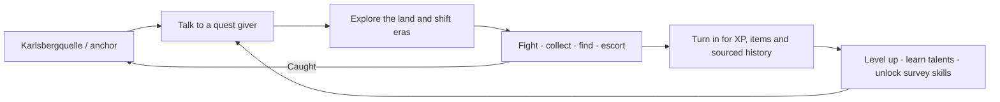
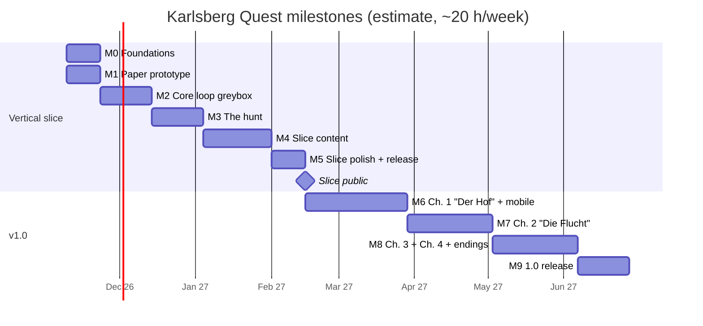

# Karlsberg Quest — PRD / Game Design Document (living)

> Version 0.8.0 · 2026-11-23 · Owner: schloss-karlsberg maintainers · First idea paper (archived): [`archive/IDEA.md`](archive/IDEA.md)
> Status: **in production — action RPG with a guided-tour opening.** The full campaign is playable (D-006) as an
> action RPG with quests and fights (D-008). Since v0.7.0 a new game opens with the **guided tour** of the Karlsberg
> (D-010): the time travel starts at the Karlsbergquelle, and every ending closes with a party. The tour's design and
> the owner's decisions are in [`design/tour/README.md`](design/tour/README.md); the action-RPG spec is
> [`ACTION-RPG.md`](ACTION-RPG.md). Where they and this file disagree, the newer decision wins.
>
> **Concept change (D-010, 2026-11-20).** The game started as "a LiDAR surveyor with a field book, a Feldstation /
> Bauwagen and a lantern". That framing is retired: the player is an ordinary visitor on a guided tour. Passages
> below that still describe the earlier concept are marked as history or as legacy code that TASK-007 removes.

## 0. How this document works

This is the single, living source of truth for the game. It lives in the repo, next to the code.

- **Decisions** go into the [decision log](#12-decision-log) with a date and a reason. History is never rewritten.
- **Open questions** stay in [§11](#11-risks--open-questions) until answered, then move to the decision log.
- **Milestones** ([§10](#10-milestones)) are updated when one exits. Scope cuts are written down, not quietly dropped.
- Facts in the game need a source; fiction is labelled as fiction. The same rule applies to this document.

| Version | Date | Change |
| --- | --- | --- |
| unreleased | 2026-11-28 | **Faster merge signal (TASK-094).** Every pull request runs the four gates in about a minute. The hosted Playwright run picks its specs from the changed paths: none for docs, task files and unit tests, the covering specs plus smoke for a feature system, the full suite for shared code. The full suite still runs after every merge and in the merge queue, and a red run on `main` opens an issue. No change for players. |
| unreleased | 2026-11-28 | **Calmer ambience captions (TASK-079).** „Vögel zwitschern.“ and the 1789 hoof and court captions appear when the sound starts and then at most every 30 s instead of on every chirp, so they no longer crowd out story captions. |
| unreleased | 2026-11-28 | **Each line once (TASK-093).** The same caption no longer stands twice in the subtitle box; a repeat keeps the line up longer. The quest tracker no longer lists the story's wording of a step under the quest goal when both name the same step („An der Quelle: E – das Wasser berühren“). No key prompt shows under an open conversation. Laub explains „VAT“ (Visualisierung für archäologische Topografie) when the third relief view unlocks. |
| unreleased | 2026-11-28 | **Chestnut distraction review (TASK-095).** Chestnuts hit the first obstacle or body they reach. Watchers follow their court heading, stay wary for 20 seconds after returning and ignore landing noises at Misstrauen. Input mutes cancel held or buffered throws. Throw animations expire while the avatar is hidden and clear on teleport. |
| unreleased | 2026-11-28 | **Kastanien lenken Wachen ab (TASK-095).** A chestnut that lands within about 12 m of a court watcher makes it turn, walk over, look around for a few seconds and walk back; its fan goes with it, so the player can pass behind. Afterwards it is wary for 20 s and only turns its head. The gate's inspector keeps the gate. A chestnut that strikes a watcher, or a throw a watcher sees, raises suspicion instead. A thrown chestnut also shakes down the hanging Fläschchen, and the avatar throws with its arm. `docs/ACTION-RPG.md` §7.1. |
| unreleased | 2026-11-28 | **Kastanien werfen, Farn abschlagen (TASK-090).** F throws a chestnut where the view points (hold to see the arc; on touch the „Kastanie“ button, shown while there are chestnuts). It stings and briefly staggers small enemies, wakes one out of a pack, makes the tour's deer look up and draws one hound of a calm patrol to the spot. The staff now cuts ferns, flower clumps, low bushes and grass, which grow back after 75 s; about one fresh plant in five or six hides a chestnut. In the guided tour the borrowed Messstab swings at plants although fighting stays off. `docs/ACTION-RPG.md` §7.1. |
| unreleased | 2026-11-28 | **The Karlsbergquelle is back in view, on the right of the gorge (TASK-087, TASK-081).** The spring had not been removed, but „Weiter“ opened the title on its bare ground (sets and water were not built under the title), and on the tour it stood on the left of the path with the group on the slope behind its wall. It now stands at the foot of the south-west flank, on the right for people walking up from the Karlsbergweiher (local 1058.5/−831.0 facing 24°, before 1061.0/−834.5 facing 234°; evidence: the OSM node lies right of the footpath inside its hairpin, the 1 m LiDAR shows the hollow and the brook's channel there). The trough stand, wake spot and Q-return keep their place (1059.3/−833.1) and now face the other way. The brook runs visibly beside the trail, the trough overflows in a small fall, ferns and mossy boulders fill the shaded hollow, the guide stops before the spring and the group leaves the trough free. At the break, „Nachsehen, was im Trog glänzt“ offers E „Untersuchen“ anywhere before the trough. The title backdrop of a save shows the spring. |
| unreleased | 2026-11-28 | **Crouching no longer folds the character (TASK-091).** Crouched and standing still, the character's torso swung round the waist until the head hung upside down at knee height. The lean of the crouch was added again on every drawn frame, because the animation system only writes a bone when its value changes and the waist bone holds still in the player's clips. The crouch is now a real pose: knees bent, a lean at the waist, the head up and the feet on the ground, standing still and sneaking, in both outfits. The same flaw could twist the neck of a person looking at you; it is fixed with it. |
| unreleased | 2026-11-28 | **Travel in time once and stay (TASK-089, D-012).** Touching the water at the Karlsbergquelle is the journey. Before, the tour showed 1789 for a moment, faded to black and took the visitor back to the present, and „Der Hof“ opened the next morning with a second touch. Now the tour ends at the touch: the visitor keeps control in 1789, Laub's lines play while they look around, and „Der Hof“ begins where they stand, with the coat at the Bleiche as the first objective. Nobody stands on the arriving player any more (the servant waits in the Orangerie). Saves from the old opening continue without a touch: one waiting for the second touch loads in 1789 at the spring. Chosen from Pause → Kapitel, „Der Hof“ starts at the spring in the present, where Q leads back into the summer. Laub's arrival line lost its last sentence („Für heute genügt ein Blick.“); its recording was cut from the same take. |
| unreleased | 2026-11-28 | **People are solid (TASK-092).** Marlene at the pond and the people of the 1790s (the Hofgärtner, Liese, Hanne, Soll, Jost, the Gardisten and the others) were drawn as translucent smoke figures with mist at their feet, a look left from the time when they were memories. They are now living people: opaque, lit by the world, with shadows, on every graphics tier, and Marlene wears her own clothes instead of a tricorn. A person fades in over a third of a second and is then fully opaque. The old Pikeur at the kennel in the present stays a ghost. |
| unreleased | 2026-11-27 | **The mouse reaches „Überspringen“ and „Weiter“ (TASK-070).** On desktop, choosing an ending closed the chooser, which asked for pointer lock, and the lock arrived after the staged ending had appeared. The cursor stayed captured, so a mouse click could not reach „Überspringen“; only Esc, Space or Enter skipped. „Zum Titelbild“ in the pause menu had the same race over the title. The game now frees the mouse when the staged ending starts, and it releases any lock that lands after it let go of the mouse. Touch play has no pointer lock and was not affected. |
| unreleased | 2026-11-27 | **Hosted end-to-end tests (TASK-070).** Pull requests and pushes to `main` run the Playwright suite across up to 16 single-worker shards that share one build. Hosted tests default to 640×360 with SwiftShader. Manual runs can select spec files. Failed shards retain browser diagnostics, and machine-dependent timing and real-GPU checks run locally. |
| unreleased | 2026-11-27 | **No empty guide dialogue (TASK-076).** A person offers „E Mit … sprechen“ only while there is something to say. At the later tour stops, where the guide talks through the radio box, pressing E no longer opens a dialogue with only „Auf Wiedersehen“. His car-park talk stays at the car park: a player who skipped it does not hear it at the Felsenpfad. |
| unreleased | 2026-11-27 | **Markers for „dort: Q“ goals (TASK-083).** An objective that asks you to walk somewhere and shift time there (the chapter 1 to 4 openers, e.g. „Im Ehrenhof: Q – in den Juli 1793“) shows its marker, distance and beam in the present too; before, the place was tagged with the destination era and hidden until after the shift. The stall hint says „Zur Markierung gehen …, dort Q halten“. |
| unreleased | 2026-11-27 | **„Mit dem Hofgärtner sprechen“ (TASK-078).** The talk prompt names the person in the dative: „E Mit dem Hofgärtner sprechen“, „Mit einem Gardisten“, „Mit einem Lakaien“, „Mit dem zweiten Gärtner“, „Mit dem Diener“ and, at the party, „Mit Herrn Soll“, instead of „Mit Der Hofgärtner sprechen“. Names without an article („Mit Hanne sprechen“) are unchanged. |
| unreleased | 2026-11-27 | **Paced test draws (TASK-075).** The `kq.step` / `kq.press` debug hooks draw on the GPU only once it has finished their previous draw. Otherwise they prepare the frame, and the next animation frame paints it (`kq.step(n, { draw: true })` forces a draw). Unpaced synchronous draws let software WebGL on hosted e2e runners fall minutes behind, and headless-shell Chromium grew by about 30 MB/s per process until the runner ran out of memory. Players are not affected: game code never calls these hooks. |
| unreleased | 2026-11-27 | **Captions clear of the cards on phones (TASK-074).** On a landscape phone the level card and the standalone skill card step aside while a sound caption is shown under the dialogue (spoken subtitles do not hold them), so the line is never covered; the card's reading time pauses and it returns when the line has gone. Desktop, tablets and reduced motion are unchanged. |
| unreleased | 2026-11-27 | **Captions stay readable (TASK-073).** Each subtitle line, sound captions included, stays on screen for at least 1.5 s before a newer line may push it out of the three-line box; lines that arrive while the box is full wait in order and are not lost. The tour's „[Diane und Bijou bellen]“ no longer vanishes as the dialogue starts. |
| unreleased | 2026-11-27 | **Wegweiser on the frozen lake (TASK-071).** In February 1793 the trail and the „Weg“ marker lead across the walkable ice instead of hiding there; open water still blocks them. |
| unreleased | 2026-11-27 | **Ending card after a reload (TASK-068).** A save taken during an ending scene or while its closing card is up shows the closing card again after title Continue or a pause-menu load, then the epilogue as before. Once the card is dismissed (the game checkpoints then), a reload opens the epilogue directly. Older saves from that stretch cannot tell the two apart and show the card once more. |
| unreleased | 2026-11-27 | **v0.5.0 ending saves (TASK-069).** A v0.5.0 save made right after its credits (story finished, still on beat e2, combat off) now loads into free play with combat back on, the free-play hint and the post-game party, without replaying the ending. |
| unreleased | 2026-11-27 | **Party reload position (TASK-067).** An old e3 save written while the credits rolled but still at the spring (its arrival teleport was lost) now loads at the party on the plateau, on boot and on an in-session load. |
| unreleased | 2026-11-27 | **Chapter 2 progress and resume (TASK-042).** The Orangerie and Wachhaus no longer advance past unpaid main quests; older saves can still unlock the Wachfeuer after clearing the lights. Shifting during Jost's horn lead-in no longer sets the pack loose in the present, and a save or title Continue made before the pack appeared lets the hunt restart. |
| unreleased | 2026-11-26 | **Legacy ending recovery (TASK-045).** Continue restores the epilogue's party button when needed, preserves identifiable plateau positions and recovers the missing free-play hint. Older chapter replays regain the ending choice and can earn the Keep return route again. Fresh replays play the finale dialogue again. |
| unreleased | 2026-11-26 | **Ending saves and chapter replay (TASK-045).** Continue remembers a confirmed choice and completes a pending trip to the party. Credits checkpoint free play, including the Keep return route. Loading another slot does not complete its credits, and replaying the endings starts a fresh choice. |
| unreleased | 2026-11-26 | **Galerie auf dem Handy (TASK-006).** Every photo with signal is now kept on the device and survives a reload. The gallery (G on the phone, the „Galerie“ button on touch, or Pause → Album) shows the photos newest first, opens one full-size with swiping, and can delete, download or share it through the system's share sheet (WhatsApp, Signal, AirDrop …; a download where sharing files is not supported). Up to 100 photos; the gallery explains that they live only on this device. |
| unreleased | 2026-11-26 | **Encounter hazard cleanup (TASK-028).** Removing the pack that triggered a falling stone or ember rain cancels the warning and pending damage. Other encounters keep their attacks. |
| unreleased | 2026-11-26 | **Combat, hunt and skills coverage (TASK-028).** Removing an encounter clears its airborne attacks. Ordinary snow prints expire alongside the Warner’s longer-lived trail. Standalone skill unlocks wait for the shared card slot. Added unit coverage for these transitions, saved combat groups, RPG stats and rewards, and paused and reloaded unlock cards. |
| unreleased | 2026-11-26 | **Chapter 3 garden turn-in and dialogue (TASK-037).** Continue makes „Der Festsaal“ ready for Hanne when the repaired save has every required objective. Laub's transition line precedes his quest offer at „Hinauf“ and „Zum Zwinger“, and both quests start in time for the autosave. |
| unreleased | 2026-11-26 | **Chapter 3 autosaves (TASK-037).** The first saves at „Hinauf“ and „Zum Zwinger“ include their mandatory quests. Continue repairs missing quest state in the Festsaal, garden and kennel while preserving earned objective counts and completed rewards. |
| unreleased | 2026-11-26 | **Corrupt save fields (TASK-053).** A save with a damaged field in the animal, combat, bottle, photo, progression, quest or walker data still loads with defaults for that field instead of breaking the system. Missing stamina, Bannlicht or deer flight radii start at their defaults, and duplicate or retired bottle IDs no longer count towards the collection. Seeded tests cover all 19 saved system slices. |
| unreleased | 2026-11-26 | **Motion and accessibility review fixes (TASK-032).** The camera checks its extended shoulder path before cutting outward. Torch-lit windows, reflected Bannlicht, the fireworks finale, survey markers, loot and party lights retain steady cues. The OS preference can select static credits, „Neuigkeiten“ opens at the newest entry, and the playtest pilot applies inline choices. |
| unreleased | 2026-11-26 | **Motion and keyboard accessibility (TASK-032).** „Weniger Bewegung“ keeps the title view and map markers still, cuts the spring camera, shortens story fades and suppresses full-screen flashes and selected particle effects. The title, Pause, Einstellungen and journal pages show keyboard focus and return it to the opener or refreshed control. Icon-only controls use German accessible names. |
| unreleased | 2026-11-26 | **Autosave backoff (TASK-031).** The first failed autosave can retry immediately. After consecutive failures, autosave requests wait one second between attempts so a burst of progress updates cannot repeatedly hit unavailable storage. |
| unreleased | 2026-11-26 | **Saving and input between updates (TASK-031).** A failed autosave keeps the last saved time and can retry immediately. Opening or closing a menu and losing focus clear queued actions, turns and zoom. Disabling touch cancels pending taps. Two fingers on Hieb sustain one charge until the last finger lifts. |
| unreleased | 2026-11-26 | **Photo mode review fixes (TASK-017).** The lantern choice and Gerold's good-photo reaction lower the phone. The viewfinder hides measuring controls and quest giver glyphs. Continue points the deer objective at the doe's saved position. At 2× zoom the timed fallback works beyond 27 m even at 95° field of view. |
| unreleased | 2026-11-26 | **Tour photo mode (TASK-017).** The phone clears gameplay overlays on desktop and touch. A crouched player can frame the doe and fawn from 20–25 m at 2× zoom. The pair graze in a clearer spot, react sooner to an upright player, and Gerold's reaction reflects the doe's state when the shutter fires. |
| unreleased | 2026-11-26 | **Urgent dialogue and pack validation (TASK-029 review).** The dodge tutorial can interrupt dialogue with every waiting slot filled. Pack discovery accepts regular files and links to regular files. |
| unreleased | 2026-11-26 | **Quest and story reliability (TASK-029).** Interrupted memories release their scene without advancing quests or the story. Chapter replay starts with fresh reaction timers, and crowded dialogue retains story lines ahead of barks. Content validation skips directories named like pack files. |
| unreleased | 2026-11-26 | **Heavy-job slots follow-ups (TASK-064, dev tooling, no player-visible change).** `heavy.sh` tells its job the mode (`KQ_HEAVY_MODE`). The mobile UI tour, the storyboard and `look.mjs` refuse a normal slot and take their port from the slot. In slot k ≥ 1 the Playwright output and screenshot dirs get a `-slot<k>` suffix, so two jobs from one checkout no longer clobber each other. The walk, framerate, perf and real-GPU runs warn when they share the machine. |
| unreleased | 2026-11-26 | **Chapter 2 sneak with working sentries (TASK-065).** The three hounds in „Augen im Nebel“ walk their beats instead of running off along the Warner's trail. While they keep to their beats they notice you only by sight and hearing, as their cones show, and ignore your prints in the frost. Once they have noticed you, they follow your prints from where they lost you. |
| unreleased | 2026-11-26 | **Autosave protection (TASK-024 review).** Malformed system slices make a save unavailable to „Weiter“. If another tab writes a different autosave during „Neues Spiel“, the title asks before replacing those bytes. A cancelled or failed setup preserves the slot. |
| unreleased | 2026-11-26 | **Unreadable autosaves (TASK-024).** The title explains when the autosave cannot be loaded and offers „Weiter“ for readable saves, including saves that need migration. Cancelling „Neues Spiel“ preserves the occupied slot byte for byte. |
| unreleased | 2026-11-26 | **Read-only playtests and campaign pacing (TASK-019 review).** „Weiter“ loads the autosave, including after returning to the title from a `?nosave` session. Read-only new games open the content warning directly. A deferred paint reuses the prepared presentation, and the campaign skips the K3 station's cosmetic wait when chapter screenshots are off. |
| unreleased | 2026-11-26 | **Campaign testing and save protection (TASK-019).** Manual campaign tests can use subtitle timing and draw once after a batch of steps. The travel and group-walk tests bound work independently of machine speed. Starting „Neues Spiel“ with `?nosave` preserves the stored game. |
| unreleased | 2026-11-26 | **Minimap review fixes (TASK-015).** The Registratur marker leads through the doorway, and historical paths follow the in-game terrain over the survey. On landscape phones, notices clear long action labels. The minimap steps aside for staged scenes and the touch survey menu. |
| unreleased | 2026-11-26 | **Minimap (TASK-015).** A north-up corner map shows nearby paths, the current objective, the player's heading and the guide and group during the tour. It switches with the era, fits beside the landscape touch controls and can be switched off under Spiel → „Minikarte“. |
| unreleased | 2026-11-26 | **Heavy-job slots (TASK-063, dev tooling, no player-visible change).** `scripts/dev/heavy.sh` runs up to three normal heavy jobs at once (`KQ_HEAVY_SLOTS`, default 3; 1 restores one at a time). `--exclusive` takes every slot, for the walk, framerate and perf specs, real-GPU runs and local model runs, and jobs queued behind an exclusive ticket wait for it. Waiters running an older heavy.sh keep slot 0 and their place in the queue. |
| unreleased | 2026-11-26 | **Heavy-job slots (TASK-063, dev tooling, no player-visible change).** `scripts/dev/heavy.sh` runs up to three normal heavy jobs at once (`KQ_HEAVY_SLOTS`, default 3; 1 restores one at a time). `--exclusive` takes every slot, for the walk, framerate and perf specs, real-GPU runs and local model runs, and jobs queued behind an exclusive ticket wait for it. Waiters running an older heavy.sh keep slot 0 and their place in the queue. Inside slot k the e2e preview server defaults to port 5281 + k (CONTRIBUTING.md). |
| unreleased | 2026-11-26 | **Court return and cinematic recovery (TASK-055 review).** Holding Q during a court escort returns the player to the present with movement restored, including with reduced motion. An autosave flushed during cinematic disposal keeps the interrupted shot ID so loading it completes the shot as skipped. Tests cover both active gate inspection timers on reload. |
| unreleased | 2026-11-26 | **Cinematics and court escorts (TASK-055).** Consecutive shots restore the player's gameplay field of view. Loading a save or changing eras cancels the court escort and returns movement control. Coverage includes keyboard and touch skip, pause, reduced motion, gate inspection and the Bleiche layout. |
| unreleased | 2026-11-26 | **Palace and scenery continuity (TASK-059).** An indoor save restores the occupied storey, also while the palace still loads and from a doorway. Shifting reports the room left, sets an open Festsaal choice aside until the player returns and releases departed scenery obstacles. Loaded slots restore their coat, gate and window lighting. |
| unreleased | 2026-11-26 | **Hunt and exploration persistence (TASK-058).** Loading restores the configured pack and cancels a pending capture. Bottles follow the loaded encounter and memorials, and partial pickup stacks retain their visible remainder. Survey skills are rechecked, unfinished measurements close, and the notes clock resumes from its latest flush. |
| unreleased | 2026-11-26 | **Shared-link look input (TASK-060).** A shared starting heading wraps within one turn, keeping horizontal look responsive even for very large finite `yaw` values. |
| unreleased | 2026-11-26 | **Core regression sweep (TASK-060).** Shared links preserve the current pose when coordinates are invalid. A failing event observer no longer interrupts gameplay listeners, and a rejected system dependency cycle can be corrected and retried. Translation lookup handles missing keys and placeholders consistently. Terrain loading rejects incomplete height samples and ground or canopy layers of the wrong size. |
| unreleased | 2026-11-26 | **Progression review fixes (TASK-052).** Validation checks arrival destinations, pickup consumption, inline choice prerequisites, reaction timing and actual quest turn-ins and chapter resets. Laub's basket cue also checks that Hanne's basket is still uncollected when an older save resumes. |
| unreleased | 2026-11-26 | **Static progression checks (TASK-052).** Content validation follows beat and quest prerequisites, checks item and event timing, and flags conflicting dialogue ids. In chapter 3 Laub's basket cue now fires when the fourth required Raffschatten falls. |
| unreleased | 2026-11-26 | **Card timing (TASK-062).** Skill unlocks and level-ups count visible game time through their stamp and dismissal. Manual e2e checks advance the card and its shared UI slot with a fixed step budget. |
| unreleased | 2026-11-26 | **Shift warm-up and title fade (TASK-056 review).** Shift teardown releases buffers uploaded during shader warm-up, including sessions that end before the first shift. Returning to the title during its fade keeps the menu visible. Regression tests check phone key listener reuse and verify that echo whispers schedule a stop before releasing ambience ducking. |
| unreleased | 2026-11-26 | **Transition resource cleanup (TASK-056).** Replaying staged effects and Festsaal choices releases retired buffers and materials. Era changes clear old interior records. Stage and shift teardown releases their listeners and reusable render resources. Deterministic tests check that resource counts stay bounded across repeated transitions. |
| unreleased | 2026-11-26 | **E2E regression coverage (TASK-050 review).** The tour-walk spec pairs hidden and visible work at matching poses and ticks and checks main-view geometry for all 16 bodies. Render-pacing checks observe held frames and verify that paced drawing resumes after the forced redraw. The voice spec reports any active dialogue that outlasts its tick budget. |
| unreleased | 2026-11-26 | **Load-robust e2e checks (TASK-050).** The ending C regression test advances the story on game ticks. The tour-walk spec compares fixed-frame draw-call and triangle counts. Render-pacing checks use the active cap and synthetic frame timestamps. |
| unreleased | 2026-11-26 | **Rendering and FX recovery (TASK-061).** Moving between displays respects the resolution slider and active tier. Restoring WebGL refreshes the held view and its lighting. Bloom retains detail across blur levels. Low-tier scans and active Steinfraß effects follow their particle budgets. Pausing interrupts an automatic downgrade. |
| unreleased | 2026-11-26 | **Player transition fixes (TASK-057 review).** Losing a held mouse attack in Pause cancels the charge. The shoulder camera stays on the player’s side of thin walls. Spirit flight resumes without drift and continues its automatic climb. The avatar faces the arrival direction as soon as fast travel places it. |
| unreleased | 2026-11-26 | **Player controls and camera transitions (TASK-057).** Losing pointer lock clears queued mouse input. The shoulder camera clears a side wall on contact. Placement after a reload or teleport starts a fresh footstep and head-bob cycle, frozen spirit flight holds in place, and the avatar faces the current view when it reappears. |
| unreleased | 2026-11-26 | **Audio and capture review fixes (TASK-054).** Loading or starting a game during capture dismisses its curtain, restores movement and discards its deferred dialogue and wake teleport. Idle barks wait for 60 seconds of inactivity in the new session. The latest playback request keeps fetch priority while the voice manifest loads, and a full queue evicts its oldest background preload first. Tests verify timed water and score fades. |
| unreleased | 2026-11-26 | **Audio playback and save transitions (TASK-054).** Loading clears the previous session's dialogue, speech ducking and pending bark requests. The loaded save keeps its bark cooldowns. The current line's recording takes the next available download slot when a full queue forced a murmur. Regression tests cover volume persistence, audio activation, pause and era changes, water and score fades, and footsteps. |
| unreleased | 2026-11-26 | **Tour crowd and dog saves (TASK-022 review).** Skinned visitors have sort bounds ready before they enter view. Dogs saved mid-reversal stay planted until they face their destination. Tour regressions check delivered wait dialogue and the touch rotation flow. |
| unreleased | 2026-11-26 | **Tour review fixes (TASK-016).** Both dogs can round occupied waypoints during the Wind sequence. The camera eases back out after clearing a ridge. Loading an unfinished departure replays Gerold's line, while saves made on the walk retain the group's progress. Muted subtitles type silently. |
| unreleased | 2026-11-26 | **Tour dogs and visitors (TASK-022).** Diane and Bijou move with the group through fades and pause to turn on sharp reversals. Visitors draw opaque when they appear, and the group continues uphill while the player examines the Bussole. A regression check covers Gerold's wait bark. |
| unreleased | 2026-11-26 | **Tour staging (TASK-016).** The Wind shot follows both dogs from above the hillside. Visitors face Gerold at stops and give the player and dogs room. Gerold finishes the departure line before walking. The Felsenpfad group gathers on the trail, the camera pulls in around the rock face, and dialogue sits above the player. |
| unreleased | 2026-11-26 | **Guided-tour audio cues (TASK-010, slice 4).** Synthesized barks follow the dogs' runs, and leaves rustle at the start of the deer shot. Footsteps crunch on gravel and are uncaptioned like other footsteps. German sound captions include the Bussole at the Quelle and the outdoor ambience. The existing SFX and ambience controls and speech ducking apply. Checks cover Gerold's narration and the walk's beds, including the ascent to the plateau. The voice directory ships at 12.97 MB of the 80 MB limit. |
| unreleased | 2026-11-26 | **Wegweiser routes (TASK-026).** The trail no longer draws its first or last leg through a wall. It tries other approaches when the last leg to a free destination is blocked, and stops at the reachable approach when a wall or blocked goal prevents arrival. It still appears for a player pressed against a wall or wading in the shallows. An enclosed player sees no trail if there is no reachable leg. Clear straight routes still appear without a search. |
| unreleased | 2026-11-26 | **Desktop epilogue controls (TASK-039).** Weiter keeps the mouse free while the restored epilogue is open, so Abspann can be clicked. |
| unreleased | 2026-11-26 | **Epilogue resume (TASK-039).** Weiter restores the saved epilogue for all three endings. Abspann starts the matching celebration and credits. Ende noch einmal wählen loads the pre-choice save. |
| unreleased | 2026-11-26 | **Palace performance review (TASK-021).** The benchmark checks room tracking after exterior teleports and pairs fixed and advancing fire samples. Its stills hold a fixed visual clock. Fire lights reuse four slots, and the interior builder writes spark data directly into instance buffers. Hardware acceptance remains open. |
| unreleased | 2026-11-26 | **Palace and Festsaal performance (TASK-021).** The palace sun-depth pass skips surface shading, shell clipping rejects fragments outside the cut bounds, and Festsaal embers use small spark quads. Hardware timing and matched look checks are pending. |
| unreleased | 2026-11-26 | **Cache level-up saves (TASK-025).** Clearing a guarded cache saves the player's new HP together with the level when the XP reward triggers a level-up. |
| unreleased | 2026-11-26 | **Consumable and cache checkpoints (TASK-025).** Using a supply saves its inventory change and effects together (Kalkstaub on the regular autosave interval). Defeating a guarded cache's last guard saves the cleared guards, the opening, every seeded pickup and its XP in a single checkpoint. Lampenöl lights the lantern, adds half a tank up to capacity and restores up to two Bannlicht charges. |
| unreleased | 2026-11-26 | **Consumable and cache checkpoints (TASK-025).** Using a supply saves its inventory change and effects together. Clearing a guarded cache saves the opening, every seeded pickup and its XP in a single checkpoint. Lampenöl lights the lantern, adds half a tank up to capacity and restores up to two Bannlicht charges. |
| unreleased | 2026-11-26 | **Fast travel saves and curtains (TASK-030).** Fast travel autosaves at the destination, and the tour group responds on the first tick after loading that save. Returning to the title before arrival cancels the trip and saves the departure position. Returning to the title, loading a save or starting a game immediately clears a fading travel curtain. |
| unreleased | 2026-11-26 | **Travel and world logic (TASK-030).** Loading during fast travel preserves the loaded position. Long sprints lose their boost on release and combat resumes its own movement speed immediately. Capture returns preserve the shift count. Shared palace doors stay blocked while either room is collapsed. Wading uses the occupied pond, and circular bodies can clear the corners of scenery props. |
| unreleased | 2026-11-26 | **Chapter 2 Pikeur regression coverage (TASK-036 review).** The browser scenario starts at the dam in February 1793 and marks the earlier echoes as heard so E starts Landremont after the fight. Unit tests guard both setup steps. |
| unreleased | 2026-11-26 | **Chapter 2 Pikeur quest credit (TASK-036).** Players can repel the Pikeur before hearing the Orangerie echo and still finish „Die Parforcejagd“. Stalled saves recover on load from the recorded encounter clear, with the boss payout awarded only by the original fight. |
| unreleased | 2026-11-26 | **Chapter 4 kennel cues and touch save reloads (TASK-035).** During „Sich stellen“, the reminder points to Landen in flight, Hinlegen while standing or crouching, and Laterne once prone if the lantern is still needed. Choosing „Ende noch einmal wählen“ from Pause refreshes the touch controls after the save puts the player back on foot. |
| unreleased | 2026-11-26 | **Chapter 4 kennel on touch (TASK-035).** Tap Hinlegen and Laterne to settle the pack in „Sich stellen“. One-key mode settles it with Hinlegen alone. A save made while the pack was waiting can continue with the new controls. |
| unreleased | 2026-11-26 | **Die Enge combat autosaves and warning (TASK-038).** Autosaves preserve every kill's earned XP and loot from the same combat tick. At the present-day wake point, Laub's reinforcement warning waits until the player returns to 1789. |
| unreleased | 2026-11-26 | **Die Enge save recovery (TASK-038).** Loading between waves restores all four reinforcements, including in previously stranded saves. Loading during the second wave restores its survivors and preserves earned XP and loot. |
| unreleased | 2026-11-26 | **Jaguar reward timing (TASK-040).** Accepting „Der Jaguar“ after an early calm saves the reward while Hanne’s conversation is still open. When a save recovers the quest at the title screen, „Weiter“ presents the reward dialogue and notice. No „Nebenaufgabe“ banner follows the payout. |
| unreleased | 2026-11-26 | **Saved jaguar quest credit (TASK-040).** Driving the jaguar away before accepting „Der Jaguar“ counts when Hanne’s quest is accepted. Loading an active save stuck at 0/1 also credits the saved calm and pays the quest reward once. |
| unreleased | 2026-11-26 | **Survival objectives in Aufgaben (TASK-047).** Progress counts and checkmarks use the same objective targets as the quest engine. A survival bonus requires at least one second of saved progress to be checked after turn-in. |
| unreleased | 2026-11-26 | **Pause pages (TASK-047).** Aufgaben clears the displayed quest’s unread mark immediately and no longer checks skipped bonus objectives after turn-in. On the map, Enter respects the same 25 m minimum travel distance as the button. |
| unreleased | 2026-11-26 | **Campaign encounter review fixes (TASK-048).** Saves restore cassowary dodges and jaguar flares, including an earned lead-home action. Menagerie animals separate on walkable ground. Deer reload during a departure when their follow chain reaches a leader with a destination. Scripted snow trails limit sampling even with tiny strides. |
| unreleased | 2026-11-26 | **Campaign encounter regressions (TASK-048).** Hounds ignore the Warner's prints; held tracks no longer keep faded prints readable, and invalid strides use ordinary spacing. Loading no longer transfers cassowary misses or jaguar flares from discarded play, or hides a departing fawn. Overlapping menagerie animals separate without jumping across the path. Switching to gentle mode stops a jaguar's pending pounce. |
| unreleased | 2026-11-26 | **Tour controls and revision labels (TASK-034 review).** The touch deer tutorial highlights Fotomodus and then the shutter. The sprint hint calls for full stick travel. The Zeitsprung button announces regrouping while it is available. The controls help and loading tip describe holding Q, and the public news footer uses „Stand“. |
| unreleased | 2026-11-26 | **German player-facing text (TASK-034).** Aligned settings, prompts, accessible labels and content with the [player-facing glossary](design/glossary.md). The map uses „Reisepunkt“, time travel is a „Zeitsprung“, and missing translations show a German fallback. Recorded dialogue text stays as published. |
| unreleased | 2026-11-26 | **Accurate shortcuts in Steuerung (TASK-027 review).** The reference shows Escape for Pause and marks a bound Shift key as a standalone reverse Relief-Blick shortcut. The settings editor and reference use the layout's printable key labels. The phone toggle is described for every era. |
| unreleased | 2026-11-26 | **Current keys in Steuerung (TASK-027).** The pause reference shows the player's saved bindings, including alternate keys, unbound actions and survey tools. It uses the settings editor's keyboard-layout labels and reflects a reset to the current defaults. |
| unreleased | 2026-11-26 | **Phone HUD clearance (TASK-020).** The credits use the safe width and hide gameplay touch controls until dismissal. Standalone skill unlocks fit below dialogue on short screens and can be dismissed with a touch on the play surface. Long HUD hints and combat callouts wrap clear of the thumb arc and the vitals. |
| unreleased | 2026-11-26 | **Phone credit gestures and skill notice timing (TASK-020 review).** A drag on the play surface takes back the camera while the credits continue. Short-screen unlock notices defer or pause while the movement stick is held. Early dismissal still queues Laub's eligible remarks. |
| unreleased | 2026-11-26 | **Touch surface during the credits orbit (TASK-020).** The cinematic leaves the play surface active during the orbit so phone players can drag to take back the camera while the credits keep moving. |
| unreleased | 2026-11-26 | **Chapter 4 Continue fixes (TASK-044).** The saved 1840 echo credits the well visit, including in saves already at the drive or kennel. The Pacht cutoff pays a ready quest and reports failure once. Continue finishes an interrupted dawn arrival and preserves the player's position and heading after reaching the spring. |
| unreleased | 2026-11-26 | **Chapter 4 progress recovery (TASK-044).** Continue restores missing quest starts at the note, Steinbrecher, well and kennel, completes the shift into today, and marks the kennel on the drive. The finale keeps earned progress toward the horn, and dawn at the spring records both final clues before the endings. |
| unreleased | 2026-11-26 | **Fixed-step and render performance (TASK-033).** Input polling and flight reuse temporary values, wading samples each position once per step, and steady views reuse terrain batches. The hunt overlay skips redundant style updates and keeps sound directions responsive to viewport changes. See [the performance guide](PERFORMANCE.md#38-fixed-step-and-render-hot-paths-task-033-2026-11-26). |
| unreleased | 2026-11-26 | **Chapter 1 save recovery review (TASK-041).** Older replays clear leftover Die Enge packs before the encounter and keep clears after it. Continue recovers missing Schuldbuch kill rewards from first-drop autosaves. New kill autosaves capture vitals after level-ups. |
| unreleased | 2026-11-26 | **Chapter 1 progress recovery (TASK-041).** Continue repairs older arrival saves, partial combat saves and an already calmed Kasuar. Combat autosaves keep kill credit and drops together; a Chapter 1 replay starts Die Enge with fresh packs and keeps earned quest rewards. |
| unreleased | 2026-11-26 | **Chapter 3 recovery (TASK-043).** Continuing brings back an undecided Festsaal choice; retries keep a choice already made without another charm payout, and Hanne accepts the turn-in after a retry. The choice timer waits while the player is away. The fire-night jaguar returns in the right era after loading, partial Bannlicht flares survive chapter selection, and the stall hint explains how to drive it home. |
| unreleased | 2026-11-26 | **Review fixes for optional progress (TASK-046).** K3 replay keeps Peter available through the opening quests and preserves earned quest rewards. Pacht retries recover collected slips and the deadline follows the shift to today. The completion autosave records free-roam guidance, and older saves recover the ending replay hint when that slot exists. |
| unreleased | 2026-11-26 | **Optional progress and post-story guidance (TASK-046).** Already-homed cassowaries and previously collected quest pickups count. Missed side quests respect their original story deadlines but can be retried through Kapitel. Shaken-down and collected bottles save immediately; old complete collections recover their final reward. The post-credits Pause hint is saved and restored. |
| unreleased | 2026-11-26 | **Immediate tour waypoint handoff (TASK-018).** When the Weiher dialogue ends, the compass and world marker point to the Karlsbergquelle on the next frame instead of waiting for the next routine marker refresh. |
| unreleased | 2026-11-26 | **Tour resume and HUD fixes (TASK-018).** Continue plays the remaining parts of Laub's introduction and preserves the unlocked trough action once he is done. The guide label has its own row across the compass, the chapter card waits while the tab is hidden, and eligible ending replay actions keep the title menu stable through loading. |
| unreleased | 2026-11-26 | **Tour wayfinding and spring handoff (TASK-018).** The trough is reachable from the forecourt. Picking up the Bussole immediately points the player to Laub, then his instruction unlocks the water action. The guide uses a gold compass diamond on a separate edge row and can call out during an ordinary bark cooldown. Cinematics and shifts hide interaction prompts, and the chapter card keeps its usual duration on slow frames. |
| unreleased | 2026-11-26 | **LiDAR terrain geometry (TASK-008, slice 7).** Mittel and Hoch stream 1 m terrain detail for dry banks and terrace edges near the present-day tour and palace. Walking, shores, the spring and the ground under existing fittings use the base surface. |
| unreleased | 2026-11-26 | **Combined Pause pages (TASK-007, slice 10).** Sammlungen includes Funde alongside sets, the bestiary and bottles. I and Pause open one „Ausrüstung & Talente“ screen with both sections and the unspent talent-point badge on the Pause entry. Codex stays dedicated to sourced history and its fiction disclosures. |
| unreleased | 2026-11-26 | **Castle understory (TASK-008, slice 6).** Low shrubs and dry flower seed heads (FIKTION) follow canopy edges and gaps at the present-day Weiher, Quelle and palace plateau. Trails, the spring and the fittings stay clear. Niedrig shows fewer plants with simpler silhouettes. |
| unreleased | 2026-11-26 | **Spring interaction and Pause chapters (TASK-007, slice 9).** At the Karlsbergquelle, „Wasser berühren“ appears when the story calls for it and the player can reach the water. Pause provides saving and a „Kapitel“ page for replaying unlocked chapters. Sammlungen shows the bottles collected so far. The spring remains the home and wake point. |
| unreleased | 2026-11-25 | **Palace plateau dressing (TASK-008, slice 5).** Present-day benches, low broken sandstone courses and verge stones follow dry ground beside the track through the former Ehrenhof. The fittings and layout are FIKTION. Niedrig keeps the benches and uses fewer stones. |
| unreleased | 2026-11-25 | **Collect chestnuts on the guided tour (TASK-002).** 24 chestnuts lie in small clusters along the route, a few just off the path. Pick them up with E, by walking over them, or with the touch interact button. The feed and Ausrüstung → Fundstücke show the saved count. Gerold remarks on the first, Herr Soll counts the twelfth, and finding all 24 earns a last word. The activity is optional and awards no XP. |
| unreleased | 2026-11-25 | **Kastanien sammeln in der Führung (TASK-002).** 24 Esskastanien lie along the paths the group walks, in small clusters, a few just off the path. Pick them up with E, by walking over them, or with the touch interact button; the feed counts them and the count is saved. Gerold remarks on the first (the old „Herzogskastanien“), Herr Soll counts the twelfth, and finding all 24 earns a last word. Optional, no XP, and the group waits as before. |
| unreleased | 2026-11-25 | **Hidden Bauwagen (TASK-007, slice 8).** The old trailer returns beside the forest track below the dam. Examining the door note unlocks „Die letzte Messung“, a FIKTION Codex card. The discovery is off the tour, maps, objectives, Bussole guidance and main story. The owner confirmed „Wissen“ as the talent heading. |
| unreleased | 2026-11-25 | **Ricke und Kitz in view (TASK-001).** When the group stops above the deer, a short skippable shot zooms in on the fawn, then the doe, while Gerold whispers. The camera stands a step ahead of the stop, so the shot works wherever the player waits. The sneak prompt follows the shot. |
| unreleased | 2026-11-25 | **Retired station and interface wording (TASK-007).** Continue updates old station return objectives and discards retired survey points while keeping chapter progress and POI discoveries. The visitor name defaults to „Alex“, and „Wissen“ is the talent branch heading. |
| unreleased | 2026-11-25 | **Guided-tour story bible (TASK-007).** Merged the opening, endings, Codex and voice drafts into [the story bible](../content/bible/00-overview.md). The bible records the shipped tour and handover, pending designs and historical chapter material. |
| unreleased | 2026-11-25 | **Staff handoff and survey controls (TASK-007).** Marlene lends the Messstab at the Weiher, with a pickup notice and the staff visible after equipping. Survey tools use 1–5 and M on desktop and the „Erkunden“ submenu on touch. Older tour saves and custom bindings are supported. |
| unreleased | 2026-11-25 | **LiDAR trail shading (TASK-008, slice 3).** Mittel and Hoch use the 1 m DGM to shade fine banks and hollows along the present-day tour and palace terraces. The shading fades toward the Weiher and at distance. The crop streams after play starts, and the walking surface uses the 2 m heightfield. |
| unreleased | 2026-11-25 | **Tour startup payload (TASK-008, slice 4).** The present-day title keeps the assets for Karlsberger Hof at the selected preset. The historic palace mesh and six architecture surface pairs stream after play starts. |
| unreleased | 2026-11-25 | **Trail dressing (TASK-008, slice 2).** The present-day tour has German wayfinding at Karlsberger Hof, Felsenpfad and the Weiher, with benches at the Hof and Weiher and low sandstone at Felsenpfad. The group path stays clear on every graphics preset. The exact fittings and placements are FIKTION. |
| unreleased | 2026-11-25 | **Surveyor content retirement (TASK-007).** Removed the former opening’s story, quest, clue and voice data from the active catalogs. Older saves still resume in „Der Hof“ with their history and earned rewards. The Bussole page remains part of the tour handover. |
| unreleased | 2026-11-25 | **Present-day ground cover on Niedrig (TASK-008).** The tour's open November verges have sparse dry grass and occasional flowers. Reeds follow the Weiher's shallow bank, and the gravel tread and Quelle steps and trough stay clear. |
| unreleased | 2026-11-25 | **Tour title and route map (TASK-007).** The title screen uses the working title „Schloss Karlsberg Tour“, with plain save actions and controls for the tour. A new visitor reads the content note, enters a name and sees the route from Karlsberger Hof via Felsenpfad and the Weiher to Karlsbergquelle. „Tour starten“ begins play and unlocks sound. |
| unreleased | 2026-11-25 | **Guide narration integration (TASK-010, slice 2).** The four tour stops use the reviewed German lines. Players can skip each subtitle, and the group waits before leaving. Gerold Imhoff’s speech batch is queued with the owner’s selection, the synthetic deep documentary voice D. [Tour script and sources](design/tour/sources.md) |
| unreleased | 2026-11-25 | **Guide narration and casting (TASK-010).** The [tour script](design/tour/sources.md) documents four German station sequences, their historical sources and the handoff to Laub. A local listening page compares three synthetic voices before recording. |
| unreleased | 2026-11-25 | **Tour ambience and mix (TASK-010, slice 3).** Procedural wind, birds and water blend along the forest trail, Weiher, Quelle and palace plateau. The 1789 plateau adds distant hoofbeats and court murmurs, with German captions marked Fiktion. Gerold's voice follows him, and speech briefly lowers ambience and score while respecting the player's volume settings. |
| unreleased | 2026-11-24 | **Surveyor opening retired (TASK-007).** Old `?classic` bookmarks open the guided tour. Saves in „Vermessung“ continue at the Karlsbergquelle at the start of „Der Hof“ with the tour's level 3 handover and their earned progress. |
| unreleased | 2026-11-24 | **Pause navigation and saving (TASK-007).** Pause opens Aufgaben, Codex, Sammlungen, Funde, Ausrüstung, Talente, Karte and Album on desktop and touch. I and M retain their shortcuts. The clue card and the Pinnwand open Codex directly. The title and saving use „Neues Spiel“, „Weiter“, „Speichern“ and „Spielstand gespeichert.“ |
| unreleased | 2026-11-24 | **Party credits (TASK-013).** All three endings credit contributors, asset authors, tools and sources. The credits page uses the same list. Enter, Escape and the touch-friendly skip button return the player to the party. Reduced motion shows a scrollable list with no camera orbit. |
| unreleased | 2026-11-24 | **Quest payouts and HUD toasts (TASK-009).** Payouts move to the HUD edge and share one slot with routine toasts. A payout reports the gains that fit and points to the field book for details. Escape and outside touch taps dismiss the notice while gameplay controls remain available. |
| unreleased | 2026-11-24 | **Bussole loading indicator (TASK-011):** the compass appears on first paint and stays in place on the title screen. Its brass ring tracks terrain progress. During play, it appears for longer scenery, era and Röntgenblick waits. Reduced motion keeps the needle still. |
| unreleased | 2026-11-23 | **Docs aligned with the guided-tour concept (D-010):** this file moved from the repo root to `docs/PRD.md`; the pitch, pillars, setting, story premise, characters and §6.3 describe the tour opening, the Karlsbergquelle as home base and the party endings; surveyor / Feldstation passages are marked as history or as legacy code (TASK-007). `IDEA.md` moved to `docs/archive/`. |
| unreleased | 2026-11-21 | **Triangle budget, phase A (performance, no visible change):** on Hoch the planar water reflection is drawn only for a lake on screen within 150 m (fading into the tree-line band from 105 m) and on the frames that re-use the shadow map; grass and flowers are drawn only in the view (everything within 3 m always) with a sparser tuft beyond 12 m; looking steeply down keeps the whole forest ring only from the air; the 1789 chandelier glass no longer uses transmission (which redrew the whole scene) and palace furniture is drawn only within 25 m of its building or inside. Peaks on the real GPU: palace plateau 3.95 → 2.60 M triangles, Weiher 2.26 → 1.59 M, 1789 front 3.74 → 1.46 M (docs/PERFORMANCE.md §3.4). |
| unreleased | 2026-11-21 | **The party after the ending (system, WP-18):** after every ending the credits can play over a party on today's palace plateau at dusk: Gerold, Marlene, the seven doubles, seven tour members and Jost's dogs around a trestle table with cake, a mulled-wine pot, a fire bowl, fairy lights and lanterns; per ending the group leans in round the archive box (museum), stands round the high fire with sparks rising (burn) or the dogs lie at your feet with their eyes catching the light (keep). The credits crawl along the bottom edge while the camera circles the party and lingers on each double, on Mats and last on Gerold; walking or looking about gives you the camera back while the credits run on, Enter or a button skips them, and afterwards the party stays and its people stay talkable. Placeholder props; the story wiring follows (docs/ARCHITECTURE.md party, ACTION-RPG §14) |
| unreleased | 2026-11-21 | **Tour animals (system, C5):** the roe doe and her fawn graze in a clearing and notice a standing or running player, lift their heads for 1.5 s and bound 25 m away, then stop and graze again (no fail state); a crouched, slow approach reaches photo range unnoticed. Jost's dogs Diane and Bijou follow him (or whoever the story names), sniff, sit when he stops, bolt barking along a path and come back, and lie down at the party. Present day only; saved and restored with the game (docs/ARCHITECTURE.md animals, ACTION-RPG §14) |
| unreleased | 2026-11-20 | **In-game cinematics (WP-15, contract C1)**: short skippable camera moves on game time (keys or an orbit, `content/cinematics/`), a production camera takeover (`ctx.cinematic.takeCamera`, the character stays in the picture, a 0.4 s hand-back), skip after 0.5 s, no autosave while one plays, reduced motion = two stills or a skip. No story uses it yet (the deer close-up `reh` is the example). |
| unreleased | 2026-11-20 | **"Unauffällig" in chapter 1 (content):** in summer 1789 the orange vest no longer gets you into the court. At Liese's Bleiche below the spring you take a servant's coat off the line while she looks at the path, or you ask her and chase three Mahnbriefe out of her linen. On the Orangerie lawn the Hofgärtner, who keeps an eye on everyone, gives you paper, and at his table you and Laub write a letter in the name of an invented Hofrat Amsel. At the gitter a Gardist inspects it (new beat „Die Musterung“): coat and letter, stand still, and the gate opens. New people (Liese, the Hofgärtner, two Gardisten with pikes, a Lakai), German lines for the inspection and for being escorted out (eight per zone), codex cx.43–cx.46 (Knigge's travel letters, contested; who was allowed up; the false Prince of Albania; what is invented), cx.07 corrected; 130 XP moved from later chapter-1 quests, the chapter still ends at level 5–6; the epilogue remembers how you got the coat (ACTION-RPG §11.1, bible 02 / 07 / 08) |
| unreleased | 2026-11-20 | **"Unauffällig" (court disguise, system)**: in 1789 the court's watchers (guards and lackeys with visible sight fans on the ground) grow suspicious when a stranger shows a tell — the hi-vis vest, running, the staff, taking something in view. An eye meter shows the highest suspicion, a caption names what gave you away, and at full you are escorted out losing nothing (the first time a card explains why). At the gate a Gardist inspects your letter: no letter, no entry; no coat, out; stand still through the ring and the gate opens. The quests and people that use it follow (docs/IDEAS-ROUND11.md §2, ACTION-RPG §4.6) |
| unreleased | 2026-11-20 | **Tour group walk (system, WP-16):** the guide (placeholder Gerold Imhoff) walks a route stop by stop and the tour group follows him in a loose cluster, gathers in a half circle at a stop, waits when the player falls more than 25 m behind (with a come-along bark), stands while the player talks to him, snaps ahead when the player travels far and jumps to a stop on a story fade; present day only, saved and restored. Figures come from the people API. Not yet used by the story (docs/ARCHITECTURE.md walk, ACTION-RPG §14) |
| unreleased | 2026-11-20 | **The Karlsbergquelle is home** (tour bridge, WP-01 + WP-03): the Feldstation trailer is gone; the hub, the safe place and the wake spot are at the spring (Chronik, Handy, Mauerkante, Mauernische, Karte, Bank: „An der Quelle“); being caught wakes you at the Quelle in every chapter, K2–K4 and the endings start there, and at the trough the spring's „Wasser berühren“ wins over the hub; holding Q in the past brings you home to the spring. The current prologue still starts by the forest road and goes home to the spring at dusk, until the guided tour replaces it (ACTION-RPG §14, bible 01-prolog) |
| unreleased | 2026-11-20 | **Echoes ready for the historical twins**: the Chronik memories ask the twin hook for Mannlich's and the Duke's figure (seated at the Kabinett desk where marked). No visible change yet: until the authored twin models land, every memory keeps its smoke silhouette |
| 0.5.0 | 2026-11-20 | **Prologue pacing (playtest round 10):** the first Nebelinge rise in view (809/−890, F-04); the point-cloud file arrives before Marlene's radio lines (no 840 m marker west, F-25); the Geisterblick is taught after the wall's Nebelling and stays in the p3 objective, Marlene speaks halfway up the Waldweg (F-10, no extra XP); p10 offers the map and counts the journey home (F-30). ACTION-RPG §11.0 and §14, bible 01-prolog |
| 0.5.0 | 2026-11-20 | **Fläschchen** (owner idea, docs/IDEAS-ROUND11.md §4): 24 hidden small bottles at named places in all five eras (the spring holds one in every year), no glow, no map mark, found by a clink, a glint and sometimes a verb (Wuchthieb, lantern on / off); E picks one up: toast „Fläschchen n/24“, a Sammlungen row in the Journal (era counts only), the bottles on the field station's Regal, Marlene at 8, Laub at 16, all 24 the lantern glass „Flaschengrün“ and codex cx.47 „Treibgut“ (FIKTION). No XP per bottle (the prologue band has no room). The bottle shows the real beer label as the owner's swappable placeholder, text only, from one file (`content/collectibles/flaschen.json`), checked by a unit test; every spot checked on the terrain and screenshotted in its era (ACTION-RPG §7, §14) |
| 0.5.0 | 2026-11-20 | **Recorded voices (playback)**: a line with a recording in `voice/manifest.json` plays the clip through its speaker's character (Laub's brass ring, Marlene's radio with crackle, the memories' hall) instead of the murmur, its subtitle typing to the clip's length; stale texts, missing clips and no manifest murmur as before. Clips of a beat are fetched and decoded ahead (never waiting), pause with the game and the hidden-tab audio suspend, stop on skip. No audio is committed yet (`public/voice/` gitignored, licensing pending; docs/ARCHITECTURE.md story) |
| 0.4.8 | 2026-11-20 | **Round 10 look fixes** (docs/PLAYTEST-ROUND10.md): the first Nebelinge no longer read as dark blobs on the forest floor; they have a pale rim and halo in their own colour and a brighter heart in every era and light, and ferns and bushes lie down round creatures so a fight in the undergrowth stays readable. The mossy foundations of the vanished buildings in 2025 now sit in the slope below the Orangerie instead of floating (docs/ART-DIRECTION.md §20, ACTION-RPG §14) |
| 0.4.7 | 2026-11-20 | **Kapitel 1 opens at the Karlsbergquelle** (owner: "start at the Karlsbergquelle, for a nice time-travel transition"): the chapter starts at the spring at dawn; the Bussole's drop dried overnight, so E at the trough takes you into summer 1789; you walk up on foot to the Ehrenhof gate (the lantern waits for the court). Waking on the way puts you at the spring, and Q never lands you inside the court before it has let you in. Old chapter-1 saves resume at the spring. Spec: `docs/ACTION-RPG.md` §11.1, design `docs/IDEAS-ROUND11.md` §1 |
| 0.4.6 | 2026-11-20 | **Open-source / release tooling round:** `scripts/release/publish.sh` publishes local main to the public repo (fresh mirror clone → deterministic history rewrite → checks → fast-forward push, never force); Conventional Commits for commits, PR titles (`pr-lint.yml`) and `--no-ff` merge summaries (CONTRIBUTING); release-please (`release.yml`, first release pinned to 0.5.0 from the first public commit) writes CHANGELOG.md and GitHub Releases, topped with German player notes from `content/release-notes/vX.Y.Z.md`; the title screen shows version + build and „Neuigkeiten“ (badge until read), the site gets `neu.html` generated at build time (docs/RELEASE.md §0a–0c, ACTION-RPG §14) |
| 0.4.5 | 2026-11-20 | **Touch phase 1** (phones and tablets in landscape): a floating move stick, drag to look, touch buttons for Hieb / Wuchthieb, Ausweichen, Bannlicht, Ziel, Balsam, Interagieren / Lauschen, Epochenwechsel (hold to return), Relief, Feldbuch, Karte and Pause. No pointer lock on touch, prompts as touch icons, safe areas and a smaller HUD on phones, the new-game lantern screen fits a phone. Setting "Touch-Steuerung" (Auto / An / Aus). Phones start on Niedrig, big tablets on Mittel (docs/ARCHITECTURE.md "Input", ACTION-RPG §14) |
| 0.4.4 | 2026-11-20 | **Fan round** (owner: loud laptop fans on a 120 Hz MacBook Pro): new setting „Bildrate“ 30 / 60 / unbegrenzt (default 60, steady pacing, the 60 Hz simulation untouched); the title draws ≤ 30 fps, the pause menu, journal and map hold their last frame, dialogues 15 fps, bullet time only on request, a hidden tab nothing and its sound suspended; pixel-ratio caps Hoch 1.25, Mittel 1; the sun shadow map re-used every 2nd frame while exact; „Energiesparen“ (30 fps, pixel ratio 1, no AO, no water reflection) with a one-time battery hint. Real GPU: forest at Hoch 60 renders/s instead of 66 GPU-bound (≈ 69 % load), menus and bullet time 0 instead of 65 (docs/PERFORMANCE.md §5.1, ARCHITECTURE §3, ACTION-RPG §14) |
| 0.4.3 | 2026-11-20 | **The Karlsbergquelle starts the time travel** (owner idea, docs/NEXT-SESSION.md §3.6): the real spring (OSM node 368031320, local 1061 / −834.5) as a set in all five eras (today's log trough, dry wall, pipe and arched spring house; an invented baroque Brunnenstube in 1789; icicles in Feb 1793; plundered in 1796) with living water and a guiding light; prologue beats p3q / p3r and the quest „Wasser, das sich erinnert“: E „Wasser berühren“ stops the moment, the brook runs back, the land shifts to 1789; the Ehrenhof shift becomes the second, self-made one („Der eigene Wechsel“); codex cx.41 (fact) and cx.42 (FIKTION); prologue XP rebalanced so it still ends at level 3. Also since 0.4.2: the bullet-time pilot API, fight metrics and a human-like combat bot, F8 notes, arrow-key turning and the balance round (docs/BALANCE.md; docs/ART-DIRECTION.md §19, ACTION-RPG §14) |
| 0.4.2 | 2026-11-20 | **Real-GPU playtest round 9** (new player, tour): no more stuck Irrlichter fight (hittable-first targeting, wider Bann, burst damage cap, bigger sparks); the prolog bed beat cannot dead-end; quest marks in the doorway and clear of the HUD; no oil burn while talking; a clamped, self-levelling camera pitch, a solid Bauwagen, a higher fight shoulder, an avatar that fades for the lens and the target; new creature bodies (Irrlicht wisp, Rufer, Foliant book golem, Nebelweber, Mahnbrief); softer glare and loot glows; a stone rosette; the palace drawn in culled cells (docs/ART-DIRECTION.md §18, ACTION-RPG §14) |
| 0.4.1 | 2026-11-19 | **Real-GPU playtest round 7** ("stuck at the lake", "looks like 1990"): the Messstab by the wagon door; deep water holds the player at a wading line and keeps every enemy within reach of the shore (the Irrlichter at the Karlsbergweiher); compass marks for every tracked quest; the Relief-Blick switches back after a find; door-first markers for goals in buildings; the spirit view climbs over the canopy; conversations frame the speaker; forgiving opening fights (novice grace, one attacker, stand-off, two starter Balsam, FOV 80); a readable moonlit night, no stars in a day sky, palace shells with interiors behind the windows, a shaded lantern, darker distant trunks, the fire night always burning, a quieter HUD; forest 47 → 60 fps at high (docs/ART-DIRECTION.md §13, ACTION-RPG §14) |
| 0.4.0 | 2026-11-19 | **Art direction foundation** (D-009): owner feedback "looks like a 1990 game"; a stylized modern look (docs/ART-DIRECTION.md: palette per era, light, materials, vegetation, characters, UI, do / don't, CC0 shopping list); render baseline (soft sun / moon shadows on everything lit by the world, SSAO, bloom, ACES, white balance and split toning per era, stylized sky with era IBL); quality tiers with `?q=` and SwiftShader → low; a CC0 asset pipeline (manifest per track, loader with meshopt / Draco / KTX2, `LICENSES.json` shown in „Lizenzen & Quellen“) |
| 0.3.6 | 2026-11-18 | **Playtest fixes, round 5** (fun first): stage directions are shown, not captioned (a validator keeps it so; „…“ pauses instead of „(Pause.)“; the Kommissär's crowbar, the 1840 eyes over bodies in a cold grade, the burn memory's hounds); a quicker start (Marlene first, the Relief key after the walk); fights tuned per content encounter (escorts, waves, ambushes and veils set by the quest; one kind per prologue fight; boss phase kept after a death; armoured hits show „Abgeprallt“); slide-in cards wait out speech, packs and echoes; the K2 sneak with sentry hounds across a shorter way |
| 0.3.5 | 2026-11-17 | **Playtest fixes, round 4** (fun first): route caches only in their own chapter, guards keep clear of survey points and quest fights; the Irrlicht teaches the Bannlicht after three swings through it (and lends a charge); paper and mist re-form once; elites shrug off the opening flare; era-varied escorts (1789 Mahnbriefe, never a robed caster among the hounds); a fight's wake at the nearest surveyed point; era-bound and stale lantern / oil lines and Q objectives dropped on a shift; the pause menu's ending choice resumes; the NPC panel never shows the previous speaker; bosses that read (book, straw, stone, the black horse) with a reveal camera that frames them; K2 par force with a lunging flanker and Atem cost while hunted (down to a floor, never exhausting); the K1 Pikeur rides past close once; the 1840 eyes staged in the echo; Balsam drops shifted to K4 |
| 0.3.3 | 2026-11-16 | **Playtest fixes, round 2** (fun first): the Schuldbuch and the Strohmann fight away from NPC safe zones (validator rule, an engaged fight ignores NPC bubbles); the content warning describes an action RPG; Laub and Marlene drop lines whose moment has passed and cut in for urgent ones; the lantern stands still while a modal is open; the Karlslust Rund with nineteen houses that light up as you count; a fireworks echo that turns your view and reads at 160 m; a calm HUD in fights (cards wait, damage merges, numbers beside the vitals); big bosses keep a readable stand-off and draw their reach, darker Steinbrecher and Gruslinge; credits keep rolling and read cleanly; ending vignettes over the live world; the combat curtain names the family |
| 0.3.2 | 2026-11-16 | **Playtest fixes, round 1** (fun first): fights now take time and cost Lebenskraft (chapter tiers for quest spawns, steeper tier HP, gentler tier damage, cleave hits the nearest fully and the next at half, bosses cannot skip phases, a headless balance test with a non-dodging bot); kill objectives count only at their place; K2 lantern refills per trip and only burns in the past, caught players wake at the anchor; K4 pacing (Steinfresser after the carts echo, the breach opened, Steinfraß explained); one HUD centre card at a time, a subtitle strip in fights; stances as two or three spoken replies; missed side quests explained; German wording (Sie/du, no codes on clue cards, clean credits) |
| 0.3.1 | 2026-11-16 | **Action-RPG rework integrated end to end.** The three system tracks (quests, combat, progression) and both content tracks are merged: the prologue and Kapitel 1–4 run as quest chains (41 quests, 25 main and 16 side, 150 objectives), with one boss per chapter (Schuldbuch, Pikeur struck back but never killed, Strohmann, Steinbrecher), stances instead of readings, and no Chronik confirmation, fill-in or noun gate anywhere on the critical path. Side-quest givers (gardener, servant, villager) got their own ghost figures; clues found before a quest opens now count at once; the quest log follows a new game started from the title (it was lost on the next load); past-era side quests end with their chapter; HUD: the tracker stops above the vitals, level and reward cards clear the tracker, boss bar and chapter card. The campaign e2e (new game → credits, with a reload) checks the quest log, level and XP and passes; the full suite is green |
| 0.3 | 2026-11-15 | **Action-RPG rework** (D-008, supersedes D-003 and the "no XP" rule): quest givers, quests with kill / collect / reach / escort objectives, real-time combat against invented spectral enemies, XP, levels, talents, loot, a journal instead of the Chronik board; history is told at turn-in and lands in the codex. Spec and quest catalogue: `docs/ACTION-RPG.md`. Contracts for the three new systems (quests, combat, progression) are in place |
| 0.2.2 | 2026-11-02 | Polish rounds 3–4: period ghost costumes, procedural forest with LOD rings, a threatening palace fire, hounds readable in fog; scenery (1796 quarry, Hohenburg, dawn, fireworks echo, lit windows, Tempelzimmer passage); story flow (wake places, fair k1 chase, k2 retry, beat-scoped delays, dialogue queue, ending replay); HUD overlap fixes; performance presets, loading, accessibility (reduced flashing reaches ghosts, hounds and fireworks) and settings with key remapping |
| 0.2.1 | 2026-11-02 | The full campaign is built and chained: prologue, chapters 1–4 and three endings, walkable interiors, NPCs, barks, skills and survey tools, hunt extensions, menagerie |
| 0.2 | 2026-11-02 | Build started: self-contained app with a data-prep step (D-005, answers Q-3); full campaign in one compressed pass (D-006); procedural art and audio (D-007) |
| 0.1 | 2026-11-02 | First full draft: vision, research summary, gameplay, story, threats, progression, art, tech, MVP slice, milestones M0–M9, risks and open questions. Research notes in `research/` |

## 1. Vision & pitch

> **On 28 July 1793 the Karlsberg burned. You join a guided tour through the forest that grew over it, and at the Karlsbergquelle the land starts to remember: the court, the fire, and the duke's hounds, which never stopped hunting.**

Karlsberg Quest is a grim first-person **action RPG** for adults, set in the real landscape around Homburg, Kirrberg and the Karlsberg (D-008). You play an ordinary visitor on a guided tour of the Karlsberg one November afternoon. The tour teaches walking, looking, talking, the map, the codex, the smartphone camera and sneaking; at the Karlsbergquelle the group walks on, a talking brass compass lies in the water, and touching the spring starts the time travel. The whole journey happens during that break. The ghosts of the court give you quests: you go into the land and its eras, fight the spectral things that have grown out of debt, greed, fire and stone, collect what was lost, escort and protect — and when you come back, they tell you what really happened. The history is real and sourced and becomes your codex. The ghosts and every enemy are fiction, and the game always says which is which.

### 1.1 Pillars

1. **The land remembers.** The real 1 m LiDAR terrain is the world. Every era is the same place seen again: calm in 1789, burning in 1793, overgrown today.
2. **People ask, you act.** Every task comes from a person with a reason. Objectives are verbs you do — fight, collect, reach, calm, escort, survive. No quizzes, no word games, no blanks to fill (D-008).
3. **Short, readable, juicy fights.** Telegraphed attacks, a dodge roll, the lantern's Bannlicht, hit-stop and knockback against invented spectral enemies that dissolve into mist, ash or grit. The hound pack stays a threat you escape, not a fight (D-008 replaces D-003).
4. **History is the reward.** Turning in a quest earns XP and loot *and* the true story, told by the giver with sources and stored as a codex card. Grim truth, labelled fiction: no gore, no real person is ever an enemy, and the player never commits atrocities.
5. **Dark world, warm home.** The first journey is one-way: the touch at the Karlsbergquelle takes the visitor to 1789, and „Der Hof“ begins there (D-012). After that each descent into the past ends back at the Karlsbergquelle in the present, the home base and wake spot, where people react and a dry voice finds the joke in power and vanity. Every ending closes with a party with the guide and the tour group (D-010).

### 1.2 Audience & rating

- **Primary:** adults 16+ who like narrative mystery games and folk horror, history fans, people from the Saarpfalz (D-001).
- **Rating target:** USK 16 / PEGI 16. Content descriptors: dark atmosphere, scary moments, distressing themes, implied violence. Sustained dread is allowed. Gore is not (see Q-2).
- **Session:** 20–40 minutes, built from 5–15 minute beats that alternate tension and calm.
- **Platform:** browser, desktop first; mobile follows in a later milestone (§8.4).

### 1.3 Goals and non-goals

| Goals | Non-goals (v1.0) |
| --- | --- |
| A short, finishable campaign (v1.0 target: 5–7 hours, 4 chapters) | Fights against real (historical) people, animals of the menagerie or victims; gore |
| Every chapter is a chain of main quests plus 2–4 side quests with givers, objectives and rewards (D-008) | Quizzes of any kind: fill-in-the-blank, word or noun selection, multiple choice |
| Combat that feels good (hit-stop, knockback, particles, sound) and honours reduced motion / flashing | Grind: no currency, no shop, no crafting, no respawning farms |
| Players can explain what LiDAR shows and why you look, not dig (kept from IDEA.md) | Multiplayer, accounts, servers |
| Every fact in the game has a source and a confidence label | Real-world location mode (safety; IDEA.md §4 hard rules still apply later) |
| Runs as a static site on GitHub Pages | Digging, metal detecting or "treasure" gameplay |
| | Extremist symbols or real occult symbols; gore |

## 2. Research summary

Three research passes on 2026-11-02 shaped this draft. The full notes, each with the sources that were opened, are in [`research/`](../research/):

- [`research/01-regional-history.md`](../research/01-regional-history.md): dark, sourced history and legends of the region; fact/legend/fiction labels; conflicting sources; 15 story hooks.
- [`research/02-sister-projects.md`](../research/02-sister-projects.md): stack, data and gaps in `saar-lidar-explorer` and `schloss-karlsberg`.
- [`research/03-game-design.md`](../research/03-game-design.md): how dark-but-fun games, deduction games and history games work; rating rules.

### 2.1 What the history gives us

The real story is darker than most invented ones. Duke Karl II. August was described by a contemporary as "finster, wollüstig, zur Härte geneigt". A 1782 satire called his land "ein einziges JagdRevier", and his subjects had to feed his hound packs. He left more than 9 million Gulden of debt. A fireworks explosion at the palace killed several people on 19 December 1785. He fled on the night of 9 February 1793 after a farmer from Rohrbach warned him. On 28 July 1793 French troops plundered the palace and burned it, reportedly with up to 100 wagonloads of straw. The ruin then became a quarry for Homburg's houses, just as the razed Hohenburg had been a quarry for the palace. Sources: [de.wikipedia: Karl II. August](https://de.wikipedia.org/wiki/Karl_II._August), [ADB](https://de.wikisource.org/wiki/ADB:Karl_II._(Herzog_von_Pfalz-Zweibr%C3%BCcken)), [de.wikipedia: Schloss Karlsberg](https://de.wikipedia.org/wiki/Schloss_Karlsberg), [rosalux.de](https://www.rosalux.de/news/id/692/der-karlsberg-von-barocker-pracht-zur-baustoffhandlung).

The region adds the Schlossberghöhlen (sandstone caves used from the fortress era to a 1950s government bunker), the Rabenhorst barrow with 12 Iron Age graves and a broken stele, the Roman town of Schwarzenacker destroyed around 275/276, and the 1939 evacuation of the "Rote Zone".

**Gap:** no sourced ghost or treasure legend exists for Homburg, Karlsberg or Kirrberg themselves. All supernatural content in this game is therefore our own fiction, inspired by real facts (the Saarland Wild Hunt legend, the hound packs) and labelled as such.

### 2.2 What the design research teaches

| # | Lesson | Where it lands |
| --- | --- | --- |
| L1 | Dark world, warm loop: a safe hub where knowledge is sorted | The Karlsbergquelle as home base (§6.3); originally the field station (§3.1) |
| L2 | One original guide voice with gallows humour, aimed at power, never at victims | The compass voice (§5) |
| L3 | Deduction as the core verb, confirmed in batches of three so guessing doesn't pay | The Chronik (§3.3) |
| L4 | Confirm settled facts, keep interpretations open | Facts vs. readings (§3.3) |
| L5 | Knowledge is the only key; no explicit signposts | Skills and routes (§6) |
| L6 | Time travel as the "second visit": same place, different era | Era shift (§3.2) |
| L7 | Folk-horror landscape over monsters | Threats (§5.2) |
| L8 | Respectful darkness through ordinary people and real sources | Tone rules (§4.4) |
| L9 | No streaks or FOMO; offer a gentle mode | §6.4 |
| L10 | Short beats, short campaign; grind and length wear players out | §1.2, §9 |
| L11 | Browser-first: playable in ~10 s, small first download, dread from fog and sound rather than near-black screens | §7, §8.4 |
| L12 | Build one vertical slice first and cut rather than extend; playtest early | §9, §10 |

The research suggested USK 12 for reach. This draft follows the owner's decision for 16+ (D-001), and Q-2 keeps the trade-off visible.

## 3. Core gameplay

The opening is a guided tour of the present-day Karlsberg. The campaign uses the RPG loop in
[`ACTION-RPG.md`](ACTION-RPG.md).

### 3.1 Core loop

**Die Führung.** Meet the guide, follow the group and photograph the deer. At the Weiher, Marlene
lends the player a Messstab. At the Karlsbergquelle, pick up the Bussole and touch the water to
reach 1789. The touch is the journey: the tour ends there at level 3, and „Der Hof“ begins in 1789
where the visitor stands, outside the palace.

The player keeps earned progress when caught. „Weiter“ resumes the current autosave, including
older saves that can be migrated. If the autosave is unreadable or comes from a newer version,
the title explains why „Weiter“ is unavailable. „Neues Spiel“ can replace an occupied slot after
the player completes the new-game flow and confirms replacement of the current autosave. If the
slot changes during setup, the title asks before replacing the current save.
A cancelled or failed setup preserves the autosave.

### 3.2 Verbs and controls

The guided tour teaches movement, conversation, sneaking and the phone camera. Combat begins in
the campaign. See [`ACTION-RPG.md`](ACTION-RPG.md) §3 for the combat controls. Geisterblick and the
survey tools help the player navigate and inspect the ground as the campaign unlocks each skill.

| Verb | What it does | Desktop control |
| --- | --- | --- |
| Walk / sneak / lie flat | Move on the real terrain; lying flat hides you from the hunt | WASD (or ↑ / ↓ forward / back), Shift, C / X |
| Look | Turn and tilt the view (over the shoulder or first person) | Mouse; without a mouse ← / → turn (120°/s), Bild↑ / Bild↓ tilt |
| Spirit view | Free flight for overview (present day only) | 1 |
| Scan | Cycle unlocked relief modes and the normal view | 2 · Shift+2 backwards · ^ off |
| Compare | Overlay the 1840 or 1935 map on the land | M |
| Measure | Height profile and distance | 3 |
| X-ray view | Ground points below the canopy | 4 |
| Plan view | Palace footprints and reconstruction confidence | 5 |
| Listen | Hear echoes: voices and sounds that happened here | Hold E |
| Examine | Pick up and turn over an object; it becomes a clue | Click |
| Shift | Use the compass to step into the era bound to this spot | Q |
| Lantern | Light helps you read clues but draws the hunt; oil is the soft timer of a shift | L |

**F8** writes a note to the developers (with a picture of the view, the place and the last 30 s of events), kept in the browser's IndexedDB; the pause menu exports all notes and the local play telemetry as one JSON. Nothing is ever sent over the network.

On touch, open „Erkunden“ for Geisterblick, Relief, Messen, Röntgenblick, Planblatt and Karte.

### 3.3 The Chronik (deduction)

> Historical design from 0.2. The campaign awards sourced Codex entries through quests, discoveries and conversations.

The Chronik is the lost chronicle of the palace's last years, rebuilt page by page. Each **case** is a page with 6–10 **entries**. An entry is a sentence with blanks: _who_ did _what_, _where_ and _when_, and _what became of them_ or _of the object_. The player fills the blanks from nouns they have discovered: names, places, objects, causes.

- **Facts** (dates, places, LiDAR features, sourced events) are **confirmed in batches of three**: only when three entries are correct does the game confirm them, so guessing doesn't pay. A confirmed fact unlocks its codex card with the source and confidence (D documented / I inferred / N period norm / U unknown, the palace catalogue's labels).
- **Readings** (motives, guilt, what a legend means) are never confirmed. The player commits to an interpretation, and the epilogue shows its consequences. There is no official culprit.
- **Hints:** the compass voice gives graded nudges after a set time, never solutions. A gentle mode shows which entries are already correct.
- **Tooling:** a clue-structure checker (in development) proves that every case can be solved from the clues placed in the world, before any content ships.

### 3.4 Tension beyond combat (threats you escape, not fight)

| Pressure | Feeling | Counterplay |
| --- | --- | --- |
| **The hunt** (spectral hound pack, night eras) | Being stalked | Lie flat, stay in hollow ways and sandstone cover, douse the lantern, cross water, read the horn signals |
| **The fire** (28 July 1793 only) | Racing a collapse | Learn the palace's real room layout; choose what to save and what to leave |
| **Oblivion** (the "stone eating") | Time running out | The longer you stay, the more stones the past loses, as they did to the quarry. The lantern oil shows how long you have left |
| **Aufmerksamkeit** (the court, 1789) | Being a stranger in plain sight | Dress the part, walk calmly, keep the staff away, stay out of the watchers' fans; caught means escorted out, never hurt |

Each pressure has a clear telegraph (a horn, a smell of smoke, stones fading) and a caption for players who can't rely on sound.

## 4. World, setting & story

### 4.1 Setting

The MVP plays in the real `karlsberg` area (3 × 3 km). v1.0 extends to the `overall` area (6 × 8 km) with Homburg and Kirrberg. Each era is a layer over the same terrain:

| Era | Places | Dark theme (fact) | In |
| --- | --- | --- | --- |
| Today (2025) | Forest over the ruin; the tour route (Wanderparkplatz → Felsenpfad → Karlsbergweiher → Karlsbergquelle) and the palace plateau (the party) | What the forest hides; looking, not digging | MVP |
| 1785–1789 | Palace and court, Karlslust menagerie, building site | Debt, unpaid wages, the 1785 fireworks deaths, a land that is "one single hunting ground" | v1.0 Ch. 1 |
| 9 Feb 1793 | Roads from Rohrbach to the palace, winter forest | The duke's flight by night | v1.0 Ch. 2 |
| 28 Jul 1793 | The burning palace | Plunder and fire; villagers join the looting | **MVP** + Ch. 3 |
| 1796–1840 | The ruin as a quarry; the 1840 Bavarian survey | Stones carted off to Homburg | v1.0 Ch. 4 |
| Later eras | Schlossberghöhlen, Rabenhorst barrow, Schwarzenacker, 1939 empty villages | See §4.3 | Expansions |

### 4.2 Story (fiction)

_Everything in this section is fiction unless it cites a fact from §2.1._

**Premise (D-010, the guided tour).** The player (player-named, any gender) is an ordinary visitor on a guided tour of the Karlsberg on a mid-November afternoon. The guide (placeholder name **Gerold Imhoff**, modelled on a real guide whose consent is pending) leads a group of 15 from the Wanderparkplatz at the forest edge along the Felsenpfad and the Karlsbergweiher to the Karlsbergquelle. The group includes modern doubles of the historical cast; modern Jost has two dogs. On the way the wind picks up and the dogs run barking into the forest (a foreshadowing of the Meute), a roe doe and her fawn are the first wow moment and the sneak tutorial, and Marlene, a forester, lends the visitor her Messstab at the Weiher. Tour design: [Prolog „Die Führung“](../content/bible/01-prolog.md).

**The first shift.** The first time travel is not a keybind. At the **Karlsbergquelle**, a real spring in the ravine below the Orangerie where the Karlsbergbach begins (fact, codex cx.41), the player takes a break while the group walks on. A brass surveyor's compass from the 1840 Bavarian survey lies in the water, and it talks (Laub). Touching the water stops the moment, the brook runs backwards, and the land shifts to 1789, where an invented baroque Brunnenstube stands (fiction, cx.42). The visitor stays there: „Der Hof“ begins at the spring in 1789, outside the palace gate, and introduces combat (D-012; until 2026-11-28 the first visit lasted a moment and the chapter opened the next morning with a second touch). A drop of that water now sits in the Bussole, which is why Q works later at places that remember. The whole time journey happens during that break; the Quelle is the home base and wake spot.

> **History:** in the earlier concept (0.1–0.6) the player was a surveyor hired by the forest office, the compass lay in the drawer of a Feldstation (Bauwagen), and the prologue "Vermessung" taught reading the relief. Releases v0.7–v0.8 kept that opening available through `?classic`. Old bookmarks now open „Die Führung“. Continue moves a save in „Vermessung“ to the start of „Der Hof“ at the Karlsbergquelle with its quest history, gear and earned progress (TASK-007).

**The central mystery: what did the fire not eat?** In 1793 the court painter and building director Mannlich rescued the collections. A legend tells of a hidden trapdoor in the picture gallery (source: [`research/02-sister-projects.md`](../research/02-sister-projects.md), schloss-karlsberg.de). Our fiction: a chronicle of the palace's last years was hidden there, and its pages were scattered when the palace burned and its stones were carted away. Whoever carries its memory is hunted by the duke's hounds, which the fiction says were left behind when he fled and still hunt for a master who never returned.

**Ending.** The player decides what to do with the completed chronicle: **give it to the museum** (truth, with sources), **let it burn** (rest for the hounds), or **keep it** (the land keeps remembering, a hook for expansions). No ending is "correct". After each ending comes a credits party on today's palace plateau at dusk with the guide and the tour group (the historical characters as their modern doubles): museum → the guide shows the chronicle, burn → a fire bowl, keep → two dogs at your feet ([the ending design](../content/bible/06-enden.md)).

**Chapter structure (v1.0):**

1. **Prologue "Die Führung"** (today, one November afternoon): the guided tour as tutorial, no combat; Marlene’s loan at the Weiher and the first time travel at the Karlsbergquelle.
2. **Ch. 1 "Der Hof"** (1789): the court at its height; the unpaid builders, the menagerie, a quiet memorial to the 1785 fireworks victims.
3. **Ch. 2 "Die Flucht"** (9 Feb 1793): the night race of the warner from Rohrbach, with the hunt at your heels. Warn the duke, or let the French come?
4. **Ch. 3 "Die Nacht"** (28 Jul 1793): the fire. Save one object and find it again in a museum "today". _The MVP slice is a cut of this chapter._
5. **Ch. 4 "Der Steinbruch"** (1796 → today): follow the wandering stones into Homburg and back to the Hohenburg; the ending.

### 4.3 Expansion hooks

All fiction, each grown from a sourced fact in [`research/01-regional-history.md`](../research/01-regional-history.md) §10:

- **"Verliese des Elends"**: the Schlossberghöhlen, each level sealed by a later era (1708 spoiled stores → 1872 backfill → 1945 shelter → 1950s bunker → 2003 collapse).
- **"Die Stele vom Rabenhorst"**: why grave 6 has no grave goods and lies under the broken stele. The answer stays open.
- **"Der letzte Tag des Vicus"**: Schwarzenacker, AD 275/276, and the twelve-sided bronze object nobody can explain.
- **"Die leeren Dörfer"**: 1939, an evacuated village, a child's suitcase. Quiet, no threat, no extremist symbols.
- **"Die Menagerie bricht aus"**: the escaped jaguar, dromedaries and cassowary after the fire (the comic-dark side quest line, possibly already in Ch. 3/4).

### 4.4 Tone rules

1. **Real victims are never monsters, jump scares or puzzles to win:** the 1785 fireworks dead, the unpaid workers, the 1945 raid victims, the evacuees.
2. **Historical people say and do only what sources support.** Their echoes are labelled fiction. Contested facts appear as contested (for example, the flight date: 9 Feb or 3 Feb 1793; the place of death: Mannheim or Rohrbach).
3. **Gallows humour targets power, vanity and bureaucracy:** the duke's decrees, the clerk who counts debts forever, the cassowary. Never the victims.
4. **Death is implied, heard or found afterwards.** No gore.
5. **The supernatural uses invented symbols.** No real occult or extremist symbols.
6. **"Schauen, nicht graben"** (look, don't dig). No digging or detector gameplay. Unexploded ordnance (UXO) appears only as a warning: don't touch, report it.

## 5. Characters & threats

### 5.1 Characters

| Character | Real or fiction | Era | Role |
| --- | --- | --- | --- |
| The player | Fiction | Today | An ordinary visitor on the guided tour, player-named (the earlier concept made them a surveyor) |
| Gerold Imhoff (placeholder name), the guide | Modelled on a real living guide (consent pending; no real name or personal details) | Today | Leads the guided tour and hosts the party after each ending |
| **Geometer Quirin Laub**, the compass voice | Fiction | 1840 → today | The guide (L2): a dry Bavarian survey official bound into his compass. Gallows humour, footnotes, contempt for dukes who don't pay their surveyors |
| Marlene, district forester | Fiction | Today | A forester (Forstamt) along the tour route; gives optional side quests during the tour and later in the present, sends messages to the phone; warmth, and the present day's practical questions |
| Johann Christian von Mannlich | **Historical** (court painter, building director) | 1789–1793 | Echo guide in the palace; his words come from his memoirs only |
| Karl II. August | **Historical** | 1789–1793 | Never seen directly. Present through decrees, portraits, the hunting horn. Sourced quotes only |
| Nikel Pfeiffer | **Historical** (farmer from Rohrbach who warned the duke) | 9 Feb 1793 | Playable in the Ch. 2 flashback |
| Hanne | Fiction | 1789 | A stonemason's widow waiting for her husband's wages; heart of Ch. 1 |
| The kennel boy | Fiction | 1789–1793 | Knows the hounds' habits and teaches the player how to hide from them |
| The ledger clerk | Fiction | 1793 → today | A ghost who counts the duke's debts forever; comic relief |

### 5.2 Threats

| Threat | Fiction inspired by | Behaviour | Set piece |
| --- | --- | --- | --- |
| **Die Meute** (the pack) | The duke's "regiments of hunting dogs"; the Saarland Wild Hunt legend | Patrols along the OSM path graph in night eras; sight cone + hearing (running, lantern, splashing); the horn signals what it is doing | "Die Parforcejagd" (the hunt to hounds), finale of Ch. 2 |
| **Der Pikeur** (the huntsman) | The ducal par-force hunt | Leads the pack, searches where it lost you, can't cross running water | Ch. 2 and Ch. 4 |
| **Das Feuer** (the fire) | 28 July 1793 | Spreads through the real room graph of the palace catalogue; rooms collapse on a schedule | "Der brennende Festsaal" (the burning ballroom), MVP and Ch. 3 |
| **Steinfraß** (stone eating) | The ruin used as a quarry | The past loses stones while you stay; paths close and the map dissolves | Ch. 4 "Der Steinbruch" |
| **Escaped animals** | The real Karlslust menagerie | A jaguar stalks, a cassowary charges, dromedaries block a bridge. Dangerous but funny | Side quest line |

## 6. Progression, meta & replayability

The campaign has 12 XP levels, three talent branches, a staff upgraded by quests, charms and
consumables. The tour leads to level 3. Tour milestones and later quests grant survey skills.
See [`ACTION-RPG.md`](ACTION-RPG.md) §6–7 for XP and gear.

### 6.1 Survey skills

The tour grants Relief-Blick 3 and Kartograf 1. The campaign unlocks the remaining tiers through quest rewards.

| Skill | Tiers | Opens |
| --- | --- | --- |
| Relief-Blick (relief sight) | Hillshade → local relief → VAT | Hidden paths, cellar entrances, the menagerie ring |
| Kartograf (cartographer) | 1840 map → 1935 map → measuring | Where buildings and roads stood; the wandering stones |
| Baumeister (master builder) | Palace plans → confidence view → room layout | Routes through the burning palace |
| Röntgenblick (x-ray sight) | Point cloud under the canopy | Ground features hidden by trees; hound tracks |
| Spurenleser (tracker) | Horn signals → pack routes | Predicting the hunt |

### 6.2 Collections

- **Codex cards:** one per confirmed fact, with source, confidence label and licence.
- **Relief patterns:** what a mound, pit, ditch, charcoal-kiln platform or cellar looks like in LiDAR.
- **Plan sheets:** the palace's 30 plan sheets, collected as found.
- **The wandering stones:** marked blocks traced across eras.
- **Menagerie animals:** found, not captured.
- **Sammlungen in Pause:** item sets, bestiary, Fläschchen and a Funde section for fictional route finds.

### 6.3 Home base: the Karlsbergquelle

The Karlsbergquelle is the home base in every chapter (tour decision 11): the wake spot after being caught, the place a held Q returns you to, and where you heal. The smartphone album (good photos from the present unlock codex cards) is a collection of its own. There is no currency.

The spring offers „Wasser berühren“ when the story calls for it and the player is in reach and facing the water. Pause provides saving, the feature pages and „Kapitel“ for replaying unlocked chapters.

The present-day Bauwagen is a fictional optional discovery beside the forest track. Its door note adds a Codex card and has no campaign role.

### 6.4 Replayability and fairness

- Three endings, plus readings that change the epilogue.
- Hidden echoes and a "Chronik complete" percentage.
- **Gentle mode:** slower hunt, no loss of clues, correct entries shown. **Rauhnacht mode** (Twelve Nights, a hard mode): faster hunt, less lantern oil.
- No streaks, daily rewards or FOMO mechanics (L9).

## 7. Art & audio direction

**The real terrain is the star.** Art stylises on top of it and stays readable. Dread comes from fog, light and sound, never from near-black screens (L11).

| Era | Look | Sound |
| --- | --- | --- |
| Today | Mid-November afternoon: golden leaves, slightly dusky light; relief shading and UI overlays as tools | Wind, birds, distant traffic, the tour group's voices |
| 1789 | Warm candlelight and painted skies; copperplate-like textures | Court music, building-site noise, the menagerie |
| 28 Jul 1793 | Desaturated blue night cut by fire orange; smoke | Crackle, collapse, distant shouting; the horn under it all |
| 1796 onward | Grey ash, moss taking over | Picks and carts; then silence |

- **Characters:** 2D portrait cards in an etching style. Ghosts are silhouettes and particles. The hounds are smoke and eyes. No full humanoid models in the MVP.
- **UI:** ruled paper, plan sheets and handwritten annotations. Desktop and touch players reach the quest log, Codex, map and other feature pages from Pause.
- **Audio:** browsers need a click before audio can play. The code still makes that click "light the lantern" on a screen from the earlier concept (legacy, to be replaced by a tour intro, TASK-007). The hunting horn is the main threat telegraph, and the hounds are placed in 3D space.
- **Accessibility:** subtitles; visual indicators for threat sounds; colour-blind-safe era palettes; reduced motion; remappable keys; gentle mode.
- **Asset sourcing:** CC0 assets from the listed sites (D-009, docs/ART-DIRECTION.md §8).

## 8. Technical approach

**Decided (D-005):** a separate, self-contained static web app on the same stack as the sister projects. A data-prep script reads their data read-only and writes compact game assets; no sister source code is imported. §8.2 lists what we derive from them.

### 8.1 Stack (matches the sister projects)

| Part | Choice | Note |
| --- | --- | --- |
| Language / build | TypeScript 7.0.2, Vite 8.3.5, pnpm | Same as explorer and castle viewer |
| 3D | three.js 0.187.0 (r187), three-mesh-bvh 0.9.16 | BVH already used for walk collisions in the castle viewer |
| Tests | vitest 5.0.5 | Quest/clue logic is pure TS and unit-tested |
| UI | No framework; plain TS + DOM overlay | Same as explorer; add an i18n layer from day one (DE first, EN later) |
| Hosting | GitHub Pages under Open-Kirrberg | Data from `saar-lidar-data` / `saar-lidar-data-2` (Pages 1 GB cap per repo) via `VITE_DATA_URL` |
| Save | `localStorage` with prefix `kq.*` | Shares the `open-kirrberg.github.io` origin with the explorer, so the prefix is required |

### 8.2 What we reuse

| Module (source project) | Use in the game | Coupling |
| --- | --- | --- |
| `Terrain.ts` quadtree streaming 1–16 m, GPU budget (explorer) | The outdoor world | Constructor `(manifest, baseUrl, DecodePool)`, depends only on `src/data/`, so it is the best extraction candidate |
| `HeightQuery` (explorer) | Ground height, raycasts for clue pickup and player placement | Small, pure |
| `DroneController` + touch controllers (explorer) | "Spirit view" free-flight / overview mode | Map-style gestures + long press |
| `controls.ts` walk mode, eye 1.65 m, step 0.35 m, BVH (castle viewer) | On-foot exploration, palace interiors | Keyboard + mouse only, **no touch walking yet** |
| Palace catalogue: 101 buildings, 114 named rooms in 7 interiors, evidence tags D/I/N/U/HMS | Palace levels, room-based clues, codex confidence labels | Pin to one catalogue version; IDs can change between versions |
| Layers: relief views, `hist_1840`, `hist_1935`, ortho, canopy | Era switching and the "seeing" skills | Read via data contract |
| 44 POIs with source URLs | Clue anchors and codex sources | — |
| 3 point clouds (~4 M points each) | "Bone sight" skill (see ground under the canopy) | Heavy; desktop first |

Integration path the sister projects recommend: **the data contract (`docs/data-contract.md`, additive changes only) and URL handover** (`?src=…&E&N&h&heading&pitch&mode=fliegen|gehen&back=`), not shared code. The game cannot rely on URL handover for gameplay, because a handover loses game state. So the game loads the palace assets itself.

### 8.3 What the game must build (gaps)

- Game state and event bus: quest/clue triggers ("entered room X", "within 30 m of E/N", "layer Y active", "era Z"), inventory, codex, save.
- Outdoor walking: no navmesh exists. Use terrain height + OSM ways (4,803) as a path graph for the threat AI.
- Touch walking: new, needed for mobile.
- **Burned/ruined palace variant** (1793 night and after): does not exist. Built procedurally from the light model (91 buildings, per-vertex confidence) using charring, collapse and fire shaders.
- NPCs, dialogue, audio engine, threat AI, era post-processing.
- 1789 terrain covers only 2.15 × 2.65 km around the palace; other eras use the 2025 terrain + historic map layers.

### 8.4 Performance budget

The castle viewer runs at 4.36 M triangles and a 445 MB JS heap, and neither app has been tested on a real phone. The game therefore targets **desktop first** (M0–M3). Mobile gets its own milestone with an LOD/streaming pass (see §10). Starting data area: the `karlsberg` 3 × 3 km area (305 MB), not the full `overall` 6 × 8 km (1.4 GB).

### 8.5 Requests to sister projects (do not edit them from here)

| # | Request | To |
| --- | --- | --- |
| R-1 | Extract `Terrain`, `HeightQuery`, `DecodePool` into an importable package (or confirm a stable import path) | saar-lidar-explorer |
| R-2 | Emit room enter/leave events, or publish room volumes in the catalogue | schloss-karlsberg |
| R-3 | Touch walk controls (shared need) | schloss-karlsberg |
| R-4 | Fix the data-contract note that says the palace dataset is local-only (RELEASING.md publishes it) | saar-lidar-explorer |

## 9. Scope: MVP / vertical slice

> **History (0.1 plan).** D-006 replaced the slice-first plan with a full campaign; this section and §10 describe the original surveyor-era plan and stay for the record.

**"Die Nacht vom Karlsberg":** one case, two eras (today and 28 July 1793), in the 3 × 3 km `karlsberg` area. Target play time: 30–45 minutes.

| In | Out (later or never) |
| --- | --- |
| Prologue: relief tutorial, find the palace footprint, first shift | Chapters 1, 2 and 4 |
| One Chronik case with 8 entries (6 facts, 2 readings) | Other eras and expansion areas |
| The hunt in one night echo of the forest; hide, lie flat, lantern | Mobile and touch controls |
| Fire set piece in 3–4 real rooms (Festsaal, gallery, one wing) | Voice acting (text only; Q-6) |
| Skills: Relief-Blick (3 tiers), Kartograf (1840 map) | English UI (i18n ready, German only) |
| 15 codex cards with sources, 5 relief-pattern cards | Full ruined-palace variant (only the slice area) |
| Compass voice (text), Marlene (text) | Endings 2 and 3 (the slice ends on a cliffhanger) |
| Field station hub, autosave, gentle mode | Multiplayer, accounts, real-world mode (non-goals) |
| Desktop Chrome, Firefox, Safari; German UI; licence and attribution screen | |

**Exit criteria for the slice:**

- [ ] 5 external playtesters aged 16+ finish in 30–45 minutes; at least 4 of 5 want to play the next chapter.
- [ ] No tester is stuck for more than 5 minutes without a hint.
- [ ] The content validator passes: every fact has a source and a confidence label.
- [ ] First input possible within 10 s, under 20 MiB before the first input, and at least 45 fps on a 2020 laptop with integrated graphics.
- [ ] A historian has reviewed the slice's scripts (Q-8).

## 10. Milestones

Estimate for one developer with AI help at **about 20 hours a week (assumption, Q-4)**, starting 2026-11-09. The dates move when Q-4 is answered; the order and the exit criteria don't.

| M | Name | Content | Done when |
| --- | --- | --- | --- |
| M0 | Foundations | Repo, Vite + TS + three r187; terrain import spike (R-1); walk on the `karlsberg` terrain; save (`kq.*`); i18n skeleton; content schema (YAML) with a validator that requires sources; clue-structure checker stub | You can walk the real Karlsberg in the browser, and the validator fails on a fact without a source |
| M1 | Paper prototype | The slice case as cards and a printed relief map; deduction rules; hint ladder | 3 testers solve the case on paper; confusing entries are rewritten |
| M2 | Core loop greybox | Field station, Relief-Blick, era shift (post-processing + palace light model), clue pickup, Chronik board with batch-of-3 confirmation | The full loop runs in greybox: start → shift → clue → one confirmed batch |
| M3 | The hunt | Pack AI on the OSM path graph, sight and hearing, hide / lie flat / lantern, caught → return, gentle mode, horn telegraph and captions | 5 testers rate the hunt as tense, not unfair; no one is stuck for more than 5 minutes |
| M4 | Slice content | The full 8-entry case; fire set piece in 3–4 rooms; burned variant of the slice area; 15 codex cards; compass and Marlene texts; art and audio pass | All slice content is in; the clue checker proves the case solvable |
| M5 | Slice polish and release | Performance budget, accessibility pass, historian review, licence and attribution screen, GitHub Pages deployment | The §9 exit criteria are met and the public URL works |
| M6 | Chapter 1 "Der Hof" + mobile | The 1789 court, Hanne's wages, the menagerie; touch walking (R-3); mobile LOD pass | Ch. 1 is playable on desktop and on one mid-range phone |
| M7 | Chapter 2 "Die Flucht" | The winter night race, Nikel Pfeiffer, the Parforcejagd set piece | Ch. 2 is playable; the hunt is tuned for a long chase |
| M8 | Chapter 3 + Chapter 4 + endings | The slice grown into Ch. 3; wandering stones, Steinfraß, three endings | Full campaign of 5–7 hours playable end to end |
| M9 | 1.0 release | English localisation, rating self-check (IARC / USK), full playtest, press kit | 1.0 is public; no open blocker bugs |
| M-RPG | Action-RPG rework (D-008) | Quest givers and quest chains for all chapters, real-time combat against spectral enemies, XP / levels / talents / loot, the Journal replacing the Chronik board | **Done 2026-11-16 (v0.3.1):** all chapters play as quest chains from new game to credits in the campaign e2e; no quiz remains. Open: §14 of `docs/ACTION-RPG.md` |

**Cut order if time runs short** (cut first at the top): voice acting → English localisation → Röntgenblick skill → menagerie side quests → Ch. 4 shrinks to the epilogue → mobile moves after 1.0.

## 11. Risks & open questions

### 11.1 Risks

| Risk | Likelihood | Impact | Mitigation |
| --- | --- | --- | --- |
| Scope creep (four chapters, many eras, a real 3D world) | High | High | Slice first (§9); cut order (§10); expansions stay out of v1.0 |
| Deduction too hard or too guessable | Medium | High | Paper prototype (M1); batch-of-3; clue-structure checker; hint ladder; gentle mode |
| Sister engines can't be imported cleanly | Medium | Medium | M0 spike; request R-1; fallback: pin a git submodule at a tagged commit and import from it read-only |
| Browser performance (the palace interiors alone are 4.36 M triangles) | High | Medium | Light model + slice area only; budget in M5; mobile later |
| Dark tone becomes tiring or tasteless | Medium | High | Tone rules (§4.4), warm hub, humour aimed at power, historian review, playtests with 16+ |
| Fact errors or contested facts presented as certain | Medium | Medium | Validator with mandatory sources; contested facts labelled; fact-check list in `research/01-regional-history.md` §8 |
| Image and plan-scan licences | Medium | Medium | Licence field in the content schema; attribution screen; the castle project already flags local-only material |
| German youth-protection rules for an online 16+ game | Low | Medium | Check JMStV duties for a free browser game before M5 (Q-2) |
| Hosting size (Pages 1 GB per repo) | Low | Medium | Reuse the existing data repos; the game ships only its own small assets |

### 11.2 Open questions

- **Q-1 Name:** "Karlsberg Quest", "Die Asche vom Karlsberg", "Hundskarl", or "Saarpfalz-Chroniken"? **Lean:** keep "Karlsberg Quest" as the working title and decide at M4.
- **Q-2 Rating:** 16+ (D-001) gives room for real dread but loses schools and families, which IDEA.md wanted. A 12+ version would reach them. **Lean:** design for 16+, keep gentle mode, and recheck before M5 what a free browser game needs under German youth-protection law.
- ~~**Q-3 Engine path**~~ → answered by D-005.
- **Q-4 Capacity:** how many hours a week go into this? The milestone dates assume about 20.
- **Q-5 Art:** own work, open-licence assets, or AI-generated with a licence check? **Lean:** AI-assisted concepts, final portraits by hand or with a clear licence trail.
- ~~**Q-6 Voice**~~ → the compass and other speakers use locally generated dialogue clips. The
  procedural audio policy in D-007 and D-009 still applies to sound effects and ambience.
- **Q-7 Languages:** German first; English at 1.0? **Lean:** yes.
- **Q-8 Review partner:** who checks history before release: the Historisches Museum, the city of Homburg, or the Landesdenkmalamt? **Lean:** ask at M4.
- **Q-9 Learning goals:** keep IDEA.md's goals (explain LiDAR, "look, don't dig") as secondary goals? **Lean:** yes (written for the earlier surveyor concept; recheck for the tour).
- **Q-10 Mannlich quotes:** most echo quotes come from the 1910 German edition of Mannlich's memoirs, translated by Eugen Stollreither (d. 31 Mar 1956, [Deutsche Biographie](https://www.deutsche-biographie.de/sfz127799.html)). The translation is protected until 31 Dec 2026 and public domain from 1 Jan 2027. **Lean:** keep the quotes short (quotation right) and publish after 1 Jan 2027, or shorten `echo.k2.warnung`, `echo.k3.koenig` and `echo.k3.galerie` before any earlier release.

## 12. Decision log

| # | Date | Decision | Why | Replaces |
| --- | --- | --- | --- | --- |
| D-012 | 2026-11-28 | **Travel in time once and stay.** The first touch of the Karlsbergquelle is the journey: no look at 1789 that fades back to the present, no second touch. The tour (the tutorials) ends at the jump and „Der Hof“ begins in 1789 at the spring, outside the palace. The Q loop, the Quelle as home and wake spot and the chapter openers of the later chapters stay as they are; removing the present from a whole chapter or from the game would be a new design (notes in TASK-089). | Owner: "it does not make sense that we travel in time, then just 'look' and travel back. i just want to travel once and stay there." Scope set by the coordinator while the owner's answer is pending. | The glimpse at the end of the tour and the dawn opening of „Der Hof“ (round 11, idea 1) |
| D-011 | 2026-11-25 | **Bauwagen as a hidden easter egg.** Restore the old spot beside the track for optional exploration in the present. Keep it off the tour, maps, objectives, Bussole guidance and main story. | Owner decision for TASK-007 | The proposed move of hub functions to the trailer |
| D-010 | 2026-11-20 | **Guided-tour opening and party endings.** The prologue is a guided tour of the Karlsberg (a tutorial, no combat) with a real-person guide (placeholder name in the repo); the player is an ordinary visitor; the first time travel happens at the Karlsbergquelle during a break, which becomes the home base; the three endings stay and each closes with a party on today's palace plateau. No surveyor, Feldstation or Bauwagen. The tour is the default start since v0.7.0. Decisions: [`design/tour/README.md`](design/tour/README.md) | Owner redesign of the opening | The surveyor prologue "Vermessung", the field station hub (§6.3) |
| D-009 | 2026-11-19 | **Stylized modern game look with free CC0 assets.** Rich colour, soft warm light, bloom, painterly textures, lush vegetation (not photoreal); CC0 1.0 assets from Poly Haven, ambientCG, Kenney, Quaternius and Poly Pizza (CC0 filter) are allowed, each recorded in `public/assets/LICENSES.json` and shown in-game; never assets from or imitating commercial games. Spec: `docs/ART-DIRECTION.md` | Owner, after playing on a real GPU (2026-11-19): "the whole game looks like a 1990 game … objects, world, everything looks ugly and buggy"; chose the stylized look and allowed free CC0 assets | D-007 (procedural only) for art; audio stays procedural |
| D-008 | 2026-11-15 | **Action RPG.** Quests from givers (kill / collect / reach / talk / calm / escort / survive objectives), real-time first-person combat against invented spectral enemies with one boss per chapter, XP, levels 1–12, talents, a quest-upgraded weapon, charms and consumable loot; the Chronik board (blanks, nouns, batches of three) leaves the critical path for a journal; history is taught by the giver at turn-in, codex cards, echoes and collectibles; the old readings become stances asked at turn-in. Never: real people, menagerie animals or victims as enemies, gore, quizzes. The hunt, the fire, memorials and the finale stay non-combat. Spec: `docs/ACTION-RPG.md` | Owner request (2026-11-15): "not that much quiz … more like people give you a quest and you need to go and collect some things or kill some things — like in WoW or Witcher … a fun, action learn role play game" | D-003, §6.1 "no XP", §3.3 as the core loop |
| D-007 | 2026-11-02 | **(Art part superseded by D-009, 2026-11-19)** Art and audio are procedural in v1.0: real terrain, shaders, particles, Web Audio synthesis; no third-party art packs | No licence risk, small payload, no asset pipeline needed; partly answers Q-5 | — |
| D-006 | 2026-11-02 | Build the complete campaign (prologue, Ch. 1–4, three endings) in one compressed production pass, about 2–3 h of play, instead of slice-first over M0–M9 | Owner request: "build the complete game … loop until it's finished and playable" | §10 schedule (order kept, dates dropped) |
| D-005 | 2026-11-02 | The game is a self-contained static Vite app. `scripts/prepare-data` reads sister data **read-only** and writes compact assets into `public/data/`; no sister source code is imported | Sister projects are under active development by other agents; importing their modules would couple us to moving code. R-1 becomes optional | Q-3, §8.2 "reuse by import" |
| D-004 | 2026-11-02 | The living document is `PRD.md` in this repo (since 2026-11-23 at `docs/PRD.md`); no external doc | Agents and humans work from the same file, versioned with the code | — |
| D-003 | 2026-11-02 | **(Superseded by D-008, 2026-11-15)** No combat; tension comes from stealth, chases, time pressure and a corrupting threat | Keeps focus on exploration and deduction; no fights against historical people | IDEA.md (no rule) |
| D-002 | 2026-11-02 | Core genre: mystery-exploration RPG (clues, deduction, eras), keeping quests, skills and codex | Deduction makes learning real facts feel like play | IDEA.md §4 (MMORPG-style quest focus) |
| D-001 | 2026-11-02 | Audience: adults 16+, grim tone | Owner wants a darker game; drops the school/family audience as primary target | IDEA.md §9 Q1 (families, schools) |
