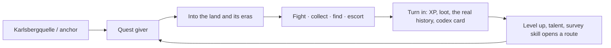
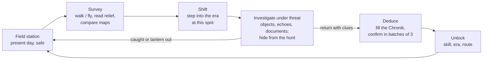
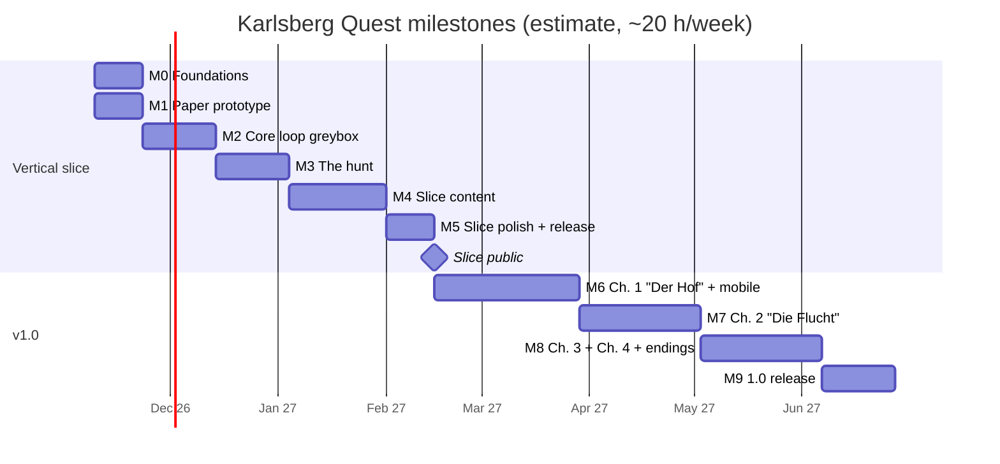

# Karlsberg Quest — PRD / Game Design Document (living)

> Version 0.8.0 · 2026-11-23 · Owner: schloss-karlsberg maintainers · First idea paper (archived): [`archive/IDEA.md`](archive/IDEA.md)
> Status: **in production — action RPG with a guided-tour opening.** The full campaign is playable (D-006) as an
> action RPG with quests and fights (D-008). Since v0.7.0 a new game opens with the **guided tour** of the Karlsberg
> (D-010): the time travel starts at the Karlsbergquelle, and every ending closes with a party. The tour's design and
> the owner's decisions are in [`design/tour/README.md`](design/tour/README.md); the action-RPG spec is
> [`ACTION-RPG.md`](ACTION-RPG.md). Where they and this file disagree, the newer decision wins.
>
> **Concept change (D-010, 2026-11-20).** The game started as "a LiDAR surveyor with a field book, a Feldstation /
> Bauwagen and a lantern". That framing is retired: the player is an ordinary visitor on a guided tour. Passages
> below that still describe the earlier concept are marked as history or as legacy code that TASK-007 removes.

## 0. How this document works

This is the single, living source of truth for the game. It lives in the repo, next to the code.

- **Decisions** go into the [decision log](#12-decision-log) with a date and a reason. History is never rewritten.
- **Open questions** stay in [§11](#11-risks--open-questions) until answered, then move to the decision log.
- **Milestones** ([§10](#10-milestones)) are updated when one exits. Scope cuts are written down, not quietly dropped.
- Facts in the game need a source; fiction is labelled as fiction. The same rule applies to this document.

| Version | Date | Change |
| --- | --- | --- |
| unreleased | 2026-11-24 | **Bussole loading indicator (TASK-011):** the compass appears on first paint and stays in place on the title screen. Its brass ring tracks terrain progress. During play, it appears for longer scenery, era and Röntgenblick waits. Reduced motion keeps the needle still. |
| unreleased | 2026-11-23 | **Docs aligned with the guided-tour concept (D-010):** this file moved from the repo root to `docs/PRD.md`; the pitch, pillars, setting, story premise, characters and §6.3 describe the tour opening, the Karlsbergquelle as home base and the party endings; surveyor / Feldstation passages are marked as history or as legacy code (TASK-007). `IDEA.md` moved to `docs/archive/`. |
| unreleased | 2026-11-21 | **Triangle budget, phase A (performance, no visible change):** on Hoch the planar water reflection is drawn only for a lake on screen within 150 m (fading into the tree-line band from 105 m) and on the frames that re-use the shadow map; grass and flowers are drawn only in the view (everything within 3 m always) with a sparser tuft beyond 12 m; looking steeply down keeps the whole forest ring only from the air; the 1789 chandelier glass no longer uses transmission (which redrew the whole scene) and palace furniture is drawn only within 25 m of its building or inside. Peaks on the real GPU: palace plateau 3.95 → 2.60 M triangles, Weiher 2.26 → 1.59 M, 1789 front 3.74 → 1.46 M (docs/PERFORMANCE.md §3.4). |
| unreleased | 2026-11-21 | **The party after the ending (system, WP-18):** after every ending the credits can play over a party on today's palace plateau at dusk: Gerold, Marlene, the seven doubles, seven tour members and Jost's dogs around a trestle table with cake, a mulled-wine pot, a fire bowl, fairy lights and lanterns; per ending the group leans in round the archive box (museum), stands round the high fire with sparks rising (burn) or the dogs lie at your feet with their eyes catching the light (keep). The credits crawl along the bottom edge while the camera circles the party and lingers on each double, on Mats and last on Gerold; walking or looking about gives you the camera back while the credits run on, Enter or a button skips them, and afterwards the party stays and its people stay talkable. Placeholder props; the story wiring follows (docs/ARCHITECTURE.md party, ACTION-RPG §14) |
| unreleased | 2026-11-21 | **Tour animals (system, C5):** the roe doe and her fawn graze in a clearing and notice a standing or running player, lift their heads for 1.5 s and bound 25 m away, then stop and graze again (no fail state); a crouched, slow approach reaches photo range unnoticed. Jost's dogs Diane and Bijou follow him (or whoever the story names), sniff, sit when he stops, bolt barking along a path and come back, and lie down at the party. Present day only; saved and restored with the game (docs/ARCHITECTURE.md animals, ACTION-RPG §14) |
| unreleased | 2026-11-20 | **In-game cinematics (WP-15, contract C1)**: short skippable camera moves on game time (keys or an orbit, `content/cinematics/`), a production camera takeover (`ctx.cinematic.takeCamera`, the character stays in the picture, a 0.4 s hand-back), skip after 0.5 s, no autosave while one plays, reduced motion = two stills or a skip. No story uses it yet (the deer close-up `reh` is the example). |
| unreleased | 2026-11-20 | **"Unauffällig" in chapter 1 (content):** in summer 1789 the orange vest no longer gets you into the court. At Liese's Bleiche below the spring you take a servant's coat off the line while she looks at the path, or you ask her and chase three Mahnbriefe out of her linen. On the Orangerie lawn the Hofgärtner, who keeps an eye on everyone, gives you paper, and at his table you and Laub write a letter in the name of an invented Hofrat Amsel. At the gitter a Gardist inspects it (new beat „Die Musterung“): coat and letter, stand still, and the gate opens. New people (Liese, the Hofgärtner, two Gardisten with pikes, a Lakai), German lines for the inspection and for being escorted out (eight per zone), codex cx.43–cx.46 (Knigge's travel letters, contested; who was allowed up; the false Prince of Albania; what is invented), cx.07 corrected; 130 XP moved from later chapter-1 quests, the chapter still ends at level 5–6; the epilogue remembers how you got the coat (ACTION-RPG §11.1, bible 02 / 07 / 08) |
| unreleased | 2026-11-20 | **"Unauffällig" (court disguise, system)**: in 1789 the court's watchers (guards and lackeys with visible sight fans on the ground) grow suspicious when a stranger shows a tell — the hi-vis vest, running, the staff, taking something in view. An eye meter shows the highest suspicion, a caption names what gave you away, and at full you are escorted out losing nothing (the first time a card explains why). At the gate a Gardist inspects your letter: no letter, no entry; no coat, out; stand still through the ring and the gate opens. The quests and people that use it follow (docs/IDEAS-ROUND11.md §2, ACTION-RPG §4.6) |
| unreleased | 2026-11-20 | **Tour group walk (system, WP-16):** the guide (placeholder Gerold Imhoff) walks a route stop by stop and the tour group follows him in a loose cluster, gathers in a half circle at a stop, waits when the player falls more than 25 m behind (with a come-along bark), stands while the player talks to him, snaps ahead when the player travels far and jumps to a stop on a story fade; present day only, saved and restored. Figures come from the people API. Not yet used by the story (docs/ARCHITECTURE.md walk, ACTION-RPG §14) |
| unreleased | 2026-11-20 | **The Karlsbergquelle is home** (tour bridge, WP-01 + WP-03): the Feldstation trailer is gone; the hub, the safe place and the wake spot are at the spring (Chronik, Handy, Mauerkante, Mauernische, Karte, Bank: „An der Quelle“); being caught wakes you at the Quelle in every chapter, K2–K4 and the endings start there, and at the trough the spring's „Wasser berühren“ wins over the hub; holding Q in the past brings you home to the spring. The current prologue still starts by the forest road and goes home to the spring at dusk, until the guided tour replaces it (ACTION-RPG §14, bible 01-prolog) |
| unreleased | 2026-11-20 | **Echoes ready for the historical twins**: the Chronik memories ask the twin hook for Mannlich's and the Duke's figure (seated at the Kabinett desk where marked). No visible change yet: until the authored twin models land, every memory keeps its smoke silhouette |
| 0.5.0 | 2026-11-20 | **Prologue pacing (playtest round 10):** the first Nebelinge rise in view (809/−890, F-04); the point-cloud file arrives before Marlene's radio lines (no 840 m marker west, F-25); the Geisterblick is taught after the wall's Nebelling and stays in the p3 objective, Marlene speaks halfway up the Waldweg (F-10, no extra XP); p10 offers the map and counts the journey home (F-30). ACTION-RPG §11.0 and §14, bible 01-prolog |
| 0.5.0 | 2026-11-20 | **Fläschchen** (owner idea, docs/IDEAS-ROUND11.md §4): 24 hidden small bottles at named places in all five eras (the spring holds one in every year), no glow, no map mark, found by a clink, a glint and sometimes a verb (Wuchthieb, lantern on / off); E picks one up: toast „Fläschchen n/24“, a Sammlungen row in the Journal (era counts only), the bottles on the field station's Regal, Marlene at 8, Laub at 16, all 24 the lantern glass „Flaschengrün“ and codex cx.47 „Treibgut“ (FIKTION). No XP per bottle (the prologue band has no room). The bottle shows the real beer label as the owner's swappable placeholder, text only, from one file (`content/collectibles/flaschen.json`), checked by a unit test; every spot checked on the terrain and screenshotted in its era (ACTION-RPG §7, §14) |
| 0.5.0 | 2026-11-20 | **Recorded voices (playback)**: a line with a recording in `voice/manifest.json` plays the clip through its speaker's character (Laub's brass ring, Marlene's radio with crackle, the memories' hall) instead of the murmur, its subtitle typing to the clip's length; stale texts, missing clips and no manifest murmur as before. Clips of a beat are fetched and decoded ahead (never waiting), pause with the game and the hidden-tab audio suspend, stop on skip. No audio is committed yet (`public/voice/` gitignored, licensing pending; docs/ARCHITECTURE.md story) |
| 0.4.8 | 2026-11-20 | **Round 10 look fixes** (docs/PLAYTEST-ROUND10.md): the first Nebelinge no longer read as dark blobs on the forest floor; they have a pale rim and halo in their own colour and a brighter heart in every era and light, and ferns and bushes lie down round creatures so a fight in the undergrowth stays readable. The mossy foundations of the vanished buildings in 2025 now sit in the slope below the Orangerie instead of floating (docs/ART-DIRECTION.md §20, ACTION-RPG §14) |
| 0.4.7 | 2026-11-20 | **Kapitel 1 opens at the Karlsbergquelle** (owner: "start at the Karlsbergquelle, for a nice time-travel transition"): the chapter starts at the spring at dawn; the Bussole's drop dried overnight, so E at the trough takes you into summer 1789; you walk up on foot to the Ehrenhof gate (the lantern waits for the court). Waking on the way puts you at the spring, and Q never lands you inside the court before it has let you in. Old chapter-1 saves resume at the spring. Spec: `docs/ACTION-RPG.md` §11.1, design `docs/IDEAS-ROUND11.md` §1 |
| 0.4.6 | 2026-11-20 | **Open-source / release tooling round:** `scripts/release/publish.sh` publishes local main to the public repo (fresh mirror clone → deterministic history rewrite → checks → fast-forward push, never force); Conventional Commits for commits, PR titles (`pr-lint.yml`) and `--no-ff` merge summaries (CONTRIBUTING); release-please (`release.yml`, first release pinned to 0.5.0 from the first public commit) writes CHANGELOG.md and GitHub Releases, topped with German player notes from `content/release-notes/vX.Y.Z.md`; the title screen shows version + build and „Neuigkeiten“ (badge until read), the site gets `neu.html` generated at build time (docs/RELEASE.md §0a–0c, ACTION-RPG §14) |
| 0.4.5 | 2026-11-20 | **Touch phase 1** (phones and tablets in landscape): a floating move stick, drag to look, touch buttons for Hieb / Wuchthieb, Ausweichen, Bannlicht, Ziel, Balsam, Interagieren / Lauschen, Epochenwechsel (hold to return), Relief, Feldbuch, Karte and Pause. No pointer lock on touch, prompts as touch icons, safe areas and a smaller HUD on phones, the new-game lantern screen fits a phone. Setting "Touch-Steuerung" (Auto / An / Aus). Phones start on Niedrig, big tablets on Mittel (docs/ARCHITECTURE.md "Input", ACTION-RPG §14) |
| 0.4.4 | 2026-11-20 | **Fan round** (owner: loud laptop fans on a 120 Hz MacBook Pro): new setting „Bildrate“ 30 / 60 / unbegrenzt (default 60, steady pacing, the 60 Hz simulation untouched); the title draws ≤ 30 fps, the pause menu, journal and map hold their last frame, dialogues 15 fps, bullet time only on request, a hidden tab nothing and its sound suspended; pixel-ratio caps Hoch 1.25, Mittel 1; the sun shadow map re-used every 2nd frame while exact; „Energiesparen“ (30 fps, pixel ratio 1, no AO, no water reflection) with a one-time battery hint. Real GPU: forest at Hoch 60 renders/s instead of 66 GPU-bound (≈ 69 % load), menus and bullet time 0 instead of 65 (docs/PERFORMANCE.md §5.1, ARCHITECTURE §3, ACTION-RPG §14) |
| 0.4.3 | 2026-11-20 | **The Karlsbergquelle starts the time travel** (owner idea, docs/NEXT-SESSION.md §3.6): the real spring (OSM node 368031320, local 1061 / −834.5) as a set in all five eras (today's log trough, dry wall, pipe and arched spring house; an invented baroque Brunnenstube in 1789; icicles in Feb 1793; plundered in 1796) with living water and a guiding light; prologue beats p3q / p3r and the quest „Wasser, das sich erinnert“: E „Wasser berühren“ stops the moment, the brook runs back, the land shifts to 1789; the Ehrenhof shift becomes the second, self-made one („Der eigene Wechsel“); codex cx.41 (fact) and cx.42 (FIKTION); prologue XP rebalanced so it still ends at level 3. Also since 0.4.2: the bullet-time pilot API, fight metrics and a human-like combat bot, F8 notes, arrow-key turning and the balance round (docs/BALANCE.md; docs/ART-DIRECTION.md §19, ACTION-RPG §14) |
| 0.4.2 | 2026-11-20 | **Real-GPU playtest round 9** (new player, tour): no more stuck Irrlichter fight (hittable-first targeting, wider Bann, burst damage cap, bigger sparks); the prolog bed beat cannot dead-end; quest marks in the doorway and clear of the HUD; no oil burn while talking; a clamped, self-levelling camera pitch, a solid Bauwagen, a higher fight shoulder, an avatar that fades for the lens and the target; new creature bodies (Irrlicht wisp, Rufer, Foliant book golem, Nebelweber, Mahnbrief); softer glare and loot glows; a stone rosette; the palace drawn in culled cells (docs/ART-DIRECTION.md §18, ACTION-RPG §14) |
| 0.4.1 | 2026-11-19 | **Real-GPU playtest round 7** ("stuck at the lake", "looks like 1990"): the Messstab by the wagon door; deep water holds the player at a wading line and keeps every enemy within reach of the shore (the Irrlichter at the Karlsbergweiher); compass marks for every tracked quest; the Relief-Blick switches back after a find; door-first markers for goals in buildings; the spirit view climbs over the canopy; conversations frame the speaker; forgiving opening fights (novice grace, one attacker, stand-off, two starter Balsam, FOV 80); a readable moonlit night, no stars in a day sky, palace shells with interiors behind the windows, a shaded lantern, darker distant trunks, the fire night always burning, a quieter HUD; forest 47 → 60 fps at high (docs/ART-DIRECTION.md §13, ACTION-RPG §14) |
| 0.4.0 | 2026-11-19 | **Art direction foundation** (D-009): owner feedback "looks like a 1990 game"; a stylized modern look (docs/ART-DIRECTION.md: palette per era, light, materials, vegetation, characters, UI, do / don't, CC0 shopping list); render baseline (soft sun / moon shadows on everything lit by the world, SSAO, bloom, ACES, white balance and split toning per era, stylized sky with era IBL); quality tiers with `?q=` and SwiftShader → low; a CC0 asset pipeline (manifest per track, loader with meshopt / Draco / KTX2, `LICENSES.json` shown in „Lizenzen & Quellen“) |
| 0.3.6 | 2026-11-18 | **Playtest fixes, round 5** (fun first): stage directions are shown, not captioned (a validator keeps it so; „…“ pauses instead of „(Pause.)“; the Kommissär's crowbar, the 1840 eyes over bodies in a cold grade, the burn memory's hounds); a quicker start (Marlene first, the Relief key after the walk); fights tuned per content encounter (escorts, waves, ambushes and veils set by the quest; one kind per prologue fight; boss phase kept after a death; armoured hits show „Abgeprallt“); slide-in cards wait out speech, packs and echoes; the K2 sneak with sentry hounds across a shorter way |
| 0.3.5 | 2026-11-17 | **Playtest fixes, round 4** (fun first): route caches only in their own chapter, guards keep clear of survey points and quest fights; the Irrlicht teaches the Bannlicht after three swings through it (and lends a charge); paper and mist re-form once; elites shrug off the opening flare; era-varied escorts (1789 Mahnbriefe, never a robed caster among the hounds); a fight's wake at the nearest surveyed point; era-bound and stale lantern / oil lines and Q objectives dropped on a shift; the pause menu's ending choice resumes; the NPC panel never shows the previous speaker; bosses that read (book, straw, stone, the black horse) with a reveal camera that frames them; K2 par force with a lunging flanker and Atem cost while hunted (down to a floor, never exhausting); the K1 Pikeur rides past close once; the 1840 eyes staged in the echo; Balsam drops shifted to K4 |
| 0.3.3 | 2026-11-16 | **Playtest fixes, round 2** (fun first): the Schuldbuch and the Strohmann fight away from NPC safe zones (validator rule, an engaged fight ignores NPC bubbles); the content warning describes an action RPG; Laub and Marlene drop lines whose moment has passed and cut in for urgent ones; the lantern stands still while a modal is open; the Karlslust Rund with nineteen houses that light up as you count; a fireworks echo that turns your view and reads at 160 m; a calm HUD in fights (cards wait, damage merges, numbers beside the vitals); big bosses keep a readable stand-off and draw their reach, darker Steinbrecher and Gruslinge; credits keep rolling and read cleanly; ending vignettes over the live world; the combat curtain names the family |
| 0.3.2 | 2026-11-16 | **Playtest fixes, round 1** (fun first): fights now take time and cost Lebenskraft (chapter tiers for quest spawns, steeper tier HP, gentler tier damage, cleave hits the nearest fully and the next at half, bosses cannot skip phases, a headless balance test with a non-dodging bot); kill objectives count only at their place; K2 lantern refills per trip and only burns in the past, caught players wake at the anchor; K4 pacing (Steinfresser after the carts echo, the breach opened, Steinfraß explained); one HUD centre card at a time, a subtitle strip in fights; stances as two or three spoken replies; missed side quests explained; German wording (Sie/du, no codes on clue cards, clean credits) |
| 0.3.1 | 2026-11-16 | **Action-RPG rework integrated end to end.** The three system tracks (quests, combat, progression) and both content tracks are merged: the prologue and Kapitel 1–4 run as quest chains (41 quests, 25 main and 16 side, 150 objectives), with one boss per chapter (Schuldbuch, Pikeur struck back but never killed, Strohmann, Steinbrecher), stances instead of readings, and no Chronik confirmation, fill-in or noun gate anywhere on the critical path. Side-quest givers (gardener, servant, villager) got their own ghost figures; clues found before a quest opens now count at once; the quest log follows a new game started from the title (it was lost on the next load); past-era side quests end with their chapter; HUD: the tracker stops above the vitals, level and reward cards clear the tracker, boss bar and chapter card. The campaign e2e (new game → credits, with a reload) checks the quest log, level and XP and passes; the full suite is green |
| 0.3 | 2026-11-15 | **Action-RPG rework** (D-008, supersedes D-003 and the "no XP" rule): quest givers, quests with kill / collect / reach / escort objectives, real-time combat against invented spectral enemies, XP, levels, talents, loot, a journal instead of the Chronik board; history is told at turn-in and lands in the codex. Spec and quest catalogue: `docs/ACTION-RPG.md`. Contracts for the three new systems (quests, combat, progression) are in place |
| 0.2.2 | 2026-11-02 | Polish rounds 3–4: period ghost costumes, procedural forest with LOD rings, a threatening palace fire, hounds readable in fog; scenery (1796 quarry, Hohenburg, dawn, fireworks echo, lit windows, Tempelzimmer passage); story flow (wake places, fair k1 chase, k2 retry, beat-scoped delays, dialogue queue, ending replay); HUD overlap fixes; performance presets, loading, accessibility (reduced flashing reaches ghosts, hounds and fireworks) and settings with key remapping |
| 0.2.1 | 2026-11-02 | The full campaign is built and chained: prologue, chapters 1–4 and three endings, walkable interiors, NPCs, barks, skills and survey tools, hunt extensions, menagerie |
| 0.2 | 2026-11-02 | Build started: self-contained app with a data-prep step (D-005, answers Q-3); full campaign in one compressed pass (D-006); procedural art and audio (D-007) |
| 0.1 | 2026-11-02 | First full draft: vision, research summary, gameplay, story, threats, progression, art, tech, MVP slice, milestones M0–M9, risks and open questions. Research notes in `research/` |

## 1. Vision & pitch

> **On 28 July 1793 the Karlsberg burned. You join a guided tour through the forest that grew over it, and at the Karlsbergquelle the land starts to remember: the court, the fire, and the duke's hounds, which never stopped hunting.**

Karlsberg Quest is a grim first-person **action RPG** for adults, set in the real landscape around Homburg, Kirrberg and the Karlsberg (D-008). You play an ordinary visitor on a guided tour of the Karlsberg one November afternoon. The tour teaches walking, looking, talking, the map, the codex, the smartphone camera and sneaking; at the Karlsbergquelle the group walks on, a talking brass compass lies in the water, and touching the spring starts the time travel. The whole journey happens during that break. The ghosts of the court give you quests: you go into the land and its eras, fight the spectral things that have grown out of debt, greed, fire and stone, collect what was lost, escort and protect — and when you come back, they tell you what really happened. The history is real and sourced and becomes your codex. The ghosts and every enemy are fiction, and the game always says which is which.

### 1.1 Pillars

1. **The land remembers.** The real 1 m LiDAR terrain is the world. Every era is the same place seen again: calm in 1789, burning in 1793, overgrown today.
2. **People ask, you act.** Every task comes from a person with a reason. Objectives are verbs you do — fight, collect, reach, calm, escort, survive. No quizzes, no word games, no blanks to fill (D-008).
3. **Short, readable, juicy fights.** Telegraphed attacks, a dodge roll, the lantern's Bannlicht, hit-stop and knockback against invented spectral enemies that dissolve into mist, ash or grit. The hound pack stays a threat you escape, not a fight (D-008 replaces D-003).
4. **History is the reward.** Turning in a quest earns XP and loot *and* the true story, told by the giver with sources and stored as a codex card. Grim truth, labelled fiction: no gore, no real person is ever an enemy, and the player never commits atrocities.
5. **Dark world, warm home.** Each descent into the past ends back at the Karlsbergquelle in the present, the home base and wake spot, where people react and a dry voice finds the joke in power and vanity. Every ending closes with a party with the guide and the tour group (D-010).

### 1.2 Audience & rating

- **Primary:** adults 16+ who like narrative mystery games and folk horror, history fans, people from the Saarpfalz (D-001).
- **Rating target:** USK 16 / PEGI 16. Content descriptors: dark atmosphere, scary moments, distressing themes, implied violence. Sustained dread is allowed. Gore is not (see Q-2).
- **Session:** 20–40 minutes, built from 5–15 minute beats that alternate tension and calm.
- **Platform:** browser, desktop first; mobile follows in a later milestone (§8.4).

### 1.3 Goals and non-goals

| Goals | Non-goals (v1.0) |
| --- | --- |
| A short, finishable campaign (v1.0 target: 5–7 hours, 4 chapters) | Fights against real (historical) people, animals of the menagerie or victims; gore |
| Every chapter is a chain of main quests plus 2–4 side quests with givers, objectives and rewards (D-008) | Quizzes of any kind: fill-in-the-blank, word or noun selection, multiple choice |
| Combat that feels good (hit-stop, knockback, particles, sound) and honours reduced motion / flashing | Grind: no currency, no shop, no crafting, no respawning farms |
| Players can explain what LiDAR shows and why you look, not dig (kept from IDEA.md) | Multiplayer, accounts, servers |
| Every fact in the game has a source and a confidence label | Real-world location mode (safety; IDEA.md §4 hard rules still apply later) |
| Runs as a static site on GitHub Pages | Digging, metal detecting or "treasure" gameplay |
| | Extremist symbols or real occult symbols; gore |

## 2. Research summary

Three research passes on 2026-11-02 shaped this draft. The full notes, each with the sources that were opened, are in [`research/`](../research/):

- [`research/01-regional-history.md`](../research/01-regional-history.md): dark, sourced history and legends of the region; fact/legend/fiction labels; conflicting sources; 15 story hooks.
- [`research/02-sister-projects.md`](../research/02-sister-projects.md): stack, data and gaps in `saar-lidar-explorer` and `schloss-karlsberg`.
- [`research/03-game-design.md`](../research/03-game-design.md): how dark-but-fun games, deduction games and history games work; rating rules.

### 2.1 What the history gives us

The real story is darker than most invented ones. Duke Karl II. August was described by a contemporary as "finster, wollüstig, zur Härte geneigt". A 1782 satire called his land "ein einziges JagdRevier", and his subjects had to feed his hound packs. He left more than 9 million Gulden of debt. A fireworks explosion at the palace killed several people on 19 December 1785. He fled on the night of 9 February 1793 after a farmer from Rohrbach warned him. On 28 July 1793 French troops plundered the palace and burned it, reportedly with up to 100 wagonloads of straw. The ruin then became a quarry for Homburg's houses, just as the razed Hohenburg had been a quarry for the palace. Sources: [de.wikipedia: Karl II. August](https://de.wikipedia.org/wiki/Karl_II._August), [ADB](https://de.wikisource.org/wiki/ADB:Karl_II._(Herzog_von_Pfalz-Zweibr%C3%BCcken)), [de.wikipedia: Schloss Karlsberg](https://de.wikipedia.org/wiki/Schloss_Karlsberg), [rosalux.de](https://www.rosalux.de/news/id/692/der-karlsberg-von-barocker-pracht-zur-baustoffhandlung).

The region adds the Schlossberghöhlen (sandstone caves used from the fortress era to a 1950s government bunker), the Rabenhorst barrow with 12 Iron Age graves and a broken stele, the Roman town of Schwarzenacker destroyed around 275/276, and the 1939 evacuation of the "Rote Zone".

**Gap:** no sourced ghost or treasure legend exists for Homburg, Karlsberg or Kirrberg themselves. All supernatural content in this game is therefore our own fiction, inspired by real facts (the Saarland Wild Hunt legend, the hound packs) and labelled as such.

### 2.2 What the design research teaches

| # | Lesson | Where it lands |
| --- | --- | --- |
| L1 | Dark world, warm loop: a safe hub where knowledge is sorted | The Karlsbergquelle as home base (§6.3); originally the field station (§3.1) |
| L2 | One original guide voice with gallows humour, aimed at power, never at victims | The compass voice (§5) |
| L3 | Deduction as the core verb, confirmed in batches of three so guessing doesn't pay | The Chronik (§3.3) |
| L4 | Confirm settled facts, keep interpretations open | Facts vs. readings (§3.3) |
| L5 | Knowledge is the only key; no explicit signposts | Skills and routes (§6) |
| L6 | Time travel as the "second visit": same place, different era | Era shift (§3.2) |
| L7 | Folk-horror landscape over monsters | Threats (§5.2) |
| L8 | Respectful darkness through ordinary people and real sources | Tone rules (§4.4) |
| L9 | No streaks or FOMO; offer a gentle mode | §6.4 |
| L10 | Short beats, short campaign; grind and length wear players out | §1.2, §9 |
| L11 | Browser-first: playable in ~10 s, small first download, dread from fog and sound rather than near-black screens | §7, §8.4 |
| L12 | Build one vertical slice first and cut rather than extend; playtest early | §9, §10 |

The research suggested USK 12 for reach. This draft follows the owner's decision for 16+ (D-001), and Q-2 keeps the trade-off visible.

## 3. Core gameplay

> **Superseded in part (D-008, 2026-11-15).** The core loop is now **quest → go → fight / collect → turn
> in → hear the history → level up**; the full design (controls, combat, enemies, progression, loot,
> quests, journal, quest catalogue per chapter) is [`docs/ACTION-RPG.md`](ACTION-RPG.md). §3.1 and
> §3.3 below describe the 0.2 deduction loop and stay for the record; §3.2 verbs and §3.4 threats remain
> valid, extended by the combat verbs (Hieb, Wuchthieb, Ausweichen, Bannlicht, Schnellgegenstand).

The original core verb (0.2) was **deduce**: walk the real land, step into its memory, bring back clues, and prove what happened.

### 3.1 Core loop

Getting caught is cheap. You are thrown back to the field station and lose only the clues from that shift that you had not yet confirmed. Confirmed Chronik entries are never lost. Autosave happens at every shift.

### 3.2 Verbs and controls

> The guided tour teaches only the calm verbs (walk, look, talk, map, codex, smartphone photo mode on N, sneaking);
> it has no combat. The first fight is a short guided training in 1789. The combat keys are in
> [`ACTION-RPG.md`](ACTION-RPG.md) §3. Spirit view, scan, maps and measuring below are survey skills from the
> earlier concept that the code still has; their place in the tour concept is TBD — see TASK-007.

| Verb | What it does | Desktop control |
| --- | --- | --- |
| Walk / sneak / lie flat | Move on the real terrain; lying flat hides you from the hunt | WASD (or ↑ / ↓ forward / back), Shift, C / X |
| Look | Turn and tilt the view (over the shoulder or first person) | Mouse; without a mouse ← / → turn (120°/s), Bild↑ / Bild↓ tilt |
| Spirit view | Short free flight for overview (present day only) | F |
| Scan | Switch relief modes (hillshade → local relief → VAT) to see features under the forest | 1–3 |
| Compare | Overlay the 1840 or 1935 map on the land | M |
| Measure | Height profile and distance, from the explorer's tools | R |
| Listen | Hear echoes: voices and sounds that happened here | Hold E |
| Examine | Pick up and turn over an object; it becomes a clue | Click |
| Shift | Use the compass to step into the era bound to this spot | Q |
| Lantern | Light helps you read clues but draws the hunt; oil is the soft timer of a shift | L |

**F8** writes a note to the developers (with a picture of the view, the place and the last 30 s of events), kept in the browser's IndexedDB; the pause menu exports all notes and the local play telemetry as one JSON. Nothing is ever sent over the network.

Touch controls follow in the mobile milestone (§10).

### 3.3 The Chronik (deduction)

The Chronik is the lost chronicle of the palace's last years, rebuilt page by page. Each **case** is a page with 6–10 **entries**. An entry is a sentence with blanks: _who_ did _what_, _where_ and _when_, and _what became of them_ or _of the object_. The player fills the blanks from nouns they have discovered: names, places, objects, causes.

- **Facts** (dates, places, LiDAR features, sourced events) are **confirmed in batches of three**: only when three entries are correct does the game confirm them, so guessing doesn't pay. A confirmed fact unlocks its codex card with the source and confidence (D documented / I inferred / N period norm / U unknown, the palace catalogue's labels).
- **Readings** (motives, guilt, what a legend means) are never confirmed. The player commits to an interpretation, and the epilogue shows its consequences. There is no official culprit.
- **Hints:** the compass voice gives graded nudges after a set time, never solutions. A gentle mode shows which entries are already correct.
- **Tooling:** a clue-structure checker (in development) proves that every case can be solved from the clues placed in the world, before any content ships.

### 3.4 Tension beyond combat (threats you escape, not fight)

| Pressure | Feeling | Counterplay |
| --- | --- | --- |
| **The hunt** (spectral hound pack, night eras) | Being stalked | Lie flat, stay in hollow ways and sandstone cover, douse the lantern, cross water, read the horn signals |
| **The fire** (28 July 1793 only) | Racing a collapse | Learn the palace's real room layout; choose what to save and what to leave |
| **Oblivion** (the "stone eating") | Time running out | The longer you stay, the more stones the past loses, as they did to the quarry. The lantern oil shows how long you have left |
| **Aufmerksamkeit** (the court, 1789) | Being a stranger in plain sight | Dress the part, walk calmly, keep the staff away, stay out of the watchers' fans; caught means escorted out, never hurt |

Each pressure has a clear telegraph (a horn, a smell of smoke, stones fading) and a caption for players who can't rely on sound.

## 4. World, setting & story

### 4.1 Setting

The MVP plays in the real `karlsberg` area (3 × 3 km). v1.0 extends to the `overall` area (6 × 8 km) with Homburg and Kirrberg. Each era is a layer over the same terrain:

| Era | Places | Dark theme (fact) | In |
| --- | --- | --- | --- |
| Today (2025) | Forest over the ruin; the tour route (Wanderparkplatz → Felsenpfad → Karlsbergweiher → Karlsbergquelle) and the palace plateau (the party) | What the forest hides; looking, not digging | MVP |
| 1785–1789 | Palace and court, Karlslust menagerie, building site | Debt, unpaid wages, the 1785 fireworks deaths, a land that is "one single hunting ground" | v1.0 Ch. 1 |
| 9 Feb 1793 | Roads from Rohrbach to the palace, winter forest | The duke's flight by night | v1.0 Ch. 2 |
| 28 Jul 1793 | The burning palace | Plunder and fire; villagers join the looting | **MVP** + Ch. 3 |
| 1796–1840 | The ruin as a quarry; the 1840 Bavarian survey | Stones carted off to Homburg | v1.0 Ch. 4 |
| Later eras | Schlossberghöhlen, Rabenhorst barrow, Schwarzenacker, 1939 empty villages | See §4.3 | Expansions |

### 4.2 Story (fiction)

_Everything in this section is fiction unless it cites a fact from §2.1._

**Premise (D-010, the guided tour).** The player (player-named, any gender) is an ordinary visitor on a guided tour of the Karlsberg on a mid-November afternoon. The guide (placeholder name **Gerold Imhoff**, modelled on a real guide whose consent is pending) leads a group of 15 from the Wanderparkplatz at the forest edge along the Felsenpfad and the Karlsbergweiher to the Karlsbergquelle. The group includes modern doubles of the historical cast; modern Jost has two dogs. On the way the wind picks up and the dogs run barking into the forest (a foreshadowing of the Meute), a roe doe and her fawn are the first wow moment and the sneak tutorial, and Marlene, a forester, offers optional side quests. Full beats: [`design/tour/bible/01-prolog.md`](design/tour/bible/01-prolog.md).

**The first shift.** The first time travel is not a keybind. At the **Karlsbergquelle**, a real spring in the ravine below the Orangerie where the Karlsbergbach begins (fact, codex cx.41), the player takes a break while the group walks on. A brass surveyor's compass from the 1840 Bavarian survey lies in the water, and it talks (Laub). Touching the water stops the moment, the brook runs backwards, and the land shifts to 1789, where an invented baroque Brunnenstube stands (fiction, cx.42). A short guided training follows (the first fight). A drop of that water now sits in the Bussole, which is why Q works later at places that remember. The whole time journey happens during that break; the Quelle is the home base and wake spot.

> **History:** in the earlier concept (0.1–0.6) the player was a surveyor hired by the forest office, the compass lay in the drawer of a Feldstation (Bauwagen), and the prologue "Vermessung" taught reading the relief. That prologue is still bundled as `legacy` (dev switch `?classic`) so old saves resume; TASK-007 decides its removal.

**The central mystery: what did the fire not eat?** In 1793 the court painter and building director Mannlich rescued the collections. A legend tells of a hidden trapdoor in the picture gallery (source: [`research/02-sister-projects.md`](../research/02-sister-projects.md), schloss-karlsberg.de). Our fiction: a chronicle of the palace's last years was hidden there, and its pages were scattered when the palace burned and its stones were carted away. Whoever carries its memory is hunted by the duke's hounds, which the fiction says were left behind when he fled and still hunt for a master who never returned.

**Ending.** The player decides what to do with the completed chronicle: **give it to the museum** (truth, with sources), **let it burn** (rest for the hounds), or **keep it** (the land keeps remembering, a hook for expansions). No ending is "correct". After each ending comes a credits party on today's palace plateau at dusk with the guide and the tour group (the historical characters as their modern doubles): museum → the guide shows the chronicle, burn → a fire bowl, keep → two dogs at your feet ([`design/tour/bible/06-enden.md`](design/tour/bible/06-enden.md)).

**Chapter structure (v1.0):**

1. **Prologue "Die Führung"** (today, one November afternoon): the guided tour as tutorial, no combat; the first time travel at the Karlsbergquelle and a short guided training in 1789. (The earlier prologue "Vermessung" is legacy.)
2. **Ch. 1 "Der Hof"** (1789): the court at its height; the unpaid builders, the menagerie, a quiet memorial to the 1785 fireworks victims.
3. **Ch. 2 "Die Flucht"** (9 Feb 1793): the night race of the warner from Rohrbach, with the hunt at your heels. Warn the duke, or let the French come?
4. **Ch. 3 "Die Nacht"** (28 Jul 1793): the fire. Save one object and find it again in a museum "today". _The MVP slice is a cut of this chapter._
5. **Ch. 4 "Der Steinbruch"** (1796 → today): follow the wandering stones into Homburg and back to the Hohenburg; the ending.

### 4.3 Expansion hooks

All fiction, each grown from a sourced fact in [`research/01-regional-history.md`](../research/01-regional-history.md) §10:

- **"Verliese des Elends"**: the Schlossberghöhlen, each level sealed by a later era (1708 spoiled stores → 1872 backfill → 1945 shelter → 1950s bunker → 2003 collapse).
- **"Die Stele vom Rabenhorst"**: why grave 6 has no grave goods and lies under the broken stele. The answer stays open.
- **"Der letzte Tag des Vicus"**: Schwarzenacker, AD 275/276, and the twelve-sided bronze object nobody can explain.
- **"Die leeren Dörfer"**: 1939, an evacuated village, a child's suitcase. Quiet, no threat, no extremist symbols.
- **"Die Menagerie bricht aus"**: the escaped jaguar, dromedaries and cassowary after the fire (the comic-dark side quest line, possibly already in Ch. 3/4).

### 4.4 Tone rules

1. **Real victims are never monsters, jump scares or puzzles to win:** the 1785 fireworks dead, the unpaid workers, the 1945 raid victims, the evacuees.
2. **Historical people say and do only what sources support.** Their echoes are labelled fiction. Contested facts appear as contested (for example, the flight date: 9 Feb or 3 Feb 1793; the place of death: Mannheim or Rohrbach).
3. **Gallows humour targets power, vanity and bureaucracy:** the duke's decrees, the clerk who counts debts forever, the cassowary. Never the victims.
4. **Death is implied, heard or found afterwards.** No gore.
5. **The supernatural uses invented symbols.** No real occult or extremist symbols.
6. **"Schauen, nicht graben"** (look, don't dig). No digging or detector gameplay. Unexploded ordnance (UXO) appears only as a warning: don't touch, report it.

## 5. Characters & threats

### 5.1 Characters

| Character | Real or fiction | Era | Role |
| --- | --- | --- | --- |
| The player | Fiction | Today | An ordinary visitor on the guided tour, player-named (the earlier concept made them a surveyor) |
| Gerold Imhoff (placeholder name), the guide | Modelled on a real living guide (consent pending; no real name or personal details) | Today | Leads the guided tour and hosts the party after each ending |
| **Geometer Quirin Laub**, the compass voice | Fiction | 1840 → today | The guide (L2): a dry Bavarian survey official bound into his compass. Gallows humour, footnotes, contempt for dukes who don't pay their surveyors |
| Marlene, district forester | Fiction | Today | A forester (Forstamt) along the tour route; gives optional side quests during the tour and later in the present, sends messages to the phone; warmth, and the present day's practical questions |
| Johann Christian von Mannlich | **Historical** (court painter, building director) | 1789–1793 | Echo guide in the palace; his words come from his memoirs only |
| Karl II. August | **Historical** | 1789–1793 | Never seen directly. Present through decrees, portraits, the hunting horn. Sourced quotes only |
| Nikel Pfeiffer | **Historical** (farmer from Rohrbach who warned the duke) | 9 Feb 1793 | Playable in the Ch. 2 flashback |
| Hanne | Fiction | 1789 | A stonemason's widow waiting for her husband's wages; heart of Ch. 1 |
| The kennel boy | Fiction | 1789–1793 | Knows the hounds' habits and teaches the player how to hide from them |
| The ledger clerk | Fiction | 1793 → today | A ghost who counts the duke's debts forever; comic relief |

### 5.2 Threats

| Threat | Fiction inspired by | Behaviour | Set piece |
| --- | --- | --- | --- |
| **Die Meute** (the pack) | The duke's "regiments of hunting dogs"; the Saarland Wild Hunt legend | Patrols along the OSM path graph in night eras; sight cone + hearing (running, lantern, splashing); the horn signals what it is doing | "Die Parforcejagd" (the hunt to hounds), finale of Ch. 2 |
| **Der Pikeur** (the huntsman) | The ducal par-force hunt | Leads the pack, searches where it lost you, can't cross running water | Ch. 2 and Ch. 4 |
| **Das Feuer** (the fire) | 28 July 1793 | Spreads through the real room graph of the palace catalogue; rooms collapse on a schedule | "Der brennende Festsaal" (the burning ballroom), MVP and Ch. 3 |
| **Steinfraß** (stone eating) | The ruin used as a quarry | The past loses stones while you stay; paths close and the map dissolves | Ch. 4 "Der Steinbruch" |
| **Escaped animals** | The real Karlslust menagerie | A jaguar stalks, a cassowary charges, dromedaries block a bridge. Dangerous but funny | Side quest line |

## 6. Progression, meta & replayability

> **Superseded (D-008):** there are now XP, 12 levels, three short talent branches, a weapon upgraded by
> quests, charms and consumable loot — but still no currency, shop or grind. Survey skills are quest
> rewards. See `docs/ACTION-RPG.md` §6–7.

### 6.1 No XP: knowledge unlocks (0.2, superseded)

Progress comes only from confirmed Chronik entries. They unlock skills, eras and routes. There are no levels, no stats and no loot grind.

| Skill (from IDEA.md) | Tiers | Opens |
| --- | --- | --- |
| Relief-Blick (relief sight) | Hillshade → local relief → VAT | Hidden paths, cellar entrances, the menagerie ring |
| Kartograf (cartographer) | 1840 map → 1935 map → measuring | Where buildings and roads stood; the wandering stones |
| Baumeister (master builder) | Palace plans → confidence view → room layout | Routes through the burning palace |
| Röntgenblick (x-ray sight) | Point cloud under the canopy | Ground features hidden by trees; hound tracks |
| Spurenleser (tracker) | Horn signals → pack routes | Predicting the hunt |

### 6.2 Collections

- **Codex cards:** one per confirmed fact, with source, confidence label and licence.
- **Relief patterns:** what a mound, pit, ditch, charcoal-kiln platform or cellar looks like in LiDAR.
- **Plan sheets:** the palace's 30 plan sheets, collected as found.
- **The wandering stones:** marked blocks traced across eras.
- **Menagerie animals:** found, not captured.

### 6.3 Home base: the Karlsbergquelle

The Karlsbergquelle is the home base in every chapter (tour decision 11): the wake spot after being caught, the place a held Q returns you to, and where you heal. The smartphone album (good photos from the present unlock codex cards) is a collection of its own. There is no currency.

> **Legacy (to be removed, TASK-007):** the code still opens a hub overlay at the spring (Chronik, phone, shelf, drawer, map, bench). Where its functions go is undecided — TBD, see TASK-007. The original plan here was a field station (Bauwagen) with a pin board, darkroom, radio and shelves; the Bauwagen was removed from the world in the tour redesign.

### 6.4 Replayability and fairness

- Three endings, plus readings that change the epilogue.
- Hidden echoes and a "Chronik complete" percentage.
- **Gentle mode:** slower hunt, no loss of clues, correct entries shown. **Rauhnacht mode** (Twelve Nights, a hard mode): faster hunt, less lantern oil.
- No streaks, daily rewards or FOMO mechanics (L9).

## 7. Art & audio direction

**The real terrain is the star.** Art stylises on top of it and stays readable. Dread comes from fog, light and sound, never from near-black screens (L11).

| Era | Look | Sound |
| --- | --- | --- |
| Today | Mid-November afternoon: golden leaves, slightly dusky light; relief shading and UI overlays as tools | Wind, birds, distant traffic, the tour group's voices |
| 1789 | Warm candlelight and painted skies; copperplate-like textures | Court music, building-site noise, the menagerie |
| 28 Jul 1793 | Desaturated blue night cut by fire orange; smoke | Crackle, collapse, distant shouting; the horn under it all |
| 1796 onward | Grey ash, moss taking over | Picks and carts; then silence |

- **Characters:** 2D portrait cards in an etching style. Ghosts are silhouettes and particles. The hounds are smoke and eyes. No full humanoid models in the MVP.
- **UI:** a field-book look: ruled paper, plan sheets, handwritten annotations. (The journal is still called „Feldbuch“ in the game; whether the term stays is TBD — see TASK-007.)
- **Audio:** browsers need a click before audio can play. The code still makes that click "light the lantern" on a screen from the earlier concept (legacy, to be replaced by a tour intro, TASK-007). The hunting horn is the main threat telegraph, and the hounds are placed in 3D space.
- **Accessibility:** subtitles; visual indicators for threat sounds; colour-blind-safe era palettes; reduced motion; remappable keys; gentle mode.
- **Asset sourcing:** CC0 assets from the listed sites (D-009, docs/ART-DIRECTION.md §8).

## 8. Technical approach

**Decided (D-005):** a separate, self-contained static web app on the same stack as the sister projects. A data-prep script reads their data read-only and writes compact game assets; no sister source code is imported. §8.2 lists what we derive from them.

### 8.1 Stack (matches the sister projects)

| Part | Choice | Note |
| --- | --- | --- |
| Language / build | TypeScript 7.0.2, Vite 8.3.5, pnpm | Same as explorer and castle viewer |
| 3D | three.js 0.187.0 (r187), three-mesh-bvh 0.9.16 | BVH already used for walk collisions in the castle viewer |
| Tests | vitest 5.0.5 | Quest/clue logic is pure TS and unit-tested |
| UI | No framework; plain TS + DOM overlay | Same as explorer; add an i18n layer from day one (DE first, EN later) |
| Hosting | GitHub Pages under Open-Kirrberg | Data from `saar-lidar-data` / `saar-lidar-data-2` (Pages 1 GB cap per repo) via `VITE_DATA_URL` |
| Save | `localStorage` with prefix `kq.*` | Shares the `open-kirrberg.github.io` origin with the explorer, so the prefix is required |

### 8.2 What we reuse

| Module (source project) | Use in the game | Coupling |
| --- | --- | --- |
| `Terrain.ts` quadtree streaming 1–16 m, GPU budget (explorer) | The outdoor world | Constructor `(manifest, baseUrl, DecodePool)`, depends only on `src/data/`, so it is the best extraction candidate |
| `HeightQuery` (explorer) | Ground height, raycasts for clue pickup and player placement | Small, pure |
| `DroneController` + touch controllers (explorer) | "Spirit view" free-flight / overview mode | Map-style gestures + long press |
| `controls.ts` walk mode, eye 1.65 m, step 0.35 m, BVH (castle viewer) | On-foot exploration, palace interiors | Keyboard + mouse only, **no touch walking yet** |
| Palace catalogue: 101 buildings, 114 named rooms in 7 interiors, evidence tags D/I/N/U/HMS | Palace levels, room-based clues, codex confidence labels | Pin to one catalogue version; IDs can change between versions |
| Layers: relief views, `hist_1840`, `hist_1935`, ortho, canopy | Era switching and the "seeing" skills | Read via data contract |
| 44 POIs with source URLs | Clue anchors and codex sources | — |
| 3 point clouds (~4 M points each) | "Bone sight" skill (see ground under the canopy) | Heavy; desktop first |

Integration path the sister projects recommend: **the data contract (`docs/data-contract.md`, additive changes only) and URL handover** (`?src=…&E&N&h&heading&pitch&mode=fliegen|gehen&back=`), not shared code. The game cannot rely on URL handover for gameplay, because a handover loses game state. So the game loads the palace assets itself.

### 8.3 What the game must build (gaps)

- Game state and event bus: quest/clue triggers ("entered room X", "within 30 m of E/N", "layer Y active", "era Z"), inventory, codex, save.
- Outdoor walking: no navmesh exists. Use terrain height + OSM ways (4,803) as a path graph for the threat AI.
- Touch walking: new, needed for mobile.
- **Burned/ruined palace variant** (1793 night and after): does not exist. Built procedurally from the light model (91 buildings, per-vertex confidence) using charring, collapse and fire shaders.
- NPCs, dialogue, audio engine, threat AI, era post-processing.
- 1789 terrain covers only 2.15 × 2.65 km around the palace; other eras use the 2025 terrain + historic map layers.

### 8.4 Performance budget

The castle viewer runs at 4.36 M triangles and a 445 MB JS heap, and neither app has been tested on a real phone. The game therefore targets **desktop first** (M0–M3). Mobile gets its own milestone with an LOD/streaming pass (see §10). Starting data area: the `karlsberg` 3 × 3 km area (305 MB), not the full `overall` 6 × 8 km (1.4 GB).

### 8.5 Requests to sister projects (do not edit them from here)

| # | Request | To |
| --- | --- | --- |
| R-1 | Extract `Terrain`, `HeightQuery`, `DecodePool` into an importable package (or confirm a stable import path) | saar-lidar-explorer |
| R-2 | Emit room enter/leave events, or publish room volumes in the catalogue | schloss-karlsberg |
| R-3 | Touch walk controls (shared need) | schloss-karlsberg |
| R-4 | Fix the data-contract note that says the palace dataset is local-only (RELEASING.md publishes it) | saar-lidar-explorer |

## 9. Scope: MVP / vertical slice

> **History (0.1 plan).** D-006 replaced the slice-first plan with a full campaign; this section and §10 describe the original surveyor-era plan and stay for the record.

**"Die Nacht vom Karlsberg":** one case, two eras (today and 28 July 1793), in the 3 × 3 km `karlsberg` area. Target play time: 30–45 minutes.

| In | Out (later or never) |
| --- | --- |
| Prologue: relief tutorial, find the palace footprint, first shift | Chapters 1, 2 and 4 |
| One Chronik case with 8 entries (6 facts, 2 readings) | Other eras and expansion areas |
| The hunt in one night echo of the forest; hide, lie flat, lantern | Mobile and touch controls |
| Fire set piece in 3–4 real rooms (Festsaal, gallery, one wing) | Voice acting (text only; Q-6) |
| Skills: Relief-Blick (3 tiers), Kartograf (1840 map) | English UI (i18n ready, German only) |
| 15 codex cards with sources, 5 relief-pattern cards | Full ruined-palace variant (only the slice area) |
| Compass voice (text), Marlene (text) | Endings 2 and 3 (the slice ends on a cliffhanger) |
| Field station hub, autosave, gentle mode | Multiplayer, accounts, real-world mode (non-goals) |
| Desktop Chrome, Firefox, Safari; German UI; licence and attribution screen | |

**Exit criteria for the slice:**

- [ ] 5 external playtesters aged 16+ finish in 30–45 minutes; at least 4 of 5 want to play the next chapter.
- [ ] No tester is stuck for more than 5 minutes without a hint.
- [ ] The content validator passes: every fact has a source and a confidence label.
- [ ] First input possible within 10 s; at most about 20 MB before the first input; at least 45 fps on a 2020 laptop with integrated graphics.
- [ ] A historian has reviewed the slice's scripts (Q-8).

## 10. Milestones

Estimate for one developer with AI help at **about 20 hours a week (assumption, Q-4)**, starting 2026-11-09. The dates move when Q-4 is answered; the order and the exit criteria don't.

| M | Name | Content | Done when |
| --- | --- | --- | --- |
| M0 | Foundations | Repo, Vite + TS + three r187; terrain import spike (R-1); walk on the `karlsberg` terrain; save (`kq.*`); i18n skeleton; content schema (YAML) with a validator that requires sources; clue-structure checker stub | You can walk the real Karlsberg in the browser, and the validator fails on a fact without a source |
| M1 | Paper prototype | The slice case as cards and a printed relief map; deduction rules; hint ladder | 3 testers solve the case on paper; confusing entries are rewritten |
| M2 | Core loop greybox | Field station, Relief-Blick, era shift (post-processing + palace light model), clue pickup, Chronik board with batch-of-3 confirmation | The full loop runs in greybox: start → shift → clue → one confirmed batch |
| M3 | The hunt | Pack AI on the OSM path graph, sight and hearing, hide / lie flat / lantern, caught → return, gentle mode, horn telegraph and captions | 5 testers rate the hunt as tense, not unfair; no one is stuck for more than 5 minutes |
| M4 | Slice content | The full 8-entry case; fire set piece in 3–4 rooms; burned variant of the slice area; 15 codex cards; compass and Marlene texts; art and audio pass | All slice content is in; the clue checker proves the case solvable |
| M5 | Slice polish and release | Performance budget, accessibility pass, historian review, licence and attribution screen, GitHub Pages deployment | The §9 exit criteria are met and the public URL works |
| M6 | Chapter 1 "Der Hof" + mobile | The 1789 court, Hanne's wages, the menagerie; touch walking (R-3); mobile LOD pass | Ch. 1 is playable on desktop and on one mid-range phone |
| M7 | Chapter 2 "Die Flucht" | The winter night race, Nikel Pfeiffer, the Parforcejagd set piece | Ch. 2 is playable; the hunt is tuned for a long chase |
| M8 | Chapter 3 + Chapter 4 + endings | The slice grown into Ch. 3; wandering stones, Steinfraß, three endings | Full campaign of 5–7 hours playable end to end |
| M9 | 1.0 release | English localisation, rating self-check (IARC / USK), full playtest, press kit | 1.0 is public; no open blocker bugs |
| M-RPG | Action-RPG rework (D-008) | Quest givers and quest chains for all chapters, real-time combat against spectral enemies, XP / levels / talents / loot, the Journal replacing the Chronik board | **Done 2026-11-16 (v0.3.1):** all chapters play as quest chains from new game to credits in the campaign e2e; no quiz remains. Open: §14 of `docs/ACTION-RPG.md` |

**Cut order if time runs short** (cut first at the top): voice acting → English localisation → Röntgenblick skill → menagerie side quests → Ch. 4 shrinks to the epilogue → mobile moves after 1.0.

## 11. Risks & open questions

### 11.1 Risks

| Risk | Likelihood | Impact | Mitigation |
| --- | --- | --- | --- |
| Scope creep (four chapters, many eras, a real 3D world) | High | High | Slice first (§9); cut order (§10); expansions stay out of v1.0 |
| Deduction too hard or too guessable | Medium | High | Paper prototype (M1); batch-of-3; clue-structure checker; hint ladder; gentle mode |
| Sister engines can't be imported cleanly | Medium | Medium | M0 spike; request R-1; fallback: pin a git submodule at a tagged commit and import from it read-only |
| Browser performance (the palace interiors alone are 4.36 M triangles) | High | Medium | Light model + slice area only; budget in M5; mobile later |
| Dark tone becomes tiring or tasteless | Medium | High | Tone rules (§4.4), warm hub, humour aimed at power, historian review, playtests with 16+ |
| Fact errors or contested facts presented as certain | Medium | Medium | Validator with mandatory sources; contested facts labelled; fact-check list in `research/01-regional-history.md` §8 |
| Image and plan-scan licences | Medium | Medium | Licence field in the content schema; attribution screen; the castle project already flags local-only material |
| German youth-protection rules for an online 16+ game | Low | Medium | Check JMStV duties for a free browser game before M5 (Q-2) |
| Hosting size (Pages 1 GB per repo) | Low | Medium | Reuse the existing data repos; the game ships only its own small assets |

### 11.2 Open questions

- **Q-1 Name:** "Karlsberg Quest", "Die Asche vom Karlsberg", "Hundskarl", or "Saarpfalz-Chroniken"? **Lean:** keep "Karlsberg Quest" as the working title and decide at M4.
- **Q-2 Rating:** 16+ (D-001) gives room for real dread but loses schools and families, which IDEA.md wanted. A 12+ version would reach them. **Lean:** design for 16+, keep gentle mode, and recheck before M5 what a free browser game needs under German youth-protection law.
- ~~**Q-3 Engine path**~~ → answered by D-005.
- **Q-4 Capacity:** how many hours a week go into this? The milestone dates assume about 20.
- **Q-5 Art:** own work, open-licence assets, or AI-generated with a licence check? **Lean:** AI-assisted concepts, final portraits by hand or with a clear licence trail.
- **Q-6 Voice:** text only, or voice for the compass? **Lean:** text until 1.0.
- **Q-7 Languages:** German first; English at 1.0? **Lean:** yes.
- **Q-8 Review partner:** who checks history before release: the Historisches Museum, the city of Homburg, or the Landesdenkmalamt? **Lean:** ask at M4.
- **Q-9 Learning goals:** keep IDEA.md's goals (explain LiDAR, "look, don't dig") as secondary goals? **Lean:** yes (written for the earlier surveyor concept; recheck for the tour).
- **Q-10 Mannlich quotes:** most echo quotes come from the 1910 German edition of Mannlich's memoirs, translated by Eugen Stollreither (d. 31 Mar 1956, [Deutsche Biographie](https://www.deutsche-biographie.de/sfz127799.html)). The translation is protected until 31 Dec 2026 and public domain from 1 Jan 2027. **Lean:** keep the quotes short (quotation right) and publish after 1 Jan 2027, or shorten `echo.k2.warnung`, `echo.k3.koenig` and `echo.k3.galerie` before any earlier release.

## 12. Decision log

| # | Date | Decision | Why | Replaces |
| --- | --- | --- | --- | --- |
| D-010 | 2026-11-20 | **Guided-tour opening and party endings.** The prologue is a guided tour of the Karlsberg (a tutorial, no combat) with a real-person guide (placeholder name in the repo); the player is an ordinary visitor; the first time travel happens at the Karlsbergquelle during a break, which becomes the home base; the three endings stay and each closes with a party on today's palace plateau. No surveyor, Feldstation or Bauwagen. The tour is the default start since v0.7.0. Decisions: [`design/tour/README.md`](design/tour/README.md) | Owner redesign of the opening | The surveyor prologue "Vermessung", the field station hub (§6.3) |
| D-009 | 2026-11-19 | **Stylized modern game look with free CC0 assets.** Rich colour, soft warm light, bloom, painterly textures, lush vegetation (not photoreal); CC0 1.0 assets from Poly Haven, ambientCG, Kenney, Quaternius and Poly Pizza (CC0 filter) are allowed, each recorded in `public/assets/LICENSES.json` and shown in-game; never assets from or imitating commercial games. Spec: `docs/ART-DIRECTION.md` | Owner, after playing on a real GPU (2026-11-19): "the whole game looks like a 1990 game … objects, world, everything looks ugly and buggy"; chose the stylized look and allowed free CC0 assets | D-007 (procedural only) for art; audio stays procedural |
| D-008 | 2026-11-15 | **Action RPG.** Quests from givers (kill / collect / reach / talk / calm / escort / survive objectives), real-time first-person combat against invented spectral enemies with one boss per chapter, XP, levels 1–12, talents, a quest-upgraded weapon, charms and consumable loot; the Chronik board (blanks, nouns, batches of three) leaves the critical path for a journal; history is taught by the giver at turn-in, codex cards, echoes and collectibles; the old readings become stances asked at turn-in. Never: real people, menagerie animals or victims as enemies, gore, quizzes. The hunt, the fire, memorials and the finale stay non-combat. Spec: `docs/ACTION-RPG.md` | Owner request (2026-11-15): "not that much quiz … more like people give you a quest and you need to go and collect some things or kill some things — like in WoW or Witcher … a fun, action learn role play game" | D-003, §6.1 "no XP", §3.3 as the core loop |
| D-007 | 2026-11-02 | **(Art part superseded by D-009, 2026-11-19)** Art and audio are procedural in v1.0: real terrain, shaders, particles, Web Audio synthesis; no third-party art packs | No licence risk, small payload, no asset pipeline needed; partly answers Q-5 | — |
| D-006 | 2026-11-02 | Build the complete campaign (prologue, Ch. 1–4, three endings) in one compressed production pass, about 2–3 h of play, instead of slice-first over M0–M9 | Owner request: "build the complete game … loop until it's finished and playable" | §10 schedule (order kept, dates dropped) |
| D-005 | 2026-11-02 | The game is a self-contained static Vite app. `scripts/prepare-data` reads sister data **read-only** and writes compact assets into `public/data/`; no sister source code is imported | Sister projects are under active development by other agents; importing their modules would couple us to moving code. R-1 becomes optional | Q-3, §8.2 "reuse by import" |
| D-004 | 2026-11-02 | The living document is `PRD.md` in this repo (since 2026-11-23 at `docs/PRD.md`); no external doc | Agents and humans work from the same file, versioned with the code | — |
| D-003 | 2026-11-02 | **(Superseded by D-008, 2026-11-15)** No combat; tension comes from stealth, chases, time pressure and a corrupting threat | Keeps focus on exploration and deduction; no fights against historical people | IDEA.md (no rule) |
| D-002 | 2026-11-02 | Core genre: mystery-exploration RPG (clues, deduction, eras), keeping quests, skills and codex | Deduction makes learning real facts feel like play | IDEA.md §4 (MMORPG-style quest focus) |
| D-001 | 2026-11-02 | Audience: adults 16+, grim tone | Owner wants a darker game; drops the school/family audience as primary target | IDEA.md §9 Q1 (families, schools) |
